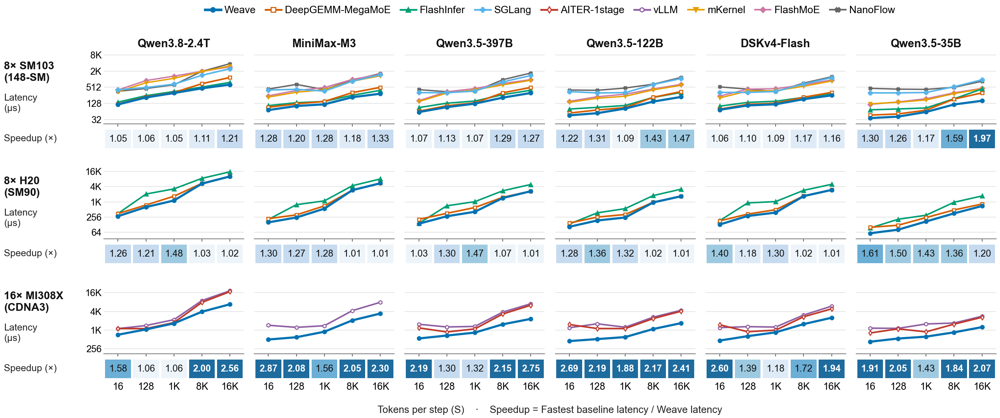
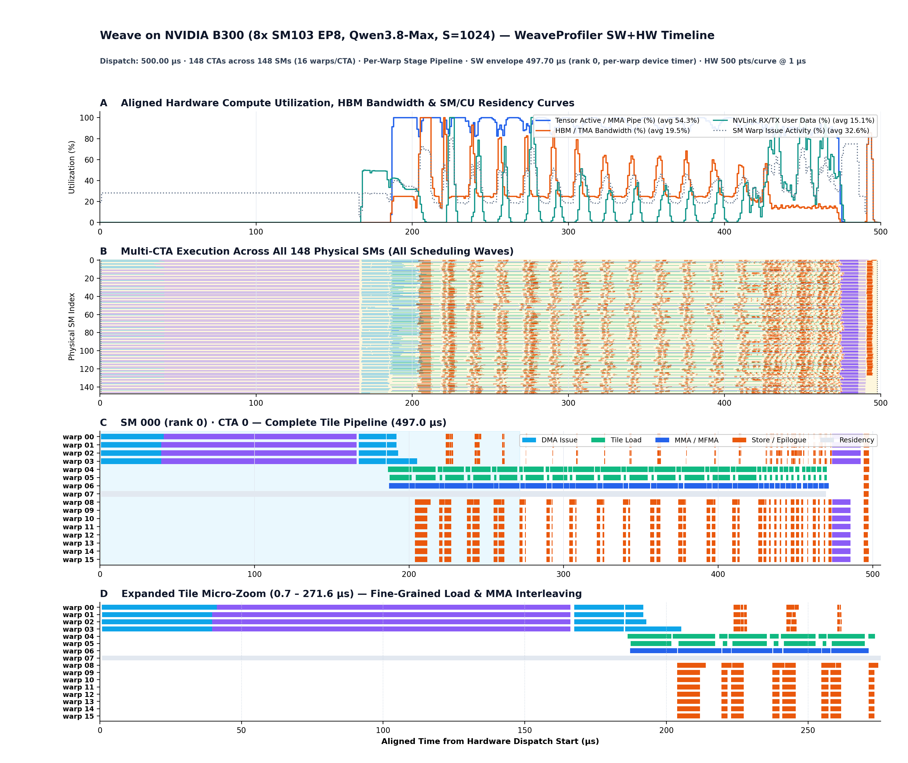
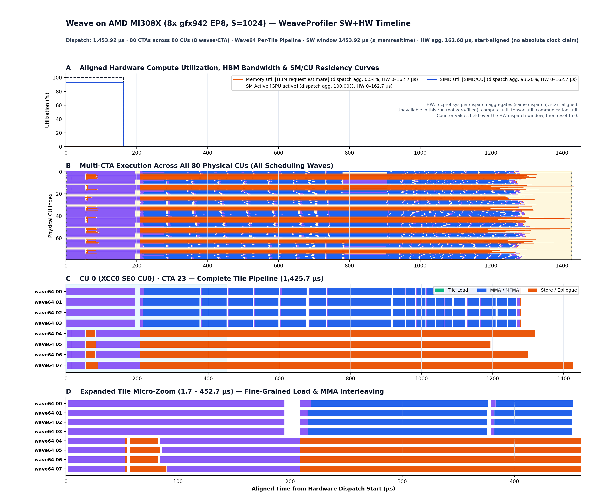

[English](README.md) | [简体中文](README_zh.md)

# Weave: Unified C++ MegaMoE for B300, H20, and MI308X

Weave is the unified C++/CUDA/HIP implementation of the MoE megakernel in
**Weave: Fine-Grained Dynamic SM Scheduling in an MoE Megakernel for
Compute-Communication Overlap** ([arXiv:2609.21483](https://arxiv.org/abs/2609.21483)).
One scheduling contract spans NVIDIA B300, NVIDIA H20, and AMD MI308X.

## Architecture

| Hardware | Language | Precision | Entry point |
|---|---|---|---|
| NVIDIA B300 (SM100/SM103) | CUDA C++ | mma_type in {fp8xfp4, fp4xfp4 (NVFP4)} | sm100_fp8_fp4_mega_moe.cuh / sm100_fp4_fp4_mega_moe.cuh via weave_mega_moe(..., mma_type=...) |
| NVIDIA H20 (SM90) | CUDA C++ | fp8 | sm90_fp8_mega_moe.cuh |
| AMD MI308X (gfx942) | HIP C++ | fp8 (EP8 and EP16) | gfx942_fp8_mega_moe.cuh and amd/megamoe_amd.hip |

The kernel has one publication rail. CTA 0 reads the live post-dispatch
histogram, evaluates Eq.(1)-(3), publishes a PolicyDecision with a release
store, and every CTA acquires it with load_published_policy or
wait_and_copy_policy. The selected fields are r_mask, scatter mode, and V_head.
No host round trip and no dynamic parallel launch are on this path.

## Quick start

    git clone https://github.com/ziyuhuang123/weave.git
    cd weave
    python -m pip install -e .
    python -m py_compile baselines/*.py ablation/*.py
    python tests/verify_tunable_params_doc.py

Minimal Python dispatch:

    import torch
    from deep_gemm.mega import SymmBuffer, weave_mega_moe

    # Construct the symmetric buffer for your process group and model shape,
    # then call weave_mega_moe(y, l1_weights, l2_weights, sym_buffer,
    #                        mma_type="fp4xfp4").
    # B300 supports fp8xfp4 and fp4xfp4; H20 uses fp8.

The public precision selector can also be set before import or before the
call:

    export WEAVE_PRECISION_MODE=fp4xfp4

## Measured performance

Paper Fig. 7: measured 3-hardware MoE-layer speedup.

All numbers below are measured on real hardware. Every TFLOPS value is a
single-GPU value, never a cluster aggregate. Full-output correctness is checked
on every rank before timing.

| Hardware / scale | Precision | Full-output correctness | Measured latency and throughput | Verdict |
|---|---|---|---|---|
| 8x NVIDIA B300/SM103-class installation; 4-GPU admissible verification window | fp4xfp4 (NVFP4) | EP4, S=16, H=6144, I=2048, E=128, K=8; 4/4 ranks finite, unified-vs-direct bit-exact, 512 routes; 4/4 full-FP32-reference rounds PASS; live CTA-0 readback magic 0x57415645, version 4, published_epoch=2, valid=1 | median-of-rank-medians 172.384 us; worst rank 172.480 us; 54.418 TFLOPS/GPU nominal (52.088--60.001). Pre-rail reference 143.552 us and 65.757 TFLOPS/GPU | PASS |
| Same B300 installation | fp8xfp4 | EP1 built the reference and printed the expected config; the first kernel launch did not return. No output or latency is claimed. Fresh clone reproduced the hang; compute-sanitizer memcheck found no invalid access before the hang | not measured | BLOCKED_RUNTIME_HANG |
| 8x NVIDIA H20 EP8 | fp8 | Qwen3.8-Max, E=512, K=10, H=8192, I=2048; worst-rank calc_diff 5.924e-4--5.948e-4, worst rel_l2 0.034483, cos_sim 0.999405; all ranks PASS | S=128 AUTO=1 1452.512 us versus AUTO=0 1942.784 us, a -25.24% latency change; S=1024 AUTO=1 4977.584 us versus AUTO=0 4981.344 us | PASS |
| 8x AMD MI308X EP8 | fp8 | 4/4 full-output cells PASS across all eight ranks; max rel_l2 0.001545--0.001908, max row rel_l2 0.001952--0.005731, device_error=0 | qwen38max S=16 687.422/713.942 us; S=128 1539.625/1554.185 us; DeepSeek-V4-Flash S=16 378.761/395.421 us; S=128 699.642/709.743 us; single-GPU TFLOPS 1.595--9.219 | PASS |
| 16x AMD MI308X EP16 (2 nodes x 8) | fp8 | 16/16 ranks full-element FP64 comparison PASS; qwen38max S=128 and DeepSeek-V4-Flash S=128; max rel_l2 0.012535/0.012292, max row rel_l2 0.019612/0.015528; all 96 launch-state records device_error=0 | qwen38max metric1 1594.079 -> 1010.679 us (1.5772x), metric2 1591.939 -> 1006.619 us (1.5815x); DeepSeek-V4-Flash metric1 1387.055 -> 735.300 us (1.8864x), metric2 1367.269 -> 732.679 us (1.8661x) | PASS |

The B300 fp8xfp4 path compiles and both B300 kernels carry the CTA-0 policy
rail, but the FP8xFP4 launch still waits in the FP8 GEMM transaction-barrier
protocol. Removing the policy rail, clamping the rank order, deleting the pull
wait, and changing the block shape all reproduced the wait. This is an open
runtime investigation, not a passing result. The NVFP4 sibling on the same
source line passes end-to-end with live policy readback.

## WeaveProfiler software + hardware timelines

The three figures use the official four-panel contract: hardware counters,
all physical SM/CU lanes, a representative CTA pipeline, and a tile-level
micro zoom. Values come from the checked-in measured paired traces; missing
counters remain unavailable rather than being zero-filled. MI308X hardware
counters are per-dispatch aggregates; its trace explicitly records a window
mismatch and does not claim absolute clock alignment.

## How parameters are selected: three-tier binding hierarchy

**Tier 1: compile-time / architecture-fixed engineering knobs.** These values
are fixed once per GPU architecture by SMEM, TMEM, VGPR, and zero-spill
constraints. They are exposed as WEAVE_* names so ablations and future
architectures can be tested without changing the public surface. Examples
include accumulator ring depth, TMA-store depth, register budgets, and
heterogeneous role encoding.

**Tier 2: host-side shape and padding heuristics.** These are O(1)
deterministic rules evaluated from static (E, H, I, K, S) before launch. B300
uses its tile-size ladder, H20 uses the swapAB gate with pad_frac >= 25%, and
MI308X uses block-M tiers plus RDMA chunk sizing. They do not inspect the live
routing histogram.

**Tier 3: in-kernel CTA-0 runtime cost model (Paper Eq. 1-3).** After dispatch
completes, CTA 0 selects only the three routing-dependent dynamic decisions:
(r, s, V_head). The model is used for ranking, not absolute latency prophecy.
On the measured 48 B300 cells, its mean absolute latency prediction error is
34.0%, yet shared overheads cancel in the argmin: it matches the exhaustive
oracle in 38/48 cells and obtains 1.301x geomean speedup versus a 1.332x oracle,
for 2.4% geomean selection regret. This distinction is intentional and is part
of the design argument.

Every row below is tagged with its tier. Every file:line citation is checked by
tests/verify_tunable_params_doc.py. The expanded document is
[docs/TUNABLE_PARAMETERS.md](docs/TUNABLE_PARAMETERS.md).

## Unified core WEAVE_* parameters

| Parameter | Tier | Values | Default | Mechanism | Host parse | Kernel consumption |
|---|---|---|---|---|---|---|
| `WEAVE_PRECISION_MODE` | 1 | fp8xfp4  /  fp4xfp4  /  fp8  /  bf16 | fp8xfp4 (0) | First-class precision switch; selects byte widths and tensor-core rate. | `deep_gemm/include/deep_gemm/scheduler/weave_knobs.cuh:269` | `deep_gemm/include/deep_gemm/scheduler/weave_cost_model.cuh:25` |
| `WEAVE_ABLATION_PRESET` | 1 | 0/1/2/3 | 0 | Four-arm progressive ablation: Weave, -S, -S-T, -S-T-C. | `deep_gemm/include/deep_gemm/scheduler/weave_knobs.cuh:40` | `deep_gemm/include/deep_gemm/scheduler/weave_cost_model.cuh:26` |
| `WEAVE_ENABLE_COST_MODEL` | 3 | 0/1 | 1 at preset 0 | Master switch for the CTA-0 Eq.(1)-(3) runtime selection. | `deep_gemm/include/deep_gemm/scheduler/weave_knobs.cuh:49` | `deep_gemm/include/deep_gemm/scheduler/weave_cost_model.cuh:27` |
| `WEAVE_COMM_UNITS` | 1 | uint32 | 4 | Compile-time default communication units when search is disabled. | `deep_gemm/include/deep_gemm/scheduler/weave_knobs.cuh:59` | `deep_gemm/include/deep_gemm/scheduler/weave_cost_model.cuh:28` |
| `WEAVE_COMP_UNITS` | 1 | uint32 | 4 | Compile-time default compute units when search is disabled. | `deep_gemm/include/deep_gemm/scheduler/weave_knobs.cuh:69` | `deep_gemm/include/deep_gemm/scheduler/weave_cost_model.cuh:29` |
| `WEAVE_V_HEAD` | 3 | uint32 | auto (0xffffffff) | Head-pull budget override; auto value comes from Eq.(3). | `deep_gemm/include/deep_gemm/scheduler/weave_knobs.cuh:259` | `deep_gemm/include/deep_gemm/scheduler/weave_cost_model.cuh:30` |
| `WEAVE_SCATTER_MODE` | 3 | 0/1/2 | 1 | Inline epilogue, communication-queue scatter, or local-dedup scatter. | `deep_gemm/include/deep_gemm/scheduler/weave_knobs.cuh:159` | `deep_gemm/include/deep_gemm/scheduler/weave_cost_model.cuh:31` |
| `WEAVE_OVERLAP_PIPELINE` | 2 | 0/1 | 1 (0 at preset >=2) | Temporal overlap across dispatch, GEMM, scatter, and combine. | `deep_gemm/include/deep_gemm/scheduler/weave_knobs.cuh:149` | `deep_gemm/include/deep_gemm/scheduler/weave_cost_model.cuh:32` |
| `WEAVE_SELECTIVE_DEDUP` | 2 | 0/1 | 1 (0 at preset 3) | Unique (token,destination) communication buckets. | `deep_gemm/include/deep_gemm/scheduler/weave_knobs.cuh:199` | `deep_gemm/include/deep_gemm/scheduler/weave_cost_model.cuh:33` |
| `WEAVE_ALL_WAVE_COMBINE` | 2 | 0/1 | 1 (0 at preset >=2) | Use all available waves for cooperative tail combine. | `deep_gemm/include/deep_gemm/scheduler/weave_knobs.cuh:179` | `deep_gemm/include/deep_gemm/scheduler/weave_cost_model.cuh:34` |
| `WEAVE_TAIL_FINE_GRAINED` | 2 | 0/1 | 1 (0 at preset >=2) | Fine-grained tail reduction instead of a monolithic tail. | `deep_gemm/include/deep_gemm/scheduler/weave_knobs.cuh:249` | `deep_gemm/include/deep_gemm/scheduler/weave_cost_model.cuh:373` |

## NVIDIA B300 WEAVE_* parameters

| Parameter | Tier | Values | Default | Mechanism | Host parse | Kernel consumption |
|---|---|---|---|---|---|---|
| `WEAVE_READY_GROUP_SIZE` | 1 | 0/1/2/4/8/16 | 0 | Ready-group granularity for expert publication. | `csrc/jit_kernels/impls/sm100_fp8_fp4_mega_moe.hpp:129` | `deep_gemm/include/deep_gemm/impls/sm100_fp8_fp4_mega_moe.cuh:7` |
| `WEAVE_WARP_SPLIT_MODE` | 1 | 0..15 | 0 | Dispatch warp reconfiguration and register split mode. | `csrc/jit_kernels/impls/sm100_fp8_fp4_mega_moe.hpp:131` | `deep_gemm/include/deep_gemm/impls/sm100_fp8_fp4_mega_moe.cuh:23` |
| `WEAVE_REG_PULL_BYTES` | 1 | 0/1024/2048/4096 | 0 | Register-direct pull width; 0 uses SMEM staging. | `csrc/jit_kernels/impls/sm100_fp8_fp4_mega_moe.hpp:132` | `deep_gemm/include/deep_gemm/impls/sm100_fp8_fp4_mega_moe.cuh:39` |
| `WEAVE_HETERO_SM_LIMIT` | 1 | 0..148 | 74 | SM-id limit for the heterogeneous role split. | `csrc/jit_kernels/impls/sm100_fp8_fp4_mega_moe.hpp:133` | `deep_gemm/include/deep_gemm/impls/sm100_fp8_fp4_mega_moe.cuh:55` |
| `WEAVE_DISP_REGS` | 1 | register count | 0 | Explicit dispatch-warp register budget. | `csrc/jit_kernels/impls/sm100_fp8_fp4_mega_moe.hpp:134` | `deep_gemm/include/deep_gemm/impls/sm100_fp8_fp4_mega_moe.cuh:66` |
| `WEAVE_EPI_REGS` | 1 | register count | 0 | Explicit epilogue-warp register budget. | `csrc/jit_kernels/impls/sm100_fp8_fp4_mega_moe.hpp:135` | `deep_gemm/include/deep_gemm/impls/sm100_fp8_fp4_mega_moe.cuh:77` |
| `WEAVE_BLOCK_M` | 2 | 32/64/96/128/192 | shape heuristic | GEMM tile M override. | `csrc/jit_kernels/impls/sm100_fp8_fp4_mega_moe.hpp:137` | `deep_gemm/include/deep_gemm/impls/sm100_fp8_fp4_mega_moe.cuh:88` |
| `WEAVE_BLOCK_N` | 2 | 64/128/256 | shape heuristic | GEMM tile N override. | `csrc/jit_kernels/impls/sm100_fp8_fp4_mega_moe.hpp:138` | `deep_gemm/include/deep_gemm/impls/sm100_fp8_fp4_mega_moe.cuh:104` |
| `WEAVE_BLOCK_K` | 2 | 64/128/256 | shape heuristic | GEMM tile K override. | `csrc/jit_kernels/impls/sm100_fp8_fp4_mega_moe.hpp:139` | `deep_gemm/include/deep_gemm/impls/sm100_fp8_fp4_mega_moe.cuh:120` |
| `WEAVE_STORE_BLOCK_M` | 2 | 4/8/16/32 | shape heuristic | TMA-store M granularity. | `csrc/jit_kernels/impls/sm100_fp8_fp4_mega_moe.hpp:140` | `deep_gemm/include/deep_gemm/impls/sm100_fp8_fp4_mega_moe.cuh:136` |
| `WEAVE_DYN_EPILOGUE` | 1 | 0/1/2 | 0 | Dynamic epilogue pass count. | `csrc/jit_kernels/impls/sm100_fp8_fp4_mega_moe.hpp:141` | `deep_gemm/include/deep_gemm/impls/sm100_fp8_fp4_mega_moe.cuh:152` |
| `WEAVE_DYN_TMA_A` | 1 | 0/1/2 | 0 | Dynamic TMA-A descriptor for small M. | `csrc/jit_kernels/impls/sm100_fp8_fp4_mega_moe.hpp:142` | `deep_gemm/include/deep_gemm/impls/sm100_fp8_fp4_mega_moe.cuh:168` |
| `WEAVE_OVERLAP_EXPERT_SMEM` | 1 | 0/1 | 0 | Overlap expert metadata SMEM with the next tile. | `csrc/jit_kernels/impls/sm100_fp8_fp4_mega_moe.hpp:143` | `deep_gemm/include/deep_gemm/impls/sm100_fp8_fp4_mega_moe.cuh:184` |
| `WEAVE_EXPERT_STEP_MODE` | 1 | 0/1/2 | 0 | Expert-step scheduling mode. | `csrc/jit_kernels/impls/sm100_fp8_fp4_mega_moe.hpp:144` | `deep_gemm/include/deep_gemm/impls/sm100_fp8_fp4_mega_moe.cuh:200` |
| `WEAVE_ACCUM_STAGES` | 1 | 2/3/4 | 2 | TMEM accumulator ring depth. | `csrc/jit_kernels/impls/sm100_fp8_fp4_mega_moe.hpp:145` | `deep_gemm/include/deep_gemm/impls/sm100_fp8_fp4_mega_moe.cuh:216` |
| `WEAVE_TMA_STORE_STAGES` | 1 | 2..6 | 2 | TMA-store ring depth. | `csrc/jit_kernels/impls/sm100_fp8_fp4_mega_moe.hpp:146` | `deep_gemm/include/deep_gemm/impls/sm100_fp8_fp4_mega_moe.cuh:227` |
| `WEAVE_SCHED_STAGES` | 1 | 2/3 | 2 | Scheduler look-ahead depth. | `csrc/jit_kernels/impls/sm100_fp8_fp4_mega_moe.hpp:147` | `deep_gemm/include/deep_gemm/scheduler/mega_moe.cuh:238` |
| `WEAVE_EXPERTS_PER_WAVE` | 2 | 1/2/4/8/16/32/64 | shape heuristic | Experts assigned to one scheduling wave. | `csrc/jit_kernels/impls/sm100_fp8_fp4_mega_moe.hpp:149` | `deep_gemm/include/deep_gemm/scheduler/mega_moe.cuh:254` |
| `WEAVE_STATIC_EXPERT_ORDER` | 2 | 0/1 | 0 | Use a static expert-order table. | `csrc/jit_kernels/impls/sm100_fp8_fp4_mega_moe.hpp:150` | `deep_gemm/include/deep_gemm/scheduler/mega_moe.cuh:270` |
| `WEAVE_READY_QUEUE` | 2 | 0/1 | 0 | Enable the dynamic ready queue. | `csrc/jit_kernels/impls/sm100_fp8_fp4_mega_moe.hpp:151` | `deep_gemm/include/deep_gemm/scheduler/mega_moe.cuh:286` |
| `WEAVE_SCHED_MODE` | 2 | 0..3 | 0 | Scheduler mode selector. | `csrc/jit_kernels/impls/sm100_fp8_fp4_mega_moe.hpp:152` | `deep_gemm/include/deep_gemm/scheduler/mega_moe.cuh:302` |
| `WEAVE_DEDUP_MODE` | 2 | 0/1/2 | 0 | Dedup mode: off, dedup, local pre-reduce. | `csrc/jit_kernels/impls/sm100_fp8_fp4_mega_moe.hpp:155` | `deep_gemm/include/deep_gemm/impls/sm100_fp8_fp4_mega_moe.cuh:318` |
| `WEAVE_DEDUP_SCHED` | 2 | 0/1 | 1 when dedup=2 | Dedup scheduler toggle. | `csrc/jit_kernels/impls/sm100_fp8_fp4_mega_moe.hpp:156` | `deep_gemm/include/deep_gemm/scheduler/mega_moe.cuh:334` |
| `WEAVE_COMBINE_GROUP_TILES` | 2 | 1/2/4/8/16 | 0 | Combine group tile count. | `csrc/jit_kernels/impls/sm100_fp8_fp4_mega_moe.hpp:158` | `deep_gemm/include/deep_gemm/impls/sm100_fp8_fp4_mega_moe.cuh:350` |
| `WEAVE_COMBINE_REDUCE_WARPS` | 2 | 0/1/2/4/8/16 | 0 (all epilogue warps) | Static combine-warp cap. | `csrc/jit_kernels/impls/sm100_fp8_fp4_mega_moe.hpp:159` | `deep_gemm/include/deep_gemm/impls/sm100_fp8_fp4_mega_moe.cuh:366` |
| `WEAVE_SCATTER_SMEM_ALIAS` | 1 | 0/1 | 1 | Alias scatter staging SMEM with epilogue storage. | `csrc/jit_kernels/impls/sm100_fp8_fp4_mega_moe.hpp:163` | `deep_gemm/include/deep_gemm/impls/sm100_fp8_fp4_mega_moe.cuh:393` |
| `WEAVE_SCATTER_WARPS` | 2 | 0/2/4/8 | 0 (auto) | Scatter executor warp count. | `csrc/jit_kernels/impls/sm100_fp8_fp4_mega_moe.hpp:164` | `deep_gemm/include/deep_gemm/impls/sm100_fp8_fp4_mega_moe.cuh:404` |
| `WEAVE_SCATTER_HANDOFF_WAIT` | 2 | 0/1 | 1 | Wait for the combine-ready epoch before handoff. | `csrc/jit_kernels/impls/sm100_fp8_fp4_mega_moe.hpp:165` | `deep_gemm/include/deep_gemm/impls/sm100_fp8_fp4_mega_moe.cuh:420` |
| `WEAVE_SHARED_L2_EARLY_BLOCKS` | 1 | 0..148 | 10 | Early blocks used to seed shared-L2 reuse. | `csrc/jit_kernels/impls/sm100_fp8_fp4_mega_moe.hpp:203` | `deep_gemm/include/deep_gemm/impls/sm100_fp8_fp4_mega_moe.cuh:431` |
| `WEAVE_ENABLE_MULTICAST` | 1 | 1 | 1 | Two-CTA TMA multicast required by the B300 FP8xFP4 kernel. | `csrc/jit_kernels/impls/sm100_fp8_fp4_mega_moe.hpp:166` | `deep_gemm/include/deep_gemm/impls/sm100_fp8_fp4_mega_moe.cuh:442` |
| `WEAVE_SCATTER_MODE` | 3 | 0/1/2 | 0 | Scatter path override for the SM100 dataflow. | `csrc/jit_kernels/impls/sm100_fp8_fp4_mega_moe.hpp:161` | `deep_gemm/include/deep_gemm/impls/sm100_fp8_fp4_mega_moe.cuh:382` |

## NVIDIA H20 WEAVE_* parameters

For the Tier 2 host-side rows below, the Kernel consumption column cites the
host decision site of the fixed compile-time kernel template. The kernel
header consumes that selected configuration, not the runtime environment
variable itself.

| Parameter | Tier | Values | Default | Mechanism | Host parse | Kernel consumption |
|---|---|---|---|---|---|---|
| `WEAVE_SWAPAB_AUTO` | 2 | 0/1 | 0 | Enable padding-aware automatic swap-AB selection. | `csrc/jit_kernels/heuristics/sm90_mega_moe.hpp:654` | `csrc/jit_kernels/heuristics/sm90_mega_moe.hpp:654` |
| `WEAVE_SWAPAB_EPI_WG` | 2 | 2/4 | 2 | Epilogue warpgroup count under swap-AB. | `csrc/jit_kernels/heuristics/sm90_mega_moe.hpp:650` | `csrc/jit_kernels/heuristics/sm90_mega_moe.hpp:650` |
| `WEAVE_SWAPAB_MAX_LOAD` | 2 | int | shape heuristic | Upper load bound for swap-AB. | `csrc/jit_kernels/heuristics/sm90_mega_moe.hpp:669` | `csrc/jit_kernels/heuristics/sm90_mega_moe.hpp:669` |
| `WEAVE_SWAPAB_PAD_PCT` | 2 | 0..100 | 25 | Padding-fraction gate for swap-AB. | `csrc/jit_kernels/heuristics/sm90_mega_moe.hpp:639` | `csrc/jit_kernels/heuristics/sm90_mega_moe.hpp:639` |
| `WEAVE_SWAPAB_MIN_LOAD` | 2 | int | 8 | Lower load bound for swap-AB. | `csrc/jit_kernels/heuristics/sm90_mega_moe.hpp:640` | `csrc/jit_kernels/heuristics/sm90_mega_moe.hpp:640` |
| `WEAVE_MCAST` | 1 | 0/1/2 | 0 | SM90 multicast mode. | `csrc/jit_kernels/heuristics/sm90_mega_moe.hpp:229` | `deep_gemm/include/deep_gemm/impls/sm90_fp8_mega_moe.cuh:7` |
| `WEAVE_SWIZZLE_TILES` | 2 | 0/1 | 0 | Enable tile swizzling across expert tiles. | `csrc/jit_kernels/heuristics/sm90_mega_moe.hpp:230` | `deep_gemm/include/deep_gemm/impls/sm90_fp8_mega_moe.cuh:18` |
| `WEAVE_HOT_COLD_MODE` | 2 | 0/1/2 | 0 | Hot/cold expert weight residency policy. | `csrc/jit_kernels/heuristics/sm90_mega_moe.hpp:231` | `deep_gemm/include/deep_gemm/impls/sm90_fp8_mega_moe.cuh:29` |
| `WEAVE_DEDUP_DISPATCH` | 2 | 0/1 | 0 | Deduplicate dispatch rows. | `csrc/jit_kernels/heuristics/sm90_mega_moe.hpp:232` | `deep_gemm/include/deep_gemm/impls/sm90_fp8_mega_moe.cuh:40` |
| `WEAVE_DEDUP_SCATTER` | 2 | 0/1 | 0 | Deduplicate scatter destinations. | `csrc/jit_kernels/heuristics/sm90_mega_moe.hpp:233` | `deep_gemm/include/deep_gemm/impls/sm90_fp8_mega_moe.cuh:51` |
| `WEAVE_REG_COMBINE` | 1 | 0/1/2 | 0 | Register-direct combine path. | `csrc/jit_kernels/heuristics/sm90_mega_moe.hpp:234` | `deep_gemm/include/deep_gemm/impls/sm90_fp8_mega_moe.cuh:62` |
| `WEAVE_ALL_IDLE_COMBINE` | 2 | 0/1 | 0 | Use idle warps for the combine phase. | `csrc/jit_kernels/heuristics/sm90_mega_moe.hpp:235` | `deep_gemm/include/deep_gemm/impls/sm90_fp8_mega_moe.cuh:73` |
| `WEAVE_DYN_SCHED` | 2 | 0/1 | 0 | Dynamic expert scheduling. | `csrc/jit_kernels/heuristics/sm90_mega_moe.hpp:236` | `deep_gemm/include/deep_gemm/impls/sm90_fp8_mega_moe.cuh:84` |
| `WEAVE_INTERLEAVE_L1_L2` | 2 | 0..6 | 0 | Interleave layer-1 and layer-2 expert work. | `csrc/jit_kernels/heuristics/sm90_mega_moe.hpp:237` | `deep_gemm/include/deep_gemm/impls/sm90_fp8_mega_moe.cuh:95` |
| `WEAVE_SCATTER_ROLE_DISP` | 2 | 0/1 | 0 | Assign scatter to dispatch warps. | `csrc/jit_kernels/heuristics/sm90_mega_moe.hpp:238` | `deep_gemm/include/deep_gemm/impls/sm90_fp8_mega_moe.cuh:106` |
| `WEAVE_HETERO_MASK_MODE` | 1 | 0..5 | 0 | Heterogeneous SM role mask mode. | `csrc/jit_kernels/heuristics/sm90_mega_moe.hpp:239` | `deep_gemm/include/deep_gemm/impls/sm90_fp8_mega_moe.cuh:117` |
| `WEAVE_PIPE_WGMMA` | 1 | 0/1 | 0 | Pipeline WGMMA issue. | `csrc/jit_kernels/heuristics/sm90_mega_moe.hpp:240` | `deep_gemm/include/deep_gemm/impls/sm90_fp8_mega_moe.cuh:128` |
| `WEAVE_SWAP_PIPE` | 1 | 0/1 | 0 | Swap producer/consumer pipeline roles. | `csrc/jit_kernels/heuristics/sm90_mega_moe.hpp:241` | `deep_gemm/include/deep_gemm/impls/sm90_fp8_mega_moe.cuh:139` |
| `WEAVE_FAST_PULL` | 1 | 0/1 | 0 | Fast register pull path. | `csrc/jit_kernels/heuristics/sm90_mega_moe.hpp:242` | `deep_gemm/include/deep_gemm/impls/sm90_fp8_mega_moe.cuh:150` |
| `WEAVE_ADAPT_BM` | 2 | 0/1 | 0 | Per-expert adaptive block-M tiers. | `csrc/jit_kernels/heuristics/sm90_mega_moe.hpp:243` | `deep_gemm/include/deep_gemm/impls/sm90_fp8_mega_moe.cuh:161` |

## AMD MI308X WEAVE_* parameters

| Parameter | Tier | Values | Default | Mechanism | Host parse | Kernel consumption |
|---|---|---|---|---|---|---|
| `WEAVE_BM_TIER_MODE` | 2 | 0/2 | 2 | Five-tier block-M planner. | `deep_gemm/include/deep_gemm/impls/amd/ep16/build_port.py:105` | `deep_gemm/include/deep_gemm/impls/amd/include/direct_gather_and_greedy_tiles.hpp:71` |
| `WEAVE_DUALGROUP_MIN_TOKENS` | 2 | uint32 | 64 | Threshold for rebinding communication waves into a second compute group. | `deep_gemm/include/deep_gemm/impls/amd/ep16/build_port.py:107` | `deep_gemm/include/deep_gemm/impls/amd/megamoe_amd.hip:1159` |
| `WEAVE_BN2_MODE` | 2 | 0/64/128 | 0 | Second-stage BN mode. | `deep_gemm/include/deep_gemm/impls/amd/ep16/build_port.py:110` | `deep_gemm/include/deep_gemm/impls/amd/megamoe_amd.hip:900` |
| `WEAVE_S2_NGROUP_MODE` | 2 | 0/1/2/4 | 0 | Second-stage N-group width. | `deep_gemm/include/deep_gemm/impls/amd/ep16/build_port.py:111` | `deep_gemm/include/deep_gemm/impls/amd/megamoe_amd.hip:908` |
| `WEAVE_TH_BM64` | 2 | uint32 | 16 | Small-M threshold for BM64. | `deep_gemm/include/deep_gemm/impls/amd/ep16/build_port.py:113` | `deep_gemm/include/deep_gemm/impls/amd/megamoe_amd.hip:544` |
| `WEAVE_TH_BM128` | 2 | uint32 | 96 | Small-M threshold for BM128. | `deep_gemm/include/deep_gemm/impls/amd/ep16/build_port.py:114` | `deep_gemm/include/deep_gemm/impls/amd/megamoe_amd.hip:547` |
| `WEAVE_PARALLEL_ROUTE_PLAN` | 2 | 0/1 | 1 | All-CTA parallel route histogram and prefix. | `deep_gemm/include/deep_gemm/impls/amd/ep16/build_port.py:112` | `deep_gemm/include/deep_gemm/impls/amd/megamoe_amd.hip:26` |
| `WEAVE_WAVE_ROLES` | 1 | struct | roles={80,0,80} | Wave-role descriptor remapped by CTA-0 from selected_r_mask. | `deep_gemm/include/deep_gemm/impls/amd/megamoe_amd.hip:397` | `deep_gemm/include/deep_gemm/impls/amd/megamoe_amd.hip:397` |
| `WEAVE_SLOT_CHUNK` | 2 | 1/2/4/8/16/32/64 | adaptive | Dispatch descriptor slot granularity. | `deep_gemm/include/deep_gemm/impls/amd/ep16/host/run_turbo512_vs_rccl.py:170` | `deep_gemm/include/deep_gemm/impls/amd/ep16/host/ep16_turbo_layout.hpp:54` |
| `WEAVE_RET_CHUNK` | 2 | 1/2/4/8/16 | derived | Return descriptor slot granularity. | `deep_gemm/include/deep_gemm/impls/amd/ep16/host/run_turbo512_vs_rccl.py:235` | `deep_gemm/include/deep_gemm/impls/amd/ep16/host/ep16_turbo_layout.hpp:303` |
| `WEAVE_META_CHUNK_SLOTS` | 2 | >=1 | max(256,t_local) | Metadata slots per RDMA write descriptor. | `deep_gemm/include/deep_gemm/impls/amd/ep16/host/run_turbo512_vs_rccl.py:234` | `deep_gemm/include/deep_gemm/impls/amd/ep16/host/ep16_turbo_layout.hpp:55` |
| `WEAVE_PROFILER_LEVEL` | 1 | 0/1/2 | 0 | Instrumentation level; bridged to FI_LEVEL for the HIP profiler. | `deep_gemm/include/deep_gemm/impls/amd/ep16/build_port.py:97` | `deep_gemm/include/deep_gemm/impls/amd/third_party_overlay/fi_lite_hip.h:31` |
| `WEAVE_ABLATION_PRESET` | 1 | 0/1/2/3 | 0 | EP16 build-time ablation selector; preset 3 also forces scatter mode 0. | `deep_gemm/include/deep_gemm/impls/amd/ep16/build_port.py:93` | `deep_gemm/include/deep_gemm/impls/amd/megamoe_amd.hip:1154` |
| `WEAVE_SCATTER_MODE` | 3 | 0/1/2 | 2 (0 at preset 3) | EP16 scatter and return mode; mode 2 enables the node-partial path. | `deep_gemm/include/deep_gemm/impls/amd/ep16/build_port.py:103` | `deep_gemm/include/deep_gemm/impls/amd/ep16/ep16_combine.hpp:50` |
| `WEAVE_SELECTIVE_DEDUP` | 2 | 1 | 1 | Selective input dedup required by the EP16 path. | `deep_gemm/include/deep_gemm/impls/amd/ep16/build_port.py:106` | `deep_gemm/include/deep_gemm/impls/amd/include/weave_comm_4wave_turbo.hpp:511` |
| `WEAVE_OVERLAP_PIPELINE` | 2 | 0/1 | 1 | Enable the EP16 overlap pipeline. | `deep_gemm/include/deep_gemm/impls/amd/ep16/build_port.py:108` | `deep_gemm/include/deep_gemm/impls/amd/megamoe_amd.hip:709` |
| `WEAVE_ALL_WAVE_COMBINE` | 2 | 0/1 | 1 | Use all waves for the cooperative tail combine. | `deep_gemm/include/deep_gemm/impls/amd/ep16/build_port.py:109` | `deep_gemm/include/deep_gemm/impls/amd/ep16/ep16_combine.hpp:194` |

## Baselines

The complete installation and launch matrix for official DeepGEMM,
DeepEP plus DeepGEMM, FlashInfer, SGLang, vLLM, RCCL plus AITER (one-stage and
two-stage CK), and ROCm inference engines is in
[baselines/README.md](baselines/README.md) and
[baselines/README_zh.md](baselines/README_zh.md).

    python baselines/run_b300_baselines.py --baseline all --dry-run
    python baselines/run_h20_baselines.py --baseline all --dry-run
    python baselines/run_mi308x_baselines.py --baseline all --ep 16 --dry-run

## Ablation and reproduction

[ablation/README.md](ablation/README.md) and
[ablation/README_zh.md](ablation/README_zh.md) document the four-arm
progressive ablation, the cost-model versus oracle study, EPLB compatibility,
and WeaveProfiler capture.

    python ablation/run_progressive_ablation.py --backend b300 --presets 0,1,2,3 --dry-run
    python ablation/eval_cost_model_vs_oracle.py
    python ablation/capture_weaveprofiler_timeline.py         --trace result.sw_hw.perfetto.json.gz --out-png result.png

Verified 48-cell geomean speedups over each official baseline (paper Table IV):

| Platform | Weave | -S | -S-T | -S-T-C |
|---|---:|---:|---:|---:|
| B300 | 1.301 | 1.192 | 1.010 | 0.996 |
| H20 | 1.162 | 1.137 | 1.053 | 0.947 |
| MI308X EP16 | 2.147 | 1.808 | 1.537 | 1.362 |

EPLB leaves Weave orthogonal to placement (paper Table V): 1.274x over the baseline with
original routing, 1.128x with EPLB, and 1.144x over the baseline with EPLB.

## Build

Dependencies: CUDA 13.x or a ROCm 7.x stack, CMake, a C++20 compiler, PyTorch,
and the vendored CUTLASS tree. AMD builds additionally need the external AITER
site tree selected by WEAVE_AITER_SITE.

    python -m pip install -e .

On Windows, run the g++ host gates inside WSL. Run nvcc from a shell that has
`vcvars64.bat` loaded and add `-Xcompiler /Zc:preprocessor`; otherwise CCCL
headers fail to preprocess.

NVIDIA device front-end checks:

    nvcc -std=c++20 -ptx -arch=sm_90a -I deep_gemm/include         -I third-party/cutlass/include -I third-party/deep_jit/include         -x cu deep_gemm/include/deep_gemm/impls/sm90_fp8_mega_moe.cuh -o h20.ptx

    nvcc -std=c++20 -ptx -arch=sm_100a -I deep_gemm/include         -I third-party/cutlass/include -I third-party/deep_jit/include         -x cu deep_gemm/include/deep_gemm/impls/sm100_fp8_fp4_mega_moe.cuh -o b300_fp8.ptx

    nvcc -std=c++20 -ptx -arch=sm_100a -I deep_gemm/include         -I third-party/cutlass/include -I third-party/deep_jit/include         -x cu deep_gemm/include/deep_gemm/impls/sm100_fp4_fp4_mega_moe.cuh -o b300_fp4.ptx

AMD EP16 build:

    cd deep_gemm/include/deep_gemm/impls/amd/ep16
    WEAVE_PROFILER_LEVEL=0 python build_port.py

## Verification gates

Run from the repository root:

    g++ -std=c++17 -O2 -Wall -Wextra -I deep_gemm/include         tests/test_cost_model_eq123.cpp -o test_cost_model
    ./test_cost_model

    for p in 0 1 2 3; do
      g++ -std=c++17 -O2 -Wall -Wextra -I deep_gemm/include           -DWEAVE_ABLATION_PRESET=$p tests/test_ablation_presets.cpp           -o test_ablation_$p
      ./test_ablation_$p
    done

    python tests/validate_cost_model_3hw.py
    python tests/check_kernel_policy_wiring.py
    python tests/verify_tunable_params_doc.py
    python -m py_compile baselines/*.py ablation/*.py
    python ablation/eval_cost_model_vs_oracle.py

## Citation

If you use this repository, cite the 17-author paper:

Ziyu Huang, Yangjie Zhou, Chenhao Zhu, Peng Yu, Zihan Liu, Jinyu Liu,
Shulai Zhang, Xingxun Tang, Hongzhe Yan, Xinhao Luo, Minyi Guo, Xiu Lin,
Yinghao Yu, Guodong Yang, Liping Zhang, Shixuan Sun, and Jingwen Leng.
Weave: Fine-Grained Dynamic SM Scheduling in an MoE Megakernel for
Compute-Communication Overlap. arXiv:2609.21483, 2026.
<https://arxiv.org/abs/2609.21483>

    @misc{huang2026weavefinegraineddynamicsm,
          title={Weave: Fine-Grained Dynamic SM Scheduling in an MoE Megakernel for Compute-Communication Overlap},
          author={Ziyu Huang and Yangjie Zhou and Chenhao Zhu and Peng Yu and Zihan Liu and Jinyu Liu and Shulai Zhang and Xingxun Tang and Hongzhe Yan and Xinhao Luo and Minyi Guo and Xiu Lin and Yinghao Yu and Guodong Yang and Liping Zhang and Shixuan Sun and Jingwen Leng},
          year={2026},
          eprint={2609.21483},
          archivePrefix={arXiv},
          primaryClass={cs.DC},
          url={https://arxiv.org/abs/2609.21483},
    }

DeepGEMM, CUTLASS, and the AMD aiter/CK components retain their original
licenses; see LICENSE and third-party/.
