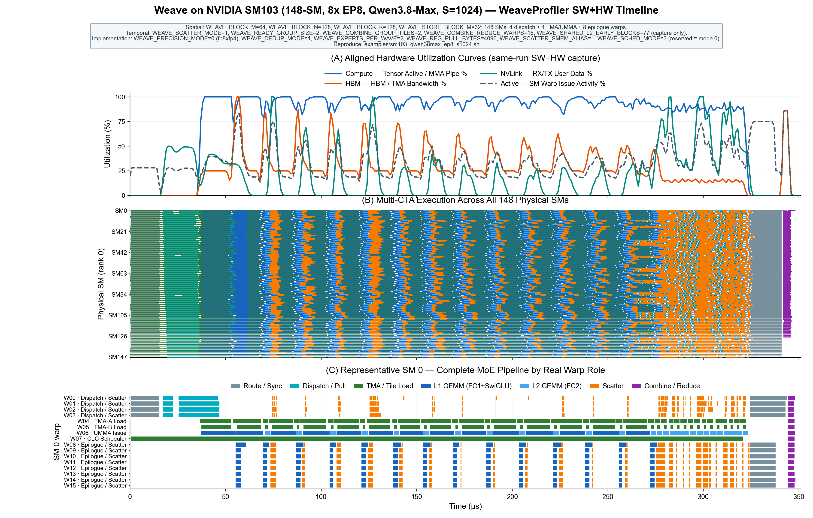

[English](README.md) | [简体中文](README_zh.md)

# Weave: Routing-Adaptive Runtime-Dynamic MoE Megakernel

Weave is a **routing-adaptive, runtime-dynamic MoE megakernel** implemented in a
unified C++/CUDA/HIP codebase ([Weave: Fine-Grained Dynamic SM Scheduling in an
MoE Megakernel for Compute-Communication Overlap](https://arxiv.org/abs/2609.21483)),
supporting **NVIDIA SM103 (148-SM)**, **NVIDIA H20**, and **AMD MI308X**. Right
after dispatch finishes, the kernel reads live per-expert token counts and
performs **spatial partitioning and temporal scheduling** directly on the GPU at
runtime.

## Architecture and runtime scheduling

| Hardware | Language | Supported precision values | Entry point |
|---|---|---|---|
| NVIDIA SM103 (148-SM) | CUDA C++ | `0 = fp8xfp4` (default), `1 = fp4xfp4` (NVFP4), `3 = bf16`; `2 = fp8` is not supported | sm100_fp8_fp4_mega_moe.cuh / sm100_fp4_fp4_mega_moe.cuh via weave_mega_moe(..., mma_type=...) |
| NVIDIA H20 (SM90) | CUDA C++ | `2 = fp8` (fp8xfp8) only | sm90_fp8_mega_moe.cuh |
| AMD MI308X (gfx942) | HIP C++ | `2 = fp8` (fp8xfp8) only; EP8 and EP16 | gfx942_fp8_mega_moe.cuh and amd/megamoe_amd.hip |

After dispatch completes, CTA 0 evaluates an on-device cost model over the live
per-expert token distribution and communication volume, selecting the layer's
**spatial partitioning** and **temporal schedule**, which all other CTAs read
from device memory:

- **Spatial partitioning:** chooses the per-SM/CU ratio between communication
  warps and compute/epilogue warps, and adapts per-expert tile sizes at runtime
  according to each expert's actual token count to cut padding waste.
- **Temporal scheduling (eliminating head, middle, and tail bubbles):**
  - **Head:** at layer start before any GEMM tile is ready, otherwise-waiting
    compute/TMA/epilogue warps join remote token pulling within their own
    register budgets to saturate link bandwidth, then switch to GEMM once the
    first tiles arrive;
  - **Middle:** based on the live comm-to-compute ratio, selects whether FC2
    Scatter runs inline in epilogue warps or is handed off to communication
    warps to overlap with subsequent GEMM tiles;
  - **Tail:** replaces the global cross-GPU barrier before Combine with
    **per-token readiness** (each token is reduced as soon as all `K` of its
    expert outputs arrive) and recruits **all finished warps (comm, TMA/MMA, and
    epilogue)** into cooperative weighted reduction.

## Hardware partitions and global ready queues

Warps on each SM/CU are divided into a **Communication Partition (`N_c`)** and a
**Compute/GEMM Partition (`N_e`)**, each pulling work from its own global task
queue:

- **GEMM Ready Queue** (consumed by `N_e`): holds `(expert_id, m_tile_idx)`
  compute tiles. As remote tokens land in local buffers, communication warps
  atomically increment per-expert (or per-group) arrival counters; instead of
  materializing and sorting a full per-tile array at runtime, compute CTAs claim
  ready tiles directly via prefix-summed expert offsets in a preset expert order
  (descending load / L2 tile-swizzle), or pop ready tile IDs from a global FIFO
  when `WEAVE_READY_QUEUE=1`. When `WEAVE_SCATTER_MODE=0`, epilogue warps send
  FC2 outputs directly over NVLink/xGMI inside the compute partition.
- **Communication Ready Queue** (consumed by `N_c`): holds cross-GPU Pull and
  async Scatter tasks. When `WEAVE_SCATTER_MODE=1`, epilogue warps hand off
  completed FC2 tile scatter descriptors into this queue; when
  `WEAVE_SCATTER_MODE=2`, duplicate partial outputs for the same source token on
  the local GPU (or node) are first merged in HBM before enqueuing a single
  transfer, allowing `N_c` warps to overlap NVLink/xGMI scatter with ongoing
  GEMM tiles.

## Quick start

    git clone https://github.com/ziyuhuang123/weave.git
    cd weave
    python -m pip install -e .
    python -m py_compile baselines/*.py ablation/*.py
    python tests/verify_tunable_params_doc.py

Minimal Python dispatch:

    import torch
    from deep_gemm.mega import SymmBuffer, weave_mega_moe

    # Construct the symmetric buffer for your process group and model shape,
    # then call weave_mega_moe(y, l1_weights, l2_weights, sym_buffer,
    #                        mma_type="fp4xfp4").
    # NVIDIA SM103 (148-SM) supports fp8xfp4, fp4xfp4 and bf16;
    # NVIDIA H20 and AMD MI308X use fp8.

The public precision selector can also be set before import or before the
call:

    export WEAVE_PRECISION_MODE=fp4xfp4

## Measured performance

Paper Fig. 7: measured 3-hardware MoE-layer speedup across 6 models x 5 batch
sizes.

Bound hardware resource utilization: each point is the measured peak
utilization of the resource that actually bounds that cell (HBM, NVLink/xGMI,
or compute). Small models such as `Qwen3.5-35B` (`H=2048, I=512`) and
`Qwen3.5-122B` at `S=16..1024` across 8-GPU EP8 are strictly latency-floor
dominated (their entire ideal HBM/NVLink time is only `2-10 us` on 148-SM SM103
versus the `~35 us` 8-GPU barrier/launch floor), and climb back to `79.4%`
(SM103) / `60.8%` (H20) once `S=16K` amortizes the fixed floor. On 8-GPU-scale
models (`Qwen3.8-2.4T`, `MiniMax-M3`), Weave reaches up to `97.6%` on 148-SM
SM103 and `85.5%` on H20; at `S=1024` on H20, `Qwen3.8-2.4T` is HBM3-bound
(`T_hbm=755 us` vs `T_comp=437 us`), which physically caps FP8 Tensor Core
activity below `58%`.

## WeaveProfiler software + hardware timelines

Each figure shows aligned software + hardware timelines on `Qwen3.8-Max`
(hardware utilization curves, all physical SM/CU lanes, and representative CTA
warp-role pipelines). `S_rank` is the token count per rank and `S_global` the
total across all ranks:

- **NVIDIA SM103 (148-SM), 4x EP4, `S_rank=1024` (`S_global=4096`, `num_shared_experts=0`, `BM=80, store=8/8, stages=8, WEAVE_EPI_REG_STAGES=2`)**:
  same-run WeaveProfiler SW+HW capture (`3.52%` warm instrumentation overhead,
  `0` buffer overflow, bitwise-exact output across all 4 ranks) measures
  **Active SMs `100.0%`** median / max, **HBM bandwidth `81.0%`** median / `94.0%` max,
  **NVLink `43.0%`** median / `100.0%` max, and **Tensor Active `38.0%`**
  median / `42.0%` max (141 same-run `nsys` samples per curve, recorded in
  `weaveprofiler_optimal_s1024.hw_curves_same_run_nsys`).
- **NVIDIA H20 (78-SM), 4x EP4, `S_global=1024` (`S_rank=256`, `num_shared_experts=0`, `BM=64, adapt_bm=1, comm_only + XOR-swizzled smem`)**:
  same-run WeaveProfiler SW+HW capture saturates the HBM3 roofline at
  **HBM3 `91.5%` mean (`96.1%` p50)** and **Active SMs `97.7%` mean (`100.0%` p50)**
  with strict binary scatter ownership (`epi_scatter_spans = 0`, zero remote
  scatter on `Math+Epi WG0..WG3`).
- **AMD MI308X, 8x EP8 (`Qwen3.8-Max, S=1024`)**: aligned per-wavefront software
  events and hardware activity curves across all physical CUs.

### Verified EP4 head-to-head results (`num_shared_experts = 0`, CUDA Graph, 256 MiB L2 flush, palindromic ABBA)

Full raw receipts live in
[results/opus_sm103_ep4_verified.json](results/opus_sm103_ep4_verified.json),
[results/opus_h20_ep4_verified.json](results/opus_h20_ep4_verified.json), and
[results/gcmoe_same_precision_ep4.json](results/gcmoe_same_precision_ep4.json).

**NVIDIA SM103 (148-SM), 4x EP4 (`FP8 x MXFP4`, `num_shared_experts = 0`):**

| Workload | Routing | Reference Baseline | Weave (Unified) | Speedup | Accuracy (all 4 ranks) |
|---|---|---:|---:|---:|---|
| `Qwen3.8-Max`, `S_rank=1024` (`S_global=4096`) | Balanced | `881.38 us` (`BM=240`) / `748.88 us` (auto `BM=128`) | **`710.53 us`** (`BM=80, st=8/8, epi2`) | **`1.2405x`** (`+24.05%`) / **`1.0540x`** (`+5.40%`) | `rel_l2=2.91e-5`, `stats_exact` |
| `Qwen3.8-Max`, `S_rank=1024` (`S_global=4096`) | Random multinomial | `824.7 us` (`GC-MoE BM=96`) | **`779.0 us`** (auto `BM=96, st=16/8, epi2`) | **`1.0553x`** (`+5.53%`, 5/5 rounds) | Bit-exact vs GC-MoE (`dL2=0.00`) |
| `416E`, `S_rank=1024` (`S_global=4096`) | Balanced | `450.26 us` (`BM=240`) / `411.66 us` (auto `BM=128`) | **`382.85 us`** (`BM=64, st=8/8, epi2`) | **`1.1761x`** (`+17.61%`) / **`1.0753x`** (`+7.53%`) | `rel_l2=5.37e-5`, `stats_exact` |
| `416E`, `S_rank=1024` (`S_global=4096`) | Random multinomial | `412.9 us` (`GC-MoE BM=96`) | **`393.8 us`** (auto `BM=80, st=8/8, epi2`) | **`1.0423x`** (`+4.23%`, 5/5 rounds) | Bit-exact vs GC-MoE (`dL2=0.00`) |

TMEM pipeline study at `Qwen3.8-Max`, `S_rank=8192` (balanced, both arms 100%
PASS, `rel_l2=5.67e-5`, recorded in `s8192_tmem_pipeline_study`): the default
`BM=240` with the `2.0`-stage TMEM pipeline (`24/8` stores, 6 stages) runs at
`3779.42 us`, while the fractional `1.75`-stage overlapping TMEM pipeline at
`BM=256` (`32/32` stores, 4 stages) runs at `4276.50 us` (`0.8838x`), so `BM=240`
stays the default prefill tile and `1.75` remains an opt-in variant.

**NVIDIA H20 (78-SM), 4x EP4 (`FP8 x FP8`, `num_shared_experts = 0`, `Qwen3.8-Max`):**

| Seqlen (`S_global`) | Official Baseline | Earlier Tuned | GC-MoE Native FP8 | Weave (Unified) | Speedup vs Official / Earlier / GC-MoE |
|---|---:|---:|---:|---:|---|
| `S=128` (`S_rank=32`) | `1477.84 us` | `1386.11 us` | `1956.7 us` *(same-host `Weave 1839.2 us`)* | **`1328.26 us`** (`bm16/bm32 smem`) | **`1.1126x`** / `+4.36%` / **`1.059x`** (`S_rank=128`: **`1.102x`**) |
| `S=1024` (`S_rank=256`) | `3241.71 us` | `2341.92 us` | `3740.3 us` *(same-host `Weave 2216.8 us`)* | **`2177.54 us`** (`bm64 adapt comm_only+smem`) | **`1.4887x`** / **`+7.55%`** / **`1.679x`** |
| `S=4096` (`S_rank=1024`) | `6210.22 us` | `5814.43 us` | `11794.3 us` *(same-host `Weave 5272.7 us`)* | **`5248.66 us`** (`bm64 adapt comm_only+smem`) | **`1.1832x`** / **`+10.78%`** / **`2.276x`** |

The GC-MoE columns compare both operators on the same host; the winning Weave
arms use `reg_2stage` / `smem` staging, which combine in FP32. The optional
`hbm_dedup` staging merges duplicate top-k rows with local `bf16x2` atomics before
the send, so it rounds once more than the FP32 combine paths.

Full tuned `WEAVE_*` presets (organized by **Spatial**, **Temporal**, and
**Implementation**) and reproducible launch scripts live under
[examples/](examples/README.md):

- NVIDIA SM103 (148-SM): [examples/sm103_qwen38max_ep8_s1024.sh](examples/sm103_qwen38max_ep8_s1024.sh)
- NVIDIA H20: [examples/h20_qwen38max_ep8_s1024.sh](examples/h20_qwen38max_ep8_s1024.sh)
- AMD MI308X: [examples/mi308x_qwen38max_ep8_s1024.sh](examples/mi308x_qwen38max_ep8_s1024.sh) (EP8) and [examples/mi308x_qwen38max_ep16_s128.sh](examples/mi308x_qwen38max_ep16_s128.sh) (2-node EP16)
- One-command runner & renderer: `python examples/profile_and_render_timeline.py --preset sm103` (supports `sm103`, `h20`, `mi308x_ep8`, `mi308x_ep16`, plus `--run` / `--render`)

## Parameter taxonomy: Spatial, Temporal, and Implementation

Weave's scheduling and kernel parameters fall into three categories:

- **Spatial dimension:** how compute, communication, and tile
  resources are partitioned across SMs/CUs, warps, clusters, and numeric
  formats—including the comm/compute warp split, heterogeneous SM role masks,
  2-CTA multicast, numeric precision (`fp8xfp4` / `fp4xfp4` / `fp8` / `bf16`),
  and **runtime per-expert tile sizing** from live per-expert token counts
  (MI308X five-tier `BM_e in {16, 32, 64, 128, 256}` with EP16 floored at 32;
  H20 8-tier swapAB `{8..64}` gated by padding waste; 148-SM SM103 dynamic
  TMA-A `m8/m16/BM`, dynamic epilogue `store_m8/m16`, and per-expert tile
  ladders).
- **Temporal dimension:** execution order, compute-communication
  overlap, opening all-warp prefetch token count, scatter ownership (epilogue
  inline vs. async comm queue vs. local pre-reduce dedup), ready-queue &
  L2-swizzled ordering, L1/L2 interleaving, per-token ready &
  cooperative all-warp tail reduction, and **runtime-derived pipeline stage
  depth** (`num_stages` is computed at launch from the tile shape and remaining
  SMEM budget rather than hardcoded at compile time).
- **Implementation & prior work:** standard GPU/MoE systems techniques from
  prior work (register-direct pull/combine, selective deduplication, RDMA
  descriptor chunking, SMEM aliasing, profiler instrumentation, and ablation
  presets).

At runtime, CTA 0 ranks candidate schedules with the lightweight on-device cost
model: shared fixed overheads cancel in the ranking, matching the exhaustive
oracle on 38/48 measured 148-SM SM103 cells (1.301x geomean speedup vs. 1.332x
oracle, 2.4% selection regret; 34.0% mean absolute latency error).

Every file:line citation below is checked by
`tests/verify_tunable_params_doc.py`. The full reference is in
[docs/TUNABLE_PARAMETERS.md](docs/TUNABLE_PARAMETERS.md).

## Unified core WEAVE_* parameters

The parameter surface is organized strictly as **Spatial / Temporal / Implementation**. Every row names both its host parse and its kernel consumption; `tests/verify_tunable_params_doc.py` resolves each `file:line` citation. The full value semantics are in [docs/TUNABLE_PARAMETERS.md](docs/TUNABLE_PARAMETERS.md).

### Spatial

| Parameter | Category | Values (every accepted value is named) | Default | Mechanism | Host parse | Kernel consumption |
|---|---|---|---|---|---|---|
| `WEAVE_PRECISION_MODE` | Spatial | `0 = fp8xfp4`; `1 = fp4xfp4`; `2 = fp8xfp8`; `3 = bf16` | 0 | Numeric precision and tensor-core mode; the source of every byte width in the cost model. | `deep_gemm/include/deep_gemm/scheduler/weave_knobs.cuh:273` | `deep_gemm/include/deep_gemm/scheduler/weave_cost_model.cuh:25` |
| `WEAVE_DISPATCH_WARPS` | Spatial | `0 = auto` (4 warps); `4`; `8` | 0 | Per-CTA communication warp budget; 8 warps double the dispatch pull width and raise the CTA to 256 dispatch threads. | `csrc/jit_kernels/heuristics/weave_knob_config.hpp:73` | `deep_gemm/include/deep_gemm/impls/sm100_fp8_fp4_mega_moe.cuh:969` |
| `WEAVE_DISPATCH_ACTIVE_SMS` | Spatial | `0 = auto` (all SMs run dispatch pull); `D = 1..num_sms`: only D SMs pull remote tokens | 0 | Independent partial-SM dispatch throttle: limits dispatch pulls to D SMs while remaining SMs enter GEMM immediately. | `csrc/jit_kernels/heuristics/weave_knob_config.hpp:88` | `deep_gemm/include/deep_gemm/impls/sm100_fp8_fp4_mega_moe.cuh:46` |
| `WEAVE_SCATTER_ACTIVE_SMS` | Spatial | `0 = auto` (all SMs/CUs participate); `K = 1..num_sms`: only K SMs drain the scatter queue | 0 | Decoupled throttled active scatter SMs: the epilogue only publishes descriptors and a bounded SM subset owns NVLink/xGMI scatter. | `csrc/jit_kernels/impls/sm100_fp8_fp4_mega_moe.hpp:187` | `deep_gemm/include/deep_gemm/impls/sm100_fp8_fp4_mega_moe.cuh:528` |
| `WEAVE_LOCALITY_DOMAINS` | Spatial | `0 = auto`; `1 = single domain`; `2 = dual-die SM103`; `4 = XCD MI308X` | 0 | Splits every L1/L2 N-cluster queue across locality domains; each domain claims locally and steals from the peer at the tail. | `csrc/jit_kernels/impls/sm100_fp8_fp4_mega_moe.hpp:198` | `deep_gemm/include/deep_gemm/scheduler/mega_moe.cuh:837` |
| `WEAVE_SM0_STREAM_SCHED` | Spatial | `0 = SM 0 communication warps pull`; `1 = SM 0 communication warps become the streaming scheduler lane` | 0 | Repurposes SM 0/CU 0 communication warps as a dedicated scheduler lane; the remaining SMs evenly own the full dispatch pull range. | `csrc/jit_kernels/heuristics/weave_knob_config.hpp:82` | `deep_gemm/include/deep_gemm/impls/sm100_fp8_fp4_mega_moe.cuh:2856` |
| `WEAVE_SCATTER_OWNER` | Spatial | `0 = epilogue_only`: epilogue warps issue every remote FC2 store; `1 = comm_only`: epilogue warps only stage locally and communication warps own every remote store (names or codes accepted) | 0 (auto `comm_only` when a staged path or a scatter SM throttle is requested) | Strict binary scatter ownership; a mixed epilogue + communication scatter is rejected at host parse and by a kernel static assertion. | `csrc/jit_kernels/heuristics/weave_knob_config.hpp:153` | `deep_gemm/include/deep_gemm/impls/sm100_fp8_fp4_mega_moe.cuh:1431` |
| `WEAVE_AMD_8WAVE_MIN_TOK` | Spatial | `N = minimum local tokens per CU-expert`; `0 = follow WEAVE_DUALGROUP_MIN_TOKENS` | 64 | MI308X 8-wave schedule admission floor: below N tokens the CU keeps the 4-wave schedule. | `deep_gemm/include/deep_gemm/impls/amd/ep8/build_one.sh:67` | `deep_gemm/include/deep_gemm/impls/amd/ep8/megamoe_amd_ep8.hip:1215` |
| `WEAVE_DUALGROUP_MIN_TOKENS` | Spatial | `N = second compute-group threshold in local tokens` | 64 | Historical MI308X dual-group threshold; the 8-wave knob defaults to this value. | `deep_gemm/include/deep_gemm/impls/amd/ep8/build_one.sh:14` | `deep_gemm/include/deep_gemm/impls/amd/megamoe_amd.hip:1159` |
| `WEAVE_BM_TIER_MODE` | Spatial | `0 = five-tier`; `1 = four-tier`; `2 = EP16 four-tier {32,64,128,256}` | 2 | Per-expert block-M ladder used by the MI308X greedy tile planner. | `deep_gemm/include/deep_gemm/impls/amd/ep8/build_one.sh:12` | `deep_gemm/include/deep_gemm/impls/amd/include/direct_gather_and_greedy_tiles.hpp:71` |

### Temporal

| Parameter | Category | Values (every accepted value is named) | Default | Mechanism | Host parse | Kernel consumption |
|---|---|---|---|---|---|---|
| `WEAVE_L2_KBLOCK_DEP` | Temporal | `0 = default L1-first order`; `1 = 64-bit XOR L2KBlockDependency bitmask with a tight 1 L2 <-> 1 L1 alternating wave schedule` | 0 | Starts the L2 K block as soon as its matching L1 N subtile completes instead of waiting for the full L1 wave. | `csrc/jit_kernels/heuristics/sm90_mega_moe.hpp:285` | `deep_gemm/include/deep_gemm/scheduler/mega_moe.cuh:838` |
| `WEAVE_RING_BLOCKS` | Temporal | `0 = auto capacity from get_num_max_live_pool_blocks`; `N >= 1 = forced ring block count` | 0 | Bounded ring-buffer reuse for the intermediate SwiGLU activations; the ring wraps after N live pool blocks instead of allocating the whole pool. | `csrc/jit_kernels/impls/sm100_fp8_fp4_mega_moe.hpp:223` | `deep_gemm/include/deep_gemm/impls/sm100_fp8_fp4_mega_moe.cuh:1086` |
| `WEAVE_EARLY_STREAM_REDUCE` | Temporal | `0 = global barrier before combine`; `1 = barrier-free per-token cnt==topk tail-interleaved early reduce` | 0 | Epilogue warps enter the per-token reduce as soon as their last L2 tile is handed off, overlapping the tail with the remaining scatter. | `csrc/jit_kernels/impls/sm100_fp8_fp4_mega_moe.hpp:224` | `deep_gemm/include/deep_gemm/impls/sm100_fp8_fp4_mega_moe.cuh:1417` |
| `WEAVE_COMBINE_SYNC_CHUNK` | Temporal | `0 = global barrier before combine`; `16, 32, 64, 128 = chunked dedup combine sync granularity (tokens per chunk)` | 0 | Paired with local bf16x2 dedup: tracks deduplicated sends per (destination rank, chunk) in a local L2 counter and issues one cross-GPU release per chunk so finished warps overlap Combine with tail Scatter. | `csrc/jit_kernels/heuristics/weave_knob_config.hpp:108` | `deep_gemm/include/deep_gemm/impls/sm90_fp8_mega_moe.cuh:730` |
| `WEAVE_TMEM_PIPELINE_MODE` | Temporal | `0 = auto` (2.0 at BM<=240 with one prefetch stage; 1.75 at BM=256); `100 = 1.0`; `175 = 1.75`; `200 = 2.0` | 0 | TMEM epilogue pipeline depth; the 1.75 mode overlaps the tail epilogue with the next accumulator column range at BM=256. | `csrc/jit_kernels/impls/sm100_fp8_fp4_mega_moe.hpp:225` | `deep_gemm/include/deep_gemm/impls/sm100_fp8_fp4_mega_moe.cuh:3795` |
| `WEAVE_HEAD_PULL_CHUNK` | Temporal | `0 = pull the opening head budget as one prefix`; `N = tokens per head-pull chunk` | 0 | Bounds the all-warp opening head-pull prefix; after N tokens only the selected communication warps keep pulling. | `csrc/jit_kernels/heuristics/weave_knob_config.hpp:105` | `deep_gemm/include/deep_gemm/impls/sm100_fp8_fp4_mega_moe.cuh:2884` |
| `WEAVE_EPI_REG_STAGES` | Temporal | `0 = auto` (2 at BM in `{80, 96, 240, 256}` with TMEM depth >= 1.75, else 1); `1 = single register buffer`; `2 = two register stages` | 0 | Epilogue TMEM-to-register pipeline: with 2 stages the load of store block s+1 overlaps SwiGLU, quantization and the store of block s, and TMEM is released as soon as the last load is issued. | `csrc/jit_kernels/heuristics/weave_knob_config.hpp:111` | `deep_gemm/include/deep_gemm/impls/sm100_fp8_fp4_mega_moe.cuh:3805` |
| `WEAVE_SCHED_L2_RATIO` | Temporal | `1..4`: number of L2 tasks scheduled per L1 task in interleaved mode | 1 | Matches L2-to-L1 M-block consumption rate so L2 activations stay resident in L2 cache while overlapping L1 and L2. | `csrc/jit_kernels/heuristics/weave_knob_config.hpp:114` | `deep_gemm/include/deep_gemm/scheduler/mega_moe.cuh:886` |
| `WEAVE_V_HEAD` | Temporal | `0 = automatic`; `N = opening head-pull budget in tokens` | automatic | Opening head-pull budget: all warps pull the first N remote tokens at peak link bandwidth before the first GEMM tile is ready. | `deep_gemm/include/deep_gemm/scheduler/weave_knobs.cuh:263` | `deep_gemm/include/deep_gemm/scheduler/weave_cost_model.cuh:30` |
| `WEAVE_OVERLAP_PIPELINE` | Temporal | `0 = serialized`; `1 = compute-communication overlap` | 1 (forced 0 at preset 2 and above) | Turns compute-communication overlap on or off; the ablation presets derive it automatically. | `deep_gemm/include/deep_gemm/impls/amd/ep8/build_one.sh:23` | `deep_gemm/include/deep_gemm/scheduler/weave_knobs.cuh:151` |
| `WEAVE_ALL_WAVE_COMBINE` | Temporal | `0 = compute-group waves only`; `1 = all waves join the cooperative tail combine` | 1 (forced 0 at preset 2 and above) | Cooperative all-wave tail combine; the ablation presets derive it automatically. | `deep_gemm/include/deep_gemm/impls/amd/ep8/build_one.sh:24` | `deep_gemm/include/deep_gemm/scheduler/weave_knobs.cuh:181` |
| `WEAVE_READY_QUEUE` | Temporal | `0 = preset expert order`; `1 = global FIFO ready queue` | 0 | Selects the ready-tile source: prefix-summed expert offsets or a global FIFO. | `csrc/jit_kernels/impls/sm100_fp8_fp4_mega_moe.hpp:271` | `deep_gemm/include/deep_gemm/impls/sm100_fp8_fp4_mega_moe.cuh:383` |
| `WEAVE_READY_GROUP_SIZE` | Temporal | `0 = per-expert readiness`; `N = group-granularity readiness publication` | 0 | Publishes readiness per expert or per group of N experts. | `csrc/jit_kernels/impls/sm100_fp8_fp4_mega_moe.hpp:250` | `deep_gemm/include/deep_gemm/impls/sm100_fp8_fp4_mega_moe.cuh:87` |
| `WEAVE_SCHED_MODE` | Temporal | `0 = descending load`; `1 = L2 tile swizzle`; `2 = expert-major` | 0 | Tile ordering key used when the ready queue is not a FIFO. | `csrc/jit_kernels/impls/sm100_fp8_fp4_mega_moe.hpp:272` | `deep_gemm/include/deep_gemm/impls/sm100_fp8_fp4_mega_moe.cuh:399` |
| `WEAVE_EXPERTS_PER_WAVE` | Temporal | `0 = auto`; `N = LPT scheduling window`; `100 + N = inline static order` | 0 | Longest-processing-time scheduling window across experts. | `csrc/jit_kernels/impls/sm100_fp8_fp4_mega_moe.hpp:269` | `deep_gemm/include/deep_gemm/impls/sm100_fp8_fp4_mega_moe.cuh:351` |

### Implementation

| Parameter | Category | Values (every accepted value is named) | Default | Mechanism | Host parse | Kernel consumption |
|---|---|---|---|---|---|---|
| `WEAVE_ABLATION_PRESET` | Implementation | `0 = full Weave`; `1 = -S`; `2 = -S-T`; `3 = -S-T-C` | 0 | Compile-time progressive ablation selector. | `deep_gemm/include/deep_gemm/scheduler/weave_knobs.cuh:41` | `deep_gemm/include/deep_gemm/scheduler/weave_cost_model.cuh:26` |
| `WEAVE_ENABLE_COST_MODEL` | Implementation | `0 = static policy`; `1 = CTA-0 runtime cost model` | 1 at preset 0; 0 at presets 1-3 | Master switch for the on-device CTA-0 policy search. | `deep_gemm/include/deep_gemm/scheduler/weave_knobs.cuh:51` | `deep_gemm/include/deep_gemm/scheduler/weave_cost_model.cuh:27` |
| `WEAVE_ADAPT_BM` | Implementation | `0 = fixed per-expert BM`; `1 = per-expert dynamic BM ladder` | 0 | Enables the per-expert adaptive block-M ladder (H20 swapAB tiers, SM103 expert step mode). | `csrc/jit_kernels/heuristics/sm90_mega_moe.hpp:280` | `deep_gemm/include/deep_gemm/impls/sm90_fp8_mega_moe.cuh:591` |
| `WEAVE_BLOCK_M_L1` | Implementation | `0 = auto`; `16, 32, 64, 80, 96, 128, 192, 240, 256` | 0 | GEMM1 (FC1) per-expert block-M envelope; the adaptive ladder picks BM_e inside it. SM103 and H20 have one static BLOCK_M template, so a non-zero value must equal it. | `csrc/jit_kernels/heuristics/weave_knob_config.hpp:122` | `deep_gemm/include/deep_gemm/impls/sm100_fp8_fp4_mega_moe.cuh:1088` |
| `WEAVE_BLOCK_M_L2` | Implementation | `0 = auto`; `16, 32, 64, 80, 96, 128, 192, 240, 256` | 0 | GEMM2 (FC2) per-expert block-M envelope; independent from GEMM1 on the dynamic-scheduler backends. SM103 and H20 require a value equal to the compiled BLOCK_M. | `csrc/jit_kernels/heuristics/weave_knob_config.hpp:125` | `deep_gemm/include/deep_gemm/impls/sm100_fp8_fp4_mega_moe.cuh:1090` |
| `WEAVE_STORE_BLOCK_M_L1` | Implementation | `0 = auto`; positive multiple of 8 (e.g. `8` at BM=80, `16` at BM=96, `24` at BM=240) | 0 (auto 8/16/24 at BM=80/96/240) | GEMM1 epilogue store height; asymmetric splits unlock 8 TMA stages at BM=80/96 and 6 stages at BM=240. H20 accepts only the full compiled BLOCK_M. | `csrc/jit_kernels/impls/sm100_fp8_fp4_mega_moe.hpp:231` | `deep_gemm/include/deep_gemm/impls/sm100_fp8_fp4_mega_moe.cuh:1092` |
| `WEAVE_STORE_BLOCK_M_L2` | Implementation | `0 = auto`; positive multiple of 8 (e.g. `8` at BM=80/96/240) | 0 (auto 8 at BM=80/96/240) | GEMM2 epilogue store height; asymmetric splits unlock 8 TMA stages at BM=80/96 and 6 stages at BM=240. H20 accepts only the full compiled BLOCK_M. | `csrc/jit_kernels/impls/sm100_fp8_fp4_mega_moe.hpp:260` | `deep_gemm/include/deep_gemm/impls/sm100_fp8_fp4_mega_moe.cuh:233` |
| `WEAVE_LOCAL_SCATTER_DEDUP` | Implementation | `0 = full-precision local accumulation`; `1 = bf16x2 hardware L2 atomic dedup before send` | 0 | Fire-and-forget red.add.noftz.bf16x2 merge of duplicate expert contributions into a pre-zeroed L2-resident buffer; one descriptor is published per deduplicated row. | `csrc/jit_kernels/impls/sm100_fp8_fp4_mega_moe.hpp:227` | `deep_gemm/include/deep_gemm/impls/sm100_fp8_fp4_mega_moe.cuh:1420` |
| `WEAVE_SCATTER_STAGING` | Implementation | `0 = reg_2stage`: double-buffered register transfer; `1 = smem`: per-SM on-chip handoff to the same SM's dispatch warps; `2 = hbm_dedup`: L2-resident HBM buffer with bf16x2 atomic dedup and a global queue drained by the scatter SMs (names or codes accepted) | 0 (auto `hbm_dedup` when `WEAVE_LOCAL_SCATTER_DEDUP=1`) | Selects one of the three scatter fast paths; `smem` adds zero L2/HBM traffic for small batches, `hbm_dedup` removes SMEM slot backpressure for large batches. `smem` and `hbm_dedup` require `comm_only` ownership. | `csrc/jit_kernels/heuristics/weave_knob_config.hpp:145` | `deep_gemm/include/deep_gemm/impls/sm100_fp8_fp4_mega_moe.cuh:1437` |
| `WEAVE_SCATTER_MODE` | Implementation | `0 = epilogue inline`; `1 = SMEM handoff to communication warps`; `2 = local pre-reduce dedup first`; `3 = local bf16x2 dedup + HBM scatter queue` | derived | Low-level scatter executor code. On SM103 it is derived from `WEAVE_SCATTER_OWNER` and `WEAVE_SCATTER_STAGING` unless pinned explicitly; MI308X and the CTA-0 scatter override read it directly. | `csrc/jit_kernels/impls/sm100_fp8_fp4_mega_moe.hpp:206` | `deep_gemm/include/deep_gemm/scheduler/weave_cost_model.cuh:31` |
| `WEAVE_REG_PULL_BYTES` | Implementation | `0 = SMEM staging`; `1024, 2048, 4096 = register-direct pull width in bytes` | 0 | Pulls remote token payloads directly into registers instead of staging them in SMEM. | `csrc/jit_kernels/impls/sm100_fp8_fp4_mega_moe.hpp:252` | `deep_gemm/include/deep_gemm/impls/sm100_fp8_fp4_mega_moe.cuh:119` |
| `WEAVE_SCATTER_SMEM_ALIAS` | Implementation | `0 = dedicated scatter SMEM`; `1 = alias the scatter buffer into the dispatch dead zone` | 1 | Reuses the dispatch buffer's idle window for scatter staging. | `csrc/jit_kernels/impls/sm100_fp8_fp4_mega_moe.hpp:207` | `deep_gemm/include/deep_gemm/impls/sm100_fp8_fp4_mega_moe.cuh:490` |
| `WEAVE_SCATTER_WARPS` | Implementation | `0 = automatic`; `4`; `8` | 0 | Scatter warp allocation inside the dispatch partition. | `csrc/jit_kernels/impls/sm100_fp8_fp4_mega_moe.hpp:208` | `deep_gemm/include/deep_gemm/impls/sm100_fp8_fp4_mega_moe.cuh:501` |
| `WEAVE_DEDUP_MODE` | Implementation | `0 = off`; `1 = unique (token, destination) buckets`; `2 = local pre-reduce plus 32-lane fanout` | 0 | Selective input deduplication of duplicate routed reads. | `csrc/jit_kernels/impls/sm100_fp8_fp4_mega_moe.hpp:274` | `deep_gemm/include/deep_gemm/impls/sm100_fp8_fp4_mega_moe.cuh:415` |
| `WEAVE_REG_BALANCE` | Implementation | `0 = default (96/72/168)`; `1 = rebalanced (64/56/192) at E/rank > 64` | 0 | Reclaims spare dispatch/non-epilogue registers on SM103 to give epilogue warps 192 registers when E/rank > 64. | `csrc/jit_kernels/heuristics/weave_knob_config.hpp:137` | `deep_gemm/include/deep_gemm/impls/sm100_fp8_fp4_mega_moe.cuh:1503` |
| `WEAVE_PROFILER_LEVEL` | Implementation | `0 = production`; `1 = phase open/close events`; `2 = full per-stage events` | 0 | WeaveProfiler instrumentation level for the AMD port. | `deep_gemm/include/deep_gemm/impls/amd/ep16/build_port.py:97` | `deep_gemm/include/deep_gemm/impls/amd/third_party_overlay/fi_lite_hip.h:8` |

`num_shared_experts` is a Python/C++ API argument rather than an environment knob. Its default is `0` on every MegaMoE entry point; shared-expert buffers are allocated only when it is explicitly non-zero. The gate API (`bf16_mega_gate`) takes it explicitly together with `use_shared_as_routed`.

## Baselines

Installation and benchmark scripts for official DeepGEMM, DeepEP + DeepGEMM,
FlashInfer, SGLang, vLLM, and RCCL + AITER (1-stage and 2-stage CK) live under
[baselines/README.md](baselines/README.md) and
[baselines/README_zh.md](baselines/README_zh.md).

    python baselines/run_b300_baselines.py --baseline all --dry-run
    python baselines/run_h20_baselines.py --baseline all --dry-run
    python baselines/run_mi308x_baselines.py --baseline all --ep 16 --dry-run

## Ablation and reproduction

Progressive ablation scripts, cost-model vs. exhaustive-oracle evaluation, EPLB
experiments, and WeaveProfiler timeline capture live under
[ablation/README.md](ablation/README.md) and
[ablation/README_zh.md](ablation/README_zh.md).

    python ablation/run_progressive_ablation.py --backend b300 --presets 0,1,2,3 --dry-run
    python ablation/eval_cost_model_vs_oracle.py
    python ablation/capture_weaveprofiler_timeline.py --trace result.sw_hw.perfetto.json.gz --out-png result.png

Geomean speedup across the 48 evaluated configurations vs. official baselines
(paper Table IV):

| Platform | Weave | -S | -S-T | -S-T-C |
|---|---:|---:|---:|---:|
| NVIDIA SM103 (148-SM) | 1.301 | 1.192 | 1.010 | 0.996 |
| NVIDIA H20 | 1.162 | 1.137 | 1.053 | 0.947 |
| AMD MI308X EP16 | 2.147 | 1.808 | 1.537 | 1.362 |

Combined with Expert-Parallel Load Balancing (EPLB, paper Table V): Weave
achieves 1.274x speedup without EPLB; enabling EPLB alone gives 1.128x over the
baseline, and enabling Weave on top of EPLB yields an additional 1.144x speedup.

## Build

Dependencies: CUDA 13.x or ROCm 7.x, CMake, a C++20 compiler, PyTorch, and the
vendored CUTLASS headers (AMD builds also use `WEAVE_AITER_SITE` to point to
external AITER headers).

    python -m pip install -e .

Standalone NVIDIA kernel compilation checks:

    nvcc -std=c++20 -ptx -arch=sm_90a -I deep_gemm/include         -I third-party/cutlass/include -I third-party/deep_jit/include         -x cu deep_gemm/include/deep_gemm/impls/sm90_fp8_mega_moe.cuh -o h20.ptx

    nvcc -std=c++20 -ptx -arch=sm_100a -I deep_gemm/include         -I third-party/cutlass/include -I third-party/deep_jit/include         -x cu deep_gemm/include/deep_gemm/impls/sm100_fp8_fp4_mega_moe.cuh -o sm103_fp8.ptx

    nvcc -std=c++20 -ptx -arch=sm_100a -I deep_gemm/include         -I third-party/cutlass/include -I third-party/deep_jit/include         -x cu deep_gemm/include/deep_gemm/impls/sm100_fp4_fp4_mega_moe.cuh -o sm103_fp4.ptx

AMD EP16 build:

    cd deep_gemm/include/deep_gemm/impls/amd/ep16
    WEAVE_PROFILER_LEVEL=0 python build_port.py

## Verification gates

Run from the repository root:

    g++ -std=c++17 -O2 -Wall -Wextra -I deep_gemm/include         tests/test_cost_model_eq123.cpp -o test_cost_model
    ./test_cost_model

    for p in 0 1 2 3; do
      g++ -std=c++17 -O2 -Wall -Wextra -I deep_gemm/include           -DWEAVE_ABLATION_PRESET=$p tests/test_ablation_presets.cpp           -o test_ablation_$p
      ./test_ablation_$p
    done

    python tests/validate_cost_model_3hw.py
    python tests/check_kernel_policy_wiring.py
    python tests/verify_tunable_params_doc.py
    python -m py_compile baselines/*.py ablation/*.py
    python ablation/eval_cost_model_vs_oracle.py

## Citation

If you find Weave useful in your research, please cite our paper:

Ziyu Huang, Yangjie Zhou, Chenhao Zhu, Peng Yu, Zihan Liu, Jinyu Liu,
Shulai Zhang, Xingxun Tang, Hongzhe Yan, Xinhao Luo, Minyi Guo, Xiu Lin,
Yinghao Yu, Guodong Yang, Liping Zhang, Shixuan Sun, and Jingwen Leng.
Weave: Fine-Grained Dynamic SM Scheduling in an MoE Megakernel for
Compute-Communication Overlap. arXiv:2609.21483, 2026.
<https://arxiv.org/abs/2609.21483>

    @misc{huang2026weavefinegraineddynamicsm,
          title={Weave: Fine-Grained Dynamic SM Scheduling in an MoE Megakernel for Compute-Communication Overlap},
          author={Ziyu Huang and Yangjie Zhou and Chenhao Zhu and Peng Yu and Zihan Liu and Jinyu Liu and Shulai Zhang and Xingxun Tang and Hongzhe Yan and Xinhao Luo and Minyi Guo and Xiu Lin and Yinghao Yu and Guodong Yang and Liping Zhang and Shixuan Sun and Jingwen Leng},
          year={2026},
          eprint={2609.21483},
          archivePrefix={arXiv},
          primaryClass={cs.DC},
          url={https://arxiv.org/abs/2609.21483},
    }
