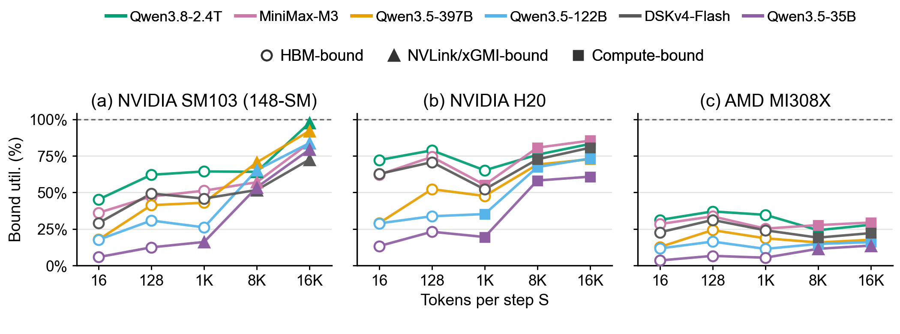
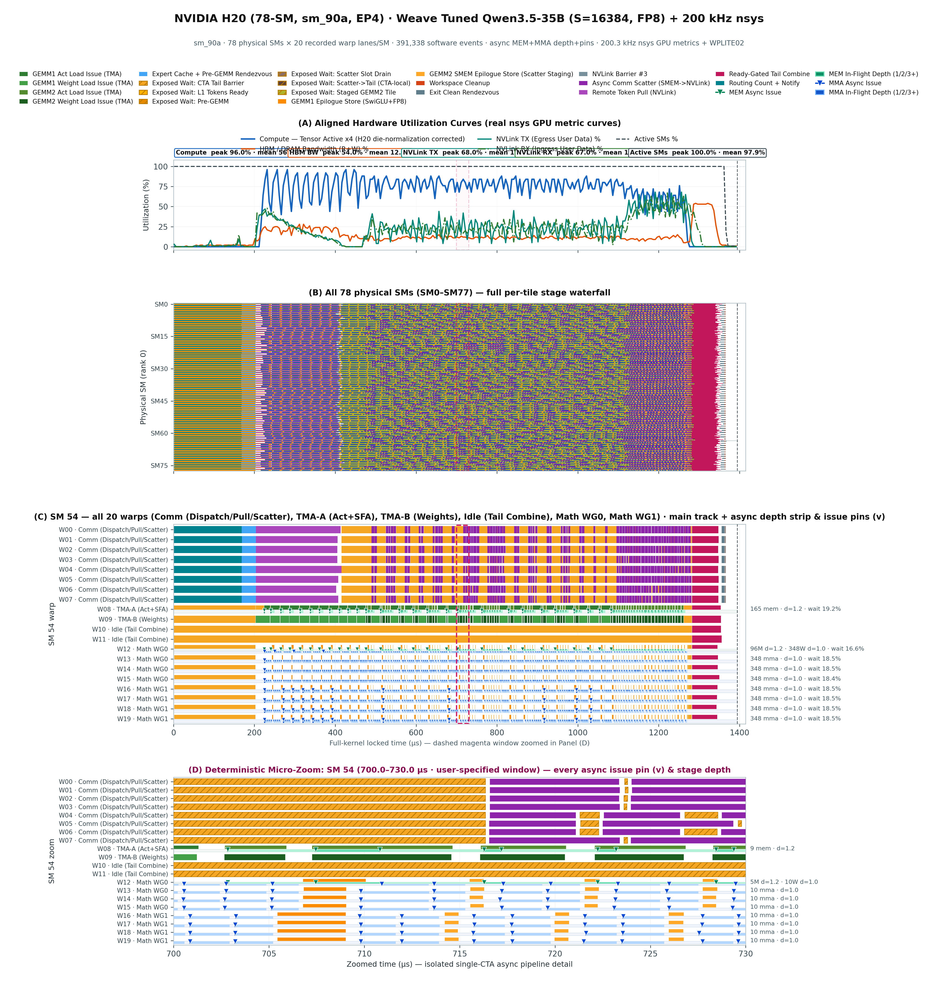

[English](README.md) | [简体中文](README_zh.md)

# Weave: Routing-Adaptive Dynamic Scheduling & Turnkey Autotuning for MoE Megakernels

Weave is a **routing-adaptive, barrier-free (zero inter-operator `grid_sync`) fused MoE megakernel** implemented in unified C++/CUDA/HIP ([Weave: Routing-Adaptive Runtime Warp Scheduling for MoE Megakernels](https://arxiv.org/pdf/2611.27765)), supporting **NVIDIA SM100 / SM103**, **NVIDIA H20 (SM90)**, and **AMD MI308X (CDNA3 gfx942)**. Through **one-time compile-time calibration + zero-env runtime selection**, Weave drives a unified **14-knob surface (Spatial 5 / Temporal 3 / Implementation 6)** to overlap cross-GPU communication with Tensor/Matrix Core execution at fine granularity.

## Architecture and cross-hardware role partitioning

| Hardware platform | Language | Supported precision (`WEAVE_PRECISION_MODE`) | Entry point |
|---|---|---|---|
| NVIDIA SM100 / SM103 (148-SM) | CUDA C++ | `0=fp8xfp4` (default), `1=fp4xfp4` (NVFP4), `3=bf16` | `sm100_fp8_fp4_mega_moe.cuh` / `sm100_fp4_fp4_mega_moe.cuh` |
| NVIDIA H20 (SM90, 78-SM) | CUDA C++ | `2=fp8` (`fp8xfp8`) | `sm90_fp8_mega_moe.cuh` |
| AMD MI308X (gfx942, 80-CU) | HIP C++ | `2=fp8` (`fp8xfp8`, single-node EP8 & 2-node EP16) | `gfx942_fp8_mega_moe.cuh` and `amd/ep16/v70/` |

Weave eliminates coarse inter-operator barriers (`Notify->Pull`, `GEMM1->GEMM2`, and `Scatter->Combine` all synchronize through fine-grained atomic counters and `ld.acquire.sys` readiness gates) across three orthogonal axes:

- **Spatial dimension (5 knobs)**: independently assigns active SMs/CUs for Dispatch pulling (`D`) and async Scatter draining (`K`, $D \neq K$), plus intra-SM/CU warp/wave ratios—NVIDIA SM103 uses `16 warps/CTA` (`4 Comm + 2 TMA + 2 UMMA/CLC + 8 TMEM Epilogue`), NVIDIA H20 uses `20 warps/CTA` (`8 Comm + 2 TMA + 8 Math WG0/1`), and AMD MI308X dynamically switches its 8 Wave64/CU (2-CTA/CU) layout between `0-8` (all 8 compute waves saturating HBM at small `S`) and `4-4` (4 compute + 4 dedicated comm waves overlapping xGMI + GDA RDMA at large `S`).
- **Temporal dimension (3 knobs)**: in the Head phase, `WEAVE_V_HEAD` bounds cooperative helper-warp pulling while `WEAVE_READY_GROUP_SIZE` starts GEMM1 at `N`-tile arrival granularity; in the Middle phase, `WEAVE_SCATTER_OWNER` enforces strict binary scatter ownership (`epilogue_only` vs. `comm_only`) while H20's `7-W` K-block bitmap interleaves `GEMM1 <-> GEMM2` with zero `grid_sync`; in the Tail phase, all warps/waves finishing upstream work join ready-gated Combine reduction.
- **Implementation dimension (6 knobs)**: **GEMM1, GEMM2, Dispatch, and Scatter** select configurations independently—choosing `blockM` via `WEAVE_GEMM1_CONFIG` / `WEAVE_GEMM2_CONFIG` synchronously locks `(blockN, blockK, mainloop_stages, epi_stages)` (default `0` keeps host shape-adaptive tuple selection always on with 0-spill clamping); Dispatch independently configures zero-SMEM register-direct pull width (`WEAVE_REG_PULL_BYTES`: `1024..4096 B/warp` on NVIDIA, `8192 B/wave` on MI308X) and remote pull deduplication (`WEAVE_DEDUP_MODE`); Scatter independently selects `reg_2stage`, bank-conflict-free `smem` ring, or `hbm_dedup` staging (`WEAVE_SCATTER_STAGING`).

## Quick start and turnkey two-stage autotune

    git clone https://github.com/ziyuhuang123/weave.git
    cd weave
    python -m pip install -e .
    python tests/verify_tunable_params_doc.py

On any GPU of a supported architecture family (queried dynamically from runtime device properties with **zero hardcoded SKU names**), tuning takes two steps (full guide in [docs/AUTOTUNE_AND_TUNING_GUIDE.md](docs/AUTOTUNE_AND_TUNING_GUIDE.md)):

    # 1) One-time compile + calibration pass (0-spill gate + per-bucket ABBA search + 4-rule break-even probes)
    python -m deep_gemm.mega.autotune --model qwen3.8-2.4t --num-processes 4

    # 2) Zero-env production inference (weave_mega_moe auto-loads the calibrated JSON; 0 host overhead in CUDA/HIP Graph)
    python -c "from deep_gemm.mega import SymmBuffer, weave_mega_moe"

End-to-end autotune receipts: [results/autotune_e2e_b300_h20.json](results/autotune_e2e_b300_h20.json), [results/autotune_e2e_mi308x_v70.json](results/autotune_e2e_mi308x_v70.json), and cross-SKU compile proof [results/blackwell_sm100a_sm103a_compile_proof.json](results/blackwell_sm100a_sm103a_compile_proof.json) (`1,440` `sm_100a`/`sm_103a` cells with `0` failures):
- **NVIDIA H20 (30 cells)**: zero-env `auto` lands within `2%` of the hand-tuned Oracle on **30/30** cells (`1.13x–1.25x` geomean speedup over official DeepGEMM, up to **`1.69x`**);
- **NVIDIA SM103 (148-SM) (20 cells)**: **19/20** cells land within `2%` of Oracle (`0.973` and `0.992` geomean `auto/Oracle`);
- **AMD MI308X 2-node 16x EP16 (30 cells)**: beats the fastest official baseline on **30/30** cells with **`1.875x`** geomean speedup.

## Measured end-to-end performance and bound-resource utilization

Across all **90 evaluation cells** (3 hardware platforms x 6 models x 5 token counts `S in {16, 128, 1K, 8K, 16K}` on real ShareGPT routing; self-contained ledger [results/bound_utilization_90cells_3hw.json](results/bound_utilization_90cells_3hw.json), renderers `scripts/render_fig7_eval_speedup_3hw.py` and `scripts/render_fig7_bound_utilization_3hw.py`), each system's bound-peak utilization is `100 * T_bound / measured_latency` (`T_bound` = critical-rank roofline floor across HBM, interconnect, and compute). Weave ranks **#1 in 90/90 cells**:

| Platform | Baselines compared | 30-cell geomean speedup (range) | Weave bound-peak util. (GM / range) | Representative large-`S` highlight |
|---|---|---|---|---|
| **8x NVIDIA SM103 (148-SM)**, EP8 | DeepGEMM-MegaMoE, FlashInfer, SGLang, mKernel, FlashMoE, NanoFlow | **`1.219x`** (`1.05x–1.97x`) | `42.9%` (`5.8%–97.6%`) | **`1.97x`** (`97.6%` peak util.) on `Qwen3.5-35B S=16K` |
| **8x NVIDIA H20 (SM90)**, EP8 | DeepGEMM-MegaMoE, FlashInfer | **`1.212x`** (`1.01x–1.61x`) | `53.6%` (`13.3%–85.5%`) | **`1.18x–1.61x`** at `S <= 1K`; `85.5%` compute peak at `S=16K` |
| **16x AMD MI308X (CDNA3)**, 2-node EP16 | AITER-1stage, vLLM (RCCL + 2-stage CK) | **`1.875x`** (`1.06x–2.87x`) | `21.6%` (mean `34.2%`, `1.4%–92.0%`) | **`58.0%–92.0%`** bound util. across all 6 models at `S=16K` (`25 GB/s/GPU` 4x400GbE RDMA & `398.7 TFLOPS` SKU peak) |

### Same-precision platform highlights

- **NVIDIA H20 (4x EP4, zero-`grid_sync` fused kernel vs. upstream official DeepGEMM)**: 72/72 full-tensor checks pass (500 back-to-back launches + 100 alternating uniform/skew launches per cell, `max calc_diff = 3.96e-4`; receipts [results/h20_ep4_nogridsync_verified.json](results/h20_ep4_nogridsync_verified.json) and [results/h20_ep4_pure21_live_sweep.json](results/h20_ep4_pure21_live_sweep.json)), reaching **`1.49x–1.51x`** on `Qwen3.8-Max S=1024` (`3246 -> 2174 us`), **`1.16x`** at `S=4096`, and **`1.25x`** on `Qwen3.5-35B S=16384`.
- **AMD MI308X (2-Node 16x EP16, V70 2-CTA/CU Path-B `160x256` champion vs. `RCCL + AITER`)**: all 21 `.co` variants compile at `256 VGPR / 106 SGPR / 0 spill`, passing 576/576 16-rank full-element FP64 checks ([results/ep16_mi308x_v70_16gpu_champion.json](results/ep16_mi308x_v70_16gpu_champion.json)):

| Model (16x MI308X EP16) | `S` | Weave V70 | Prior V62 | RCCL + AITER | V70 vs. RCCL + AITER |
|---|---:|---:|---:|---:|---:|
| `Qwen3.8-Max` 2.4T | `16384` | **`6,981.1 us`** | `8,042.6 us` | `17,156.9 us` | **`2.458x`** |
| `Qwen3.5-397B` | `16384` | **`2,363.4 us`** | `2,805.8 us` | `6,955.1 us` | **`2.943x`** |
| `MiniMax M3` | `16384` | **`3,519.2 us`** | `4,328.6 us` | `7,876.9 us` | **`2.238x`** |
| `DeepSeek-V4-Flash` | `16384` | **`2,573.0 us`** | `3,037.9 us` | `5,969.4 us` | **`2.320x`** |
| `Qwen3.5-122B` | `8192` | **`1,091.1 us`** | `1,362.6 us` | `2,374.1 us` | **`2.176x`** |
| `Qwen3.5-35B` | `8192` | **`850.0 us`** | `1,097.1 us` | `1,562.2 us` | **`1.838x`** |

- **NVIDIA SM103 (148-SM, 4x EP4, `FP8 x MXFP4`, `E=256`)**: palindromic solo ABBA vs. upstream official DeepGEMM ([results/sm103_ep4_vs_official_solo_summary.json](results/sm103_ep4_vs_official_solo_summary.json)) achieves **`292.86 us` vs. `294.91 us` (`1.007x`)** at `S=1024` (`WEAVE_DISPATCH_ACTIVE_SMS=40`) and parity at `S=4096` (`399.44` vs. `399.38 us`) with 10-launch bit-exactness.

## WeaveProfiler software + hardware timelines

Each 4-panel figure is a same-run software + hardware capture (Panel A: hardware utilization curves; Panel B: all physical SM/CU lanes; Panel C: representative CTA's full warp/wave tracks and async depth strips; Panel D: deterministic micro-zoom):

- **NVIDIA SM103 (148-SM), 4x EP4, `Qwen3.8-2.4T S=1024` (`FP8 x NVFP4`)**: 200 kHz `nsys` capture across all 16 warps (`W00..W15`), 0 spill, 4/4 rank bit-exactness, `+9.28%` warm ABBA overhead. HBM bandwidth peaks at **`82.0%`** (mean `72.8%`) and Active SMs average **`98.6%`** (`0.14%` imbalance across 148 SMs), with `MEM`/`MMA` async in-flight strips and issue pins.
- **NVIDIA H20 (78-SM), 4x EP4, `Qwen3.5-35B S=16384` (`FP8`, zero-`grid_sync` fused engine)**: 200 kHz `nsys` capture across all 20 warps (`W00..W19`), `+8.84%` warm ABBA overhead. With inter-operator `grid_sync` eliminated, `Tensor Active x4` stays continuously at **`75–100%`** (peak `96.0%`, zero mid-kernel barrier valley), `W00..W07` overlap `Async Comm Scatter (SMEM->NVLink)` immediately after pull completes, and Panel D (`700–730 us`) shows concurrent `WGMMA + TMA + NVLink Scatter`.
- **AMD MI308X (80-CU), 2-node 16x EP16, `Qwen3.8-Max S=16384` (V70 `4-4` build)**: same-run capture across all 80 CUs and all 8 Wave64s of CU 0 (`W00..W03`: `Compute / Combine`, `W04..W07`: `Comm / Dispatch & Async Scatter`), `256 VGPR / 0 spill`. `rocprofiler-sdk` curves show FP8 Matrix Core utilization sustained at **`50–62%`** (of the `398.7 TFLOPS` SKU peak) under 2-node RDMA, full-duplex xGMI TX/RX, and `100.0%` Active CUs.

## Unified core WEAVE_* parameters

The public surface is strictly **14 knobs in 3 categories** (Spatial 5 / Temporal 3 / Implementation 6). Every row reports **verified same-batch measured gains** (ledgers: `results/ep16_mi308x_v70_16gpu_champion.json`, `results/h20_v12_comm_bound_sweep.json`, `results/sm103_v3_clean_config_sweep.json`, `results/sm103_qwen38max_full_sweep.json`) alongside machine-verified `file:line` citations (`tests/verify_tunable_params_doc.py`); full per-hardware value grammar is in [docs/TUNABLE_PARAMETERS.md](docs/TUNABLE_PARAMETERS.md) and tuning workflow in [docs/AUTOTUNE_AND_TUNING_GUIDE.md](docs/AUTOTUNE_AND_TUNING_GUIDE.md).

### Spatial

| Parameter | Category | Values (`0` = default / auto) | Mechanism | Measured gain (same-batch ABBA) | Code (`host` / `kernel`) |
|---|---|---|---|---|---|
| `WEAVE_DISPATCH_ACTIVE_SMS` | Spatial | `0=auto`, `D=1..N` (`D != K`) | Active SMs/CUs pulling remote tokens; remaining SMs prefetch/compute immediately | **1.41x** MI308X EP16 (`auto` vs `2`: `1431->1015 us`); **1.007x** SM103 (`D=40`: `294.9->292.9 us`) | `csrc/jit_kernels/heuristics/weave_knob_config.hpp:173` / `deep_gemm/include/deep_gemm/impls/sm100_fp8_fp4_mega_moe.cuh:4073` |
| `WEAVE_SCATTER_ACTIVE_SMS` | Spatial | `0=auto`, `K=1..N` (`K != D`) | Active SMs/CUs draining async scatter queue; tail Combine still uses all SMs | **1.015x** MI308X EP16 (`1030->1015 us`); **1.013x** H20 `S=4K` (`K=39`: `5299->5233 us`) | `csrc/jit_kernels/impls/sm100_fp8_fp4_mega_moe.hpp:204` / `deep_gemm/include/deep_gemm/impls/sm100_fp8_fp4_mega_moe.cuh:554` |
| `WEAVE_DISPATCH_WARPS` | Spatial | `0=default`, `4`, `8` | Per-CTA communication warps assigned to remote token/scale pulling | **1.17x** H20 `S=16K` (`8` vs `4`: `1644->1403 us`, `-14.6%`) | `csrc/jit_kernels/heuristics/weave_knob_config.hpp:146` / `deep_gemm/include/deep_gemm/impls/sm100_fp8_fp4_mega_moe.cuh:1134` |
| `WEAVE_SCATTER_WARPS` | Spatial | `0=default`, `4`, `8` | Per-CTA communication warps/waves dedicated to async FC2 scatter | **1.17x** H20 `S=16K` (`1644->1405 us`); **1.04x** MI308X EP16 (`8` vs `4`: `1015->976 us`) | `csrc/jit_kernels/impls/sm100_fp8_fp4_mega_moe.hpp:195` / `deep_gemm/include/deep_gemm/impls/sm100_fp8_fp4_mega_moe.cuh:529` |
| `WEAVE_CU_WAVE_SPLIT` | Spatial | MI308X: `auto, 0-8, 4-4, 8-0`; H20: `auto/7-W, 5-E, 6-E` | MI308X per-CU 8-wave comm/compute split; H20 zero-`grid_sync` L1/L2 K-bitmap interleave | **2.15x** MI308X EP16 (`4-4` vs `0-8`: `2185->1015 us`); **1.053x** H20 `S=8K` (`926->880 us`) | `csrc/jit_kernels/heuristics/weave_knob_config.hpp:167` / `deep_gemm/include/deep_gemm/impls/amd/ep8/megamoe_amd_ep8.hip:80` |

### Temporal

| Parameter | Category | Values (`0` = default / auto) | Mechanism | Measured gain (same-batch ABBA) | Code (`host` / `kernel`) |
|---|---|---|---|---|---|
| `WEAVE_V_HEAD` | Temporal | `0=auto`, `N=1..65536` | Head cooperative helper-warp pull quota before compute warps enter GEMM1 | **1.088x** H20 `S=8K` (`4096`: `941.5->865.3 us`, `-8.1%`); **1.043x** MI308X (`1015->973 us`) | `csrc/jit_kernels/heuristics/weave_knob_config.hpp:177` / `deep_gemm/include/deep_gemm/scheduler/weave_cost_model.cuh:30` |
| `WEAVE_READY_GROUP_SIZE` | Temporal | `0=full expert`, `1, 2, 4, 8, 16` | Fine-grained N-tile arrival publication so GEMM1 starts before full expert arrives | **1.030x** MI308X EP16 (`1` vs `16`: `1015->985 us`); **1.009x** H20 `S=4K` (`5337->5289 us`) | `csrc/jit_kernels/impls/sm100_fp8_fp4_mega_moe.hpp:131` / `deep_gemm/include/deep_gemm/impls/sm100_fp8_fp4_mega_moe.cuh:111` |
| `WEAVE_SCATTER_OWNER` | Temporal | `0=epilogue_only`, `1=comm_only` | Strict binary FC2 scatter ownership to overlap cross-GPU writes with ongoing GEMM | **1.14x** H20 `S=16K` (`comm_only`: `1244->1094 us`, `-12.0%`); **1.034x** MI308X (`1015->981 us`) | `csrc/jit_kernels/heuristics/weave_knob_config.hpp:260` / `deep_gemm/include/deep_gemm/impls/sm100_fp8_fp4_mega_moe.cuh:1780` |

### Implementation

| Parameter | Category | Values (`0` = default / auto) | Mechanism | Measured gain (same-batch ABBA) | Code (`host` / `kernel`) |
|---|---|---|---|---|---|
| `WEAVE_PRECISION_MODE` | Implementation | `0=fp8xfp4`, `1=fp4xfp4`, `2=fp8`, `3=bf16` | Selects Tensor/Matrix Core numeric format and backend across GEMM1 & GEMM2 | **1.59x** SM103 `S=16K` (`fp4xfp4` vs `fp8xfp4`: `1038->654 us`); **1.010x** H20 `fp8` (`5276->5224 us`) | `csrc/jit_kernels/heuristics/weave_knob_config.hpp:389` / `deep_gemm/include/deep_gemm/scheduler/weave_cost_model.cuh:25` |
| `WEAVE_GEMM1_CONFIG` | Implementation | `0=auto` or `BM[:STORE_BM[:BK[:ST[:EPI]]]]` (`16..256`; alias `WEAVE_BLOCK_M_L1`) | Independent FC1 tuple selector; locks paired `BN/BK/stages/epi_stages` (0-spill clamped) | **1.51x** H20 `S=16K` (`BM=128`: `1651->1091 us`, `-33.9%`); **1.047x** SM103 (`96,16`: `766->731 us`) | `csrc/jit_kernels/heuristics/weave_knob_config.hpp:113` / `deep_gemm/include/deep_gemm/impls/sm100_fp8_fp4_mega_moe.cuh:1253` |
| `WEAVE_GEMM2_CONFIG` | Implementation | `0=follow/auto` or `BM[...]` (`16..256`; alias `WEAVE_BLOCK_M_L2`) | Independent FC2 tuple selector decoupled from GEMM1 (e.g. `32/64` or `96,16` + `96,8`) | **1.036x** MI308X EP16 (`64` vs `32`: `1051->1015 us`); **1.025x** H20 `32/64` (`2234->2178 us`) | `csrc/jit_kernels/heuristics/weave_knob_config.hpp:116` / `deep_gemm/include/deep_gemm/impls/sm100_fp8_fp4_mega_moe.cuh:1255` |
| `WEAVE_REG_PULL_BYTES` | Implementation | `0=SMEM`, `1024, 2048, 4096` (NV), `8192` (MI308X) | Zero-SMEM register-direct remote pull width per warp/wavefront (frees SMEM/LDS stages) | **1.19x** MI308X EP16 (`8192` vs `1024`: `1212->1015 us`); **1.024x** SM103 (`4096`: `618.5->604.1 us`) | `csrc/jit_kernels/impls/sm100_fp8_fp4_mega_moe.hpp:135` / `deep_gemm/include/deep_gemm/impls/sm100_fp8_fp4_mega_moe.cuh:143` |
| `WEAVE_DEDUP_MODE` | Implementation | `0=off`, `1=on` (unset=arch default) | Remote pull deduplication: pulls unique `(src_rank, token)` once and fans out locally | **1.067x** H20 `S=16K` (`1644->1540 us`); **1.023x** MI308X EP16 (`1` vs `0`: `1038->1015 us`) | `csrc/jit_kernels/impls/sm100_fp8_fp4_mega_moe.hpp:170` / `deep_gemm/include/deep_gemm/impls/sm100_fp8_fp4_mega_moe.cuh:443` |
| `WEAVE_SCATTER_STAGING` | Implementation | `0=reg_2stage`, `1=smem`, `2=hbm_dedup` | Scatter staging data path (2-stage regs, XOR-swizzled SMEM ring, or L2/HBM dedup) | **1.14x** H20 `S=16K` (`smem` vs `reg_2stage`: `1244->1094 us`); **1.010x** MI308X (`1025->1015 us`) | `csrc/jit_kernels/heuristics/weave_knob_config.hpp:265` / `deep_gemm/include/deep_gemm/impls/sm100_fp8_fp4_mega_moe.cuh:1786` |

### Retired internal knobs and legacy aliases

The public surface is strictly the **14 knobs** above (Spatial 5 / Temporal 3 / Implementation 6), and **every one of the 14 knobs delivers a verified positive speedup** in same-batch ABBA sweeps on its target regime. Six former knobs (`WEAVE_REDUCE_WARPS`, `WEAVE_COMBINE_SYNC_CHUNK`, `WEAVE_REG_BALANCE`, `WEAVE_LOCAL_SCATTER_DEDUP`, `WEAVE_SM0_STREAM_SCHED`, `WEAVE_READY_QUEUE`) are retired to internal compile-time macros (default `0`) and host diagnostics; `WEAVE_ADAPT_GEMM_CONFIG` (legacy alias `WEAVE_ADAPT_BM`) is likewise non-public—host shape-adaptive GEMM tuple selection is ALWAYS ON when `WEAVE_GEMM1_CONFIG=0` and `WEAVE_GEMM2_CONFIG=0` (`=0` stays accepted only as an internal canonical-tuple diagnostic). Transparent legacy aliases:

- legacy `WEAVE_BLOCK_M_L1` -> `WEAVE_GEMM1_CONFIG`
- legacy `WEAVE_BLOCK_M_L2` -> `WEAVE_GEMM2_CONFIG`

`num_shared_experts` is a Python/C++ API argument (default `0`; shared-expert buffers are allocated only when non-zero).

### Known limitations

Summary of measured and audited boundaries (full details in [docs/TUNABLE_PARAMETERS.md](docs/TUNABLE_PARAMETERS.md)):

**NVIDIA SM103**

- The internal `WEAVE_LOCAL_SCATTER_DEDUP=1` pin (retired) near-livelocks (`81-363 ms` at `S=1024..8192`); do not enable on SM103.
- Manual `BM=128` + `EPI=2` is clamped to `EPI=1` by the host (`BM128 epi2` spills `208 B/304 B`, whereas `BM128 epi1` and `BM80/96 epi2` compile with `0` spill). Legacy `WEAVE_ADAPT_GEMM_CONFIG=1` (`WEAVE_ADAPT_BM=1`, compat-only) previously triggered `misaligned address` at `S >= 4096` when driving device-side per-expert sub-tiling; the current always-on host adaptive selector binds launch-level tuples only.
- Internal `WEAVE_REDUCE_WARPS > 0` is slower than `0` (`315-317 us` vs. `295 us` at `S=1024`); `WEAVE_REG_BALANCE=1` only activates at `E/rank > 64`; `WEAVE_CU_WAVE_SPLIT` is parsed as a no-op on SM103; online CTA-0 policy compiles in only with internal `WEAVE_SM0_STREAM_SCHED=1` or `WEAVE_READY_QUEUE=sm0_fifo`.

**NVIDIA H20**

- 4-warpgroup Swap-AB launches show `~1e-8` BF16 last-bit repeat variance (`calc_diff ~ 3.55e-4 < 1e-3`, `cos > 0.9996` vs. FP32).
- Decoupled split with `WEAVE_GEMM1_CONFIG=64` (`WEAVE_BLOCK_M_L1=64`) is rejected (split L1 spills); use `16`/`32` or fused equal `BM`. Pinned GEMM1/GEMM2 tuples override host adaptive selection.
- Internal `WEAVE_REDUCE_WARPS=1/2` is `1.0-2.5%` slower than `0`; internal `WEAVE_COMBINE_SYNC_CHUNK > 0` is not part of any winner. On fused H20, `WEAVE_CU_WAVE_SPLIT` defaults to barrier-free `7-W` (legacy coarse-barrier modes `0..4` are rejected).

## Baselines, ablation, and verification gates

- **Launch scripts & baselines**: [examples/README.md](examples/README.md), [baselines/README.md](baselines/README.md), [ablation/README.md](ablation/README.md). Progressive 48-cell ablation (paper Table IV) reaches `1.301x / 1.162x / 2.147x` geomean speedup on SM103 / H20 / MI308X EP16 (`1.192x / 1.137x / 1.808x` without Spatial `-S`; `1.010x / 1.053x / 1.537x` without `-S-T`).
- **AMD MI308X EP16 V70 build & autotune**: `python deep_gemm/include/deep_gemm/impls/amd/ep16/v70/build_v70.py --dry-run` (verifies source closure without ROCm) or `v70_autotune.py`.
- **Repository verification gates**:

    python tools/gen_tunable_params_doc.py --check
    python tests/verify_tunable_params_doc.py
    python tests/check_weave_knob_schema.py
    python tests/test_21_weave_knobs_surface.py
    python tests/test_no_inter_op_grid_sync.py
    python tests/test_autotune_and_runtime_selector.py
    python tests/test_ep16_v70_champion.py

## Citation

Ziyu Huang, Yangjie Zhou, Chenhao Zhu, Hongzhe Yan, Tianwei Qiao, Sicheng He, Zihan Liu, Peng Yu, Shulai Zhang, Xingxun Tang, Xinhao Luo, Minyi Guo, Xiu Lin, Yinghao Yu, Guodong Yang, Liping Zhang, Shixuan Sun, Qingyun Chen, and Jingwen Leng. Weave: Routing-Adaptive Runtime Warp Scheduling for MoE Megakernels. arXiv:2611.27765, 2026. [PDF](https://arxiv.org/pdf/2611.27765) | [arXiv](https://arxiv.org/abs/2611.27765)

    @misc{huang2026weaveroutingadaptiveruntimewarp,
          title={Weave: Routing-Adaptive Runtime Warp Scheduling for MoE Megakernels},
          author={Ziyu Huang and Yangjie Zhou and Chenhao Zhu and Hongzhe Yan and Tianwei Qiao and Sicheng He and Zihan Liu and Peng Yu and Shulai Zhang and Xingxun Tang and Xinhao Luo and Minyi Guo and Xiu Lin and Yinghao Yu and Guodong Yang and Liping Zhang and Shixuan Sun and Qingyun Chen and Jingwen Leng},
          year={2026},
          eprint={2611.27765},
          archivePrefix={arXiv},
          primaryClass={cs.DC},
          url={https://arxiv.org/pdf/2611.27765},
    }
