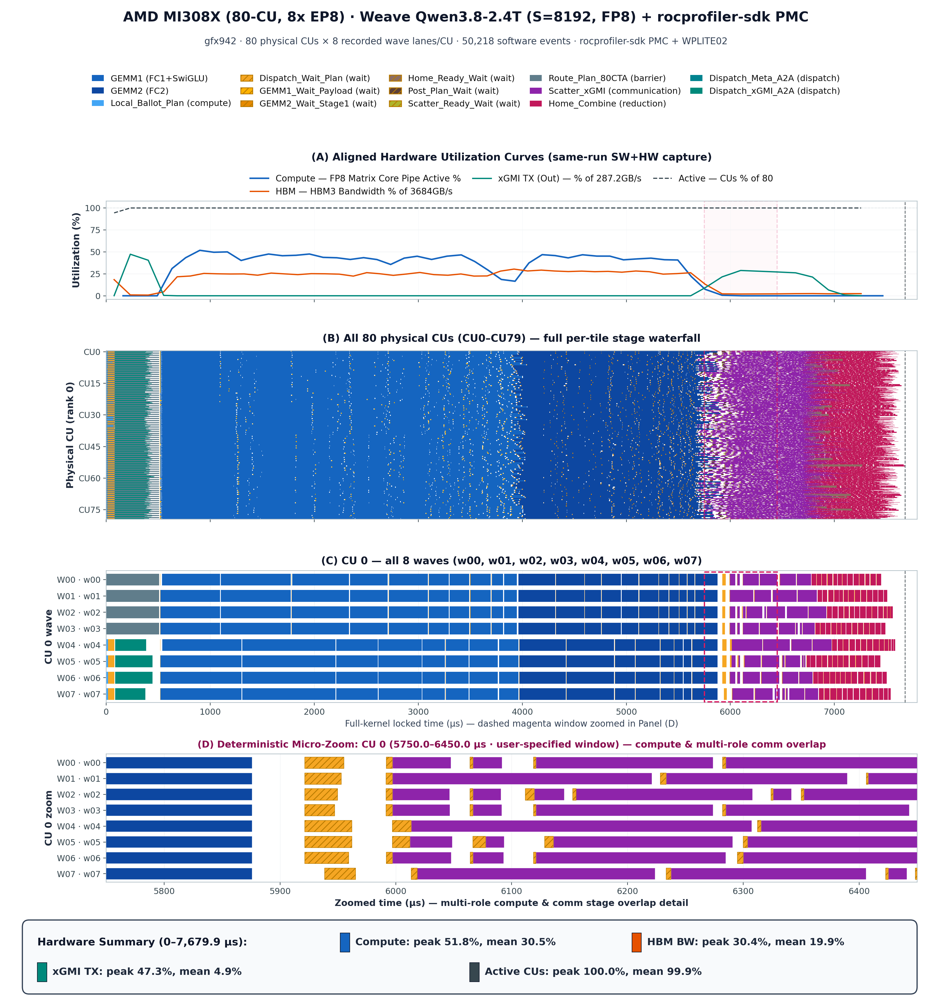

[English](README.md) | [简体中文](README_zh.md)

# Weave：面向 MoE Megakernel 的路由自适应动态调度系统

Weave 是一个面向混合专家（MoE）推理的路由自适应融合 Megakernel 系统（C++/CUDA/HIP 统一实现，论文：[Weave: Routing-Adaptive Runtime Warp Scheduling for MoE Megakernels](https://arxiv.org/pdf/2611.27765)），支持 **NVIDIA SM100 / SM103**、**NVIDIA H20（SM90）** 与 **AMD MI308X（CDNA3 gfx942）**。针对动态 Token 路由造成的跨卡、跨 SM/CU 以及不同执行阶段之间的负载失衡，Weave 联合优化空间资源配比、时间阶段角色切换与四算子独立实现配置，使跨卡通信与 Tensor / Matrix Core 计算细粒度重叠。

## 架构概览与多粒度调度设计

| 硬件平台 | 编程语言 | 支持精度（`WEAVE_PRECISION_MODE`） | 内核入口 |
|---|---|---|---|
| NVIDIA SM100 / SM103 (148-SM) | CUDA C++ | `0=fp8xfp4`（默认）、`1=fp4xfp4`（NVFP4）、`3=bf16` | `sm100_fp8_fp4_mega_moe.cuh` / `sm100_fp4_fp4_mega_moe.cuh` |
| NVIDIA H20（SM90, 78-SM） | CUDA C++ | `2=fp8`（`fp8xfp8`） | `sm90_fp8_mega_moe.cuh` |
| AMD MI308X（gfx942, 80-CU） | HIP C++ | `2=fp8`（`fp8xfp8`，单机 EP8 与双机 EP16） | `gfx942_fp8_mega_moe.cuh` 与 `amd/ep16/` |


Weave 通过离线硬件特征校准与在线轻量级代价模型，在三个正交维度上协同调度 **14 个统一参数（空间 5 / 时间 3 / 实现 6）**：

- **多粒度空间调度（Spatial，5 个参数）**：同时覆盖三个空间层级——
  1. **跨 GPU 独立决策**：各卡根据本卡实时路由直方图（每专家 Token 数 $m_e$、唯一拉取数 $D_{\text{in}}$、跨卡写出数 $M_{\text{out}}$）独立选择本卡调度方案 $(r_g, s_g)$，通过点对点就绪队列解耦执行；
  2. **同卡跨 SM/CU 异构配比**：同一张 GPU 上的不同 SM/CU 可运行不同的通算配比（例如前 $k$ 个通信富集 SM/CU 与其余 $N-k$ 个计算富集 SM/CU 同驻混合），并独立控制参与远端拉取的 SM/CU 数 $D$ 与参与异步写出的 SM/CU 数 $K$（支持 $D \neq K$），在平滑调节整卡通信带宽的同时保证全卡所有 SM/CU 的 Tensor / Matrix Core 全程参与矩阵计算；
  3. **单 SM/CU 内 Warp/Wave 分工**：NVIDIA SM103（16 warps/SM）、NVIDIA H20（20 warps/SM）与 AMD MI308X（8 Wave64/CU，动态混合 `(0,8)` 全算力 CU 与 `(4,4)` 通算同驻 CU）按架构原生并发单元切分通信、异步加载与矩阵/尾声计算角色。
- **动态时间角色切换（Temporal，3 个参数）**：同一硬件执行单元在层内按阶段动态切换角色——**首部阶段**借用空闲计算/尾声 warp 协助完成定量 $V_{\text{head}}$ 远端拉取，并按 $N$ 个 tile 粒度提前触发热点专家 GEMM1；**中部阶段**将完成拉取的通信 warp 转为后台异步 FC2 Scatter（`comm_only`）或在尾声内直接发出（`epilogue_only`），同时通过块级就绪位图/队列流水衔接 GEMM1 与 GEMM2；**尾部阶段**按逐 Token 到达计数（$k/k$）唤醒全部空闲 warp/wave 协同完成加权 Combine 归约。
- **四算子独立实现配置（Implementation，6 个参数）**：为 **GEMM1、GEMM2、Dispatch、Scatter** 分别提供独立的实现参数——`WEAVE_GEMM1_CONFIG` 与 `WEAVE_GEMM2_CONFIG` 独立选择各自的分块尺寸、主循环流水级数与多级尾声寄存器流水（`EPI=1..4`）；Dispatch 独立选择寄存器直传拉取宽度（`WEAVE_REG_PULL_BYTES`）与多专家命中跨卡去重（`WEAVE_DEDUP_MODE`）；Scatter 独立选择多级寄存器直传（`reg`）、片上共享内存异步写出（`smem`）或显存预合并缓冲（`hbm`）通路（`WEAVE_SCATTER_STAGING`）。

## 快速开始与自动调参

```bash
git clone https://github.com/ziyuhuang123/weave.git
cd weave
python -m pip install -e .
```

在新硬件环境上，可先对目标模型形状运行一次离线自动校准生成本机配置文件，随后在线推理直接调用 `weave_mega_moe` 即可自动按实时路由选择配置（详见 [docs/AUTOTUNE_AND_TUNING_GUIDE.md](docs/AUTOTUNE_AND_TUNING_GUIDE.md)）：

```bash
# 1. 对当前硬件与模型形状执行一次性离线校准
python -m deep_gemm.mega.autotune --model qwen3.8-2.4t --num-processes 4

# 2. 在线推理直接调用统一接口（自动加载本机配置，亦可随时用 WEAVE_* 环境变量显式覆盖）
python -c "from deep_gemm.mega import SymmBuffer, weave_mega_moe"
```

## 端到端性能与硬件瓶颈利用率评测


在三类硬件平台、6 个主流 MoE 模型与 5 档全局 Token 数 `S in {16, 128, 1K, 8K, 16K}` 组成的 **90 个真实 ShareGPT 路由评测点**（数据见 [results/bound_utilization_90cells_3hw.json](results/bound_utilization_90cells_3hw.json)）上，定义瓶颈硬件利用率为 `100 * T_bound / 实测时延`（`T_bound` 为关键 rank 上 HBM 带宽、跨卡互连与张量核峰值三项物理下界的最大值），Weave 在全部评测点均取得最优端到端延迟：

| 平台配置 | 对比基线 | 30 组几何平均加速比（区间） | 瓶颈硬件利用率（几何平均 / 区间） | 代表性大批量表现 |
|---|---|---|---|---|
| **8x NVIDIA SM103 (148-SM)**, EP8 | DeepGEMM-MegaMoE, FlashInfer, SGLang, mKernel, FlashMoE, NanoFlow | **`1.219x`**（`1.05x–1.97x`） | `42.9%`（`5.8%–97.6%`） | `Qwen3.5-35B S=16K` 达 **`1.97x`**（峰值利用率 `97.6%`） |
| **8x NVIDIA H20 (SM90)**, EP8 | DeepGEMM-MegaMoE, FlashInfer | **`1.212x`**（`1.01x–1.61x`） | `53.6%`（`13.3%–85.5%`） | `S <= 1K` 达 **`1.18x–1.61x`**；`S=16K` 达 `85.5%` 算力峰值 |
| **16x AMD MI308X (CDNA3)**, 双机 EP16 | AITER-1stage, vLLM (RCCL + 2-stage CK) | **`1.875x`**（`1.06x–2.87x`） | `21.6%`（算术均值 `34.2%`，`1.4%–92.0%`） | `S=16K` 六模型瓶颈利用率达 **`58.0%–92.0%`** |

在双节点 **16x AMD MI308X（EP16，xGMI + GDA RDMA）** 大批量场景下，Weave 与最强官方基线（`AITER-1stage` / `vLLM 2-stage`，与图及 [results/mi308x_ep16_weave_best_30cells.csv](results/mi308x_ep16_weave_best_30cells.csv) 严格一致）的实测延迟对比如下：

| 模型（16x MI308X EP16） | 全局 Token 数 `S` | Weave | 最强官方基线 | 加速比 |
|---|---:|---:|---:|---:|
| `Qwen3.8-Max` 2.4T | `16384` | **`6,981.1 us`** | `17,840.4 us` | **`2.556x`** |
| `Qwen3.5-397B` | `16384` | **`2,363.4 us`** | `6,499.1 us` | **`2.750x`** |
| `MiniMax M3` | `16384` | **`3,519.2 us`** | `8,100.0 us` | **`2.302x`** |
| `DeepSeek-V4-Flash` | `16384` | **`2,573.0 us`** | `4,989.0 us` | **`1.939x`** |
| `Qwen3.5-122B` | `16384` | **`1,728.6 us`** | `4,172.8 us` | **`2.414x`** |
| `Qwen3.5-35B` | `16384` | **`1,284.7 us`** | `2,665.1 us` | **`2.075x`** |

在单机 **8x AMD MI308X（EP8）** 上，引入 CDNA3 AGPR 双累加器 `BK=128` MFMA 主循环（单算子稠密 FP8 GEMM 实测 **`443.4 TFLOPS`**，达动态主频管线上限 `461.3T` 的 **`96.1%`**）并融合 Stage-2 `BN=256` Split-B 与 `BM=64` XCD-L2 复用（`232 VGPR / 0 spill`，`1 CTA/CU`）后，全 30 格相对 `AITER` 几何平均加速 **`1.255x`**（**6/6 模型全部领先 `AITER`**，相对最强官方 EP8 基线 **`1.084x`**；完整回执见 [results/ep8_mi308x_agpr_champion_30cells.json](results/ep8_mi308x_agpr_champion_30cells.json)）：

| 模型（8x MI308X EP8） | 5 档 `S` 几何平均 vs `AITER` | `S=1024` 延迟 | `S=8192` 延迟 | `S=16384` 延迟 |
|---|---:|---:|---:|---:|
| `MiniMax M3` | **`1.471x`** | `1,005.5 us` | `4,264.3 us` | `7,960.9 us` |
| `Qwen3.5-122B` | **`1.417x`** | `691.5 us` | `2,410.5 us` | `4,457.0 us` |
| `Qwen3.5-35B` | **`1.375x`** | `545.7 us` | `1,685.8 us` | `3,122.5 us` |
| `Qwen3.5-397B` | **`1.194x`** | `1,045.9 us` | `3,238.5 us` | `6,134.6 us` |
| `Qwen3.8-Max` 2.4T | **`1.073x`** | `2,005.5 us` | `7,722.2 us` | `14,605.4 us` |
| `DeepSeek-V4-Flash` | **`1.063x`** | `971.0 us` | `2,966.5 us` | `5,902.6 us` |

## WeaveProfiler 软硬件对齐时间线




四张四面板时间线均由 WeaveProfiler 在同一次内核执行中同步采集软件阶段轨迹与硬件性能计数器（Panel A：对齐的硬件资源利用率曲线；Panel B：全卡物理 SM/CU 瀑布图；Panel C：代表性 SM/CU 全量 Warp/Wave64 角色轨道；Panel D：确定性微观时间窗放大）。AMD MI308X 的 Panel A 统一采用动态主频周期域占空比 `100 * dSQ_VALU_MFMA_BUSY_CYCLES / (80 * dGRBM_GUI_ACTIVE)` 标定，消除规格表 `398.7T` 静态分母失真：

- **NVIDIA SM103 (148-SM)，4x EP4，`Qwen3.8-2.4T S=1024`（`FP8 x NVFP4`）**：200 kHz `nsys` 硬件采样对齐全部 148 个物理 SM 与 SM 42 的 16 个 warp。首部 `V_HEAD` 协助拉取快速喂满首轮输入，主体阶段 HBM 带宽峰值达 **`92.0%`**（全程均值 `72.8%`）、活跃 SM 均值 **`98.6%`**，Panel C/D 同步呈现逐 warp 的 `MEM d=0..19` 与 `MMA d=0..1` 异步流水线在途深度带及发射针标。
- **NVIDIA H20 (78-SM)，4x EP4，`Qwen3.5-35B S=16384`（`FP8`）**：200 kHz `nsys` 硬件采样对齐 78 个物理 SM 与 SM 54 的 20 个 warp。通信 warp（`W00..W07`）在完成远端拉取后无缝切换为后台 `smem` 异步 Scatter，使 Tensor Core 利用率持续稳定在 **`75%–96%`**，Panel C/D（`700–730 us`）清晰展示 `MEM d=0..2`、`MMA d=0..1` 异步流水深度与 `NVLink Scatter` 的三路并发重叠。
- **AMD MI308X (80-CU)，双机 16x EP16，`Qwen3.8-2.4T S=16384`（`FP8`）**：`rocprofiler-sdk` DCS 硬件计数器同步对齐全部 80 个物理 CU（`0–6,633.0 us`，`overflow 0`，`0 spill`），展示 `(0,8)` 纯计算 CU 与 `(4,4)` 通算混合 CU 的跨单元协同；在混合单元 `CU 62`（`3520–3820 us` 微观窗口）上，`W00..W03` 持续运行 Stage-1/Stage-2 MFMA 计算，`W04..W07` 并发重叠节点间 RDMA 与节点内 `xGMI` 传输。经动态主频周期域标定后，整卡 FP8 Matrix Core 管线占空比峰值达 **`62.2%`**（全程均值 `41.4%`；`540/640` 计算 Wave 池等效 **`73.7%`**），HBM3 带宽峰值 **`33.1%`**（均值 `20.5%`）、节点内 `xGMI TX` 峰值 **`60.5%`**、`xGMI RX` 峰值 **`15.0%`**、活跃 CU **`100.0%`**（GPU 直发绕过主机网卡统计的跨机 RDMA 计数器显式标注而不补零）。
- **AMD MI308X (80-CU)，单机 8x EP8，`Qwen3.8-2.4T S=8192`（`FP8`）**：基于最新 AGPR/MFMA 单核的 `rocprofiler-sdk` DCS 同次采集（`0–7,679.9 us`，`overflow 0`，`239 VGPR / 0 spill`），对齐全部 80 个物理 CU 与 `CU 0` 的 8 条 Wave（`5750–6450 us` 微观窗口展示 `GEMM2 -> Scatter_xGMI -> Home_Combine` 的全 8-Wave 时间角色切换）。8 条 Wave 在完成开场分发后全部切入 8-Wave 全算力矩阵计算，FP8 Matrix Core 管线占空比峰值达 **`51.8%`**（均值 `30.5%`）、HBM3 带宽峰值 **`30.4%`**（均值 `19.9%`）、`xGMI TX` 峰值 **`47.3%`**、活跃 CU 峰值 **`100.0%`**（均值 `99.9%`）。

## 统一核心 WEAVE_* 参数

Weave 通过统一的 **14 个参数（空间 5 / 时间 3 / 实现 6）** 控制跨卡、跨 SM/CU、单 SM/CU 内配比，以及时间角色切换与四算子独立实现。未显式设置时均由离线校准与在线代价模型自动选择；完整说明见 [docs/TUNABLE_PARAMETERS.md](docs/TUNABLE_PARAMETERS.md) 与 [docs/AUTOTUNE_AND_TUNING_GUIDE.md](docs/AUTOTUNE_AND_TUNING_GUIDE.md)。

### 空间维度（Spatial）

| 参数 | 分类 | 取值（`0` = 自动） | 作用机制 | 代码位置（`Host` / `Kernel`） |
|---|---|---|---|---|
| `WEAVE_DISPATCH_ACTIVE_SMS` | 空间 | `0=auto`，`D=1..N`（与 `K` 独立） | 跨 SM/CU 独立控制参与远端拉取的 SM/CU 数，其余单元立即预取并启动计算 | `csrc/jit_kernels/heuristics/weave_knob_config.hpp:189` / `deep_gemm/include/deep_gemm/impls/sm100_fp8_fp4_mega_moe.cuh:4073` |
| `WEAVE_SCATTER_ACTIVE_SMS` | 空间 | `0=auto`，`K=1..N`（与 `D` 独立） | 跨 SM/CU 独立控制参与异步 Scatter 发出的 SM/CU 数，尾部 Combine 仍用全卡单元 | `csrc/jit_kernels/impls/sm100_fp8_fp4_mega_moe.hpp:204` / `deep_gemm/include/deep_gemm/impls/sm100_fp8_fp4_mega_moe.cuh:554` |
| `WEAVE_DISPATCH_WARPS` | 空间 | `0=auto`，`4`，`8` | 单 SM 内分配给远端 token 与缩放因子拉取的通信 warp 数 | `csrc/jit_kernels/heuristics/weave_knob_config.hpp:162` / `deep_gemm/include/deep_gemm/impls/sm100_fp8_fp4_mega_moe.cuh:1134` |
| `WEAVE_SCATTER_WARPS` | 空间 | `0=auto`，`4`，`8` | 单 SM/CU 内分配给异步 FC2 Scatter 跨卡写出的通信 warp/wave 数 | `csrc/jit_kernels/impls/sm100_fp8_fp4_mega_moe.hpp:195` / `deep_gemm/include/deep_gemm/impls/sm100_fp8_fp4_mega_moe.cuh:529` |
| `WEAVE_CU_WAVE_SPLIT` | 空间 | MI308X：`auto, 0-8, 4-4, 8-0`；H20：`auto` 或 `E` | MI308X 单 CU 8-Wave64 通算配比；H20 GEMM1/GEMM2 专家任务流交错粒度 | `csrc/jit_kernels/heuristics/weave_knob_config.hpp:183` / `deep_gemm/include/deep_gemm/impls/amd/ep8/megamoe_amd_ep8.hip:80` |

### 时间维度（Temporal）

| 参数 | 分类 | 取值（`0` = 自动） | 作用机制 | 代码位置（`Host` / `Kernel`） |
|---|---|---|---|---|
| `WEAVE_V_HEAD` | 时间 | `0=auto`，`N=1..65536` | 层首阶段计算/尾声 warp 临时协助远端拉取的任务配额，缩短首块 GEMM1 启动等待 | `csrc/jit_kernels/heuristics/weave_knob_config.hpp:193` / `deep_gemm/include/deep_gemm/scheduler/weave_cost_model.cuh:30` |
| `WEAVE_READY_GROUP_SIZE` | 时间 | `0=整专家`，`1, 2, 4, 8, 16` | 按 `N` 个 `BLOCK_M` tile 粒度发布到达就绪信号，提前启动热点专家 GEMM1 | `csrc/jit_kernels/impls/sm100_fp8_fp4_mega_moe.hpp:131` / `deep_gemm/include/deep_gemm/impls/sm100_fp8_fp4_mega_moe.cuh:111` |
| `WEAVE_SCATTER_OWNER` | 时间 | `0=epilogue_only`，`1=comm_only` | 中部 FC2 跨卡写出角色归属（尾声直写 vs 释放后的通信 warp 后台异步写出） | `csrc/jit_kernels/heuristics/weave_knob_config.hpp:276` / `deep_gemm/include/deep_gemm/impls/sm100_fp8_fp4_mega_moe.cuh:1780` |

### 单算子实现维度（Implementation）

| 参数 | 分类 | 取值（`0` = 自动） | 作用机制 | 代码位置（`Host` / `Kernel`） |
|---|---|---|---|---|
| `WEAVE_PRECISION_MODE` | 实现 | `0=fp8xfp4`，`1=fp4xfp4`，`2=fp8`，`3=bf16` | 选择 GEMM1/GEMM2 的张量核数值精度与指令格式 | `csrc/jit_kernels/heuristics/weave_knob_config.hpp:405` / `deep_gemm/include/deep_gemm/scheduler/weave_cost_model.cuh:25` |
| `WEAVE_GEMM1_CONFIG` | 实现 | `0=auto` 或 `BM[:STORE_BM[:BK[:ST[:EPI]]]]`（`EPI=1..4`） | 独立配置 GEMM1（FC1）分块尺寸、主循环流水级数与多级尾声寄存器流水 | `csrc/jit_kernels/heuristics/weave_knob_config.hpp:129` / `deep_gemm/include/deep_gemm/impls/sm100_fp8_fp4_mega_moe.cuh:1253` |
| `WEAVE_GEMM2_CONFIG` | 实现 | `0=auto` 或与 GEMM1 独立解耦的 `BM[...]` 元组 | 与 GEMM1 解耦的 GEMM2（FC2）独立分块与多级尾声流水配置 | `csrc/jit_kernels/heuristics/weave_knob_config.hpp:132` / `deep_gemm/include/deep_gemm/impls/sm100_fp8_fp4_mega_moe.cuh:1255` |
| `WEAVE_REG_PULL_BYTES` | 实现 | `0=SMEM`，NVIDIA `1024/2048/4096`，MI308X `8192` | Dispatch 算子单轮寄存器直传拉取字节宽度，省出片上内存供更深 GEMM 流水使用 | `csrc/jit_kernels/impls/sm100_fp8_fp4_mega_moe.hpp:135` / `deep_gemm/include/deep_gemm/impls/sm100_fp8_fp4_mega_moe.cuh:143` |
| `WEAVE_DEDUP_MODE` | 实现 | `0=off`，`1=on` | Dispatch 跨卡拉取去重：同一远端 token 命中多个本地专家时只拉一次并片内扇出 | `csrc/jit_kernels/impls/sm100_fp8_fp4_mega_moe.hpp:170` / `deep_gemm/include/deep_gemm/impls/sm100_fp8_fp4_mega_moe.cuh:443` |
| `WEAVE_SCATTER_STAGING` | 实现 | `0=reg`，`1=smem`，`2=hbm` | Scatter 算子数据通路：多级寄存器直写（`reg`）、共享内存异步写出（`smem`）或显存缓冲预合并（`hbm`） | `csrc/jit_kernels/heuristics/weave_knob_config.hpp:279` / `deep_gemm/include/deep_gemm/impls/sm100_fp8_fp4_mega_moe.cuh:1786` |

## 示例、基线与消融复现

- **可复现配置预设**：[examples/README_zh.md](examples/README_zh.md) 提供三类硬件的标准启动预设与 WeaveProfiler 时间线导出驱动。
- **对比基线与评测脚本**：[baselines/README_zh.md](baselines/README_zh.md) 说明各平台官方基线的安装、运行与同精度对比方法。
- **渐进消融与代价模型验证**：[ablation/README_zh.md](ablation/README_zh.md) 提供四臂渐进消融（`Weave`、`-S`、`-S-T`、`-S-T-C`）与 EPLB 兼容性实验入口；在 48 组评测点上，论文全策略池下完整 Weave 在 SM103 / H20 / MI308X EP16 上相对基线几何平均加速分别为 `1.301x / 1.162x / 2.147x`（`-S` 为 `1.192x / 1.137x / 1.808x`，`-S-T` 为 `1.010x / 1.053x / 1.537x`），基于最新 14 参数统一代码库在单机 8 卡 H20 EP8 与 MI308X EP8 上的 48 格复测回执已归档于 [results/ablation/](results/ablation/)（H20 全 48 格 `1.091x -> 1.036x -> 1.022x`，`S <= 128` 为 `1.194x -> 1.111x -> 1.102x`；单机 MI308X EP8 在 `S <= 128` 为 `1.769x -> 1.501x -> 1.387x -> 1.349x`，全 48 格为 `0.977x -> 0.930x -> 0.877x -> 0.828x`）。

## 引用

Ziyu Huang, Yangjie Zhou, Chenhao Zhu, Hongzhe Yan, Tianwei Qiao, Sicheng He, Zihan Liu, Peng Yu, Shulai Zhang, Xingxun Tang, Xinhao Luo, Minyi Guo, Xiu Lin, Yinghao Yu, Guodong Yang, Liping Zhang, Shixuan Sun, Qingyun Chen, and Jingwen Leng. Weave: Routing-Adaptive Runtime Warp Scheduling for MoE Megakernels. arXiv:2611.27765, 2026. [PDF](https://arxiv.org/pdf/2611.27765) | [arXiv](https://arxiv.org/abs/2611.27765)

```bibtex
@misc{huang2026weaveroutingadaptiveruntimewarp,
      title={Weave: Routing-Adaptive Runtime Warp Scheduling for MoE Megakernels},
      author={Ziyu Huang and Yangjie Zhou and Chenhao Zhu and Hongzhe Yan and Tianwei Qiao and Sicheng He and Zihan Liu and Peng Yu and Shulai Zhang and Xingxun Tang and Xinhao Luo and Minyi Guo and Xiu Lin and Yinghao Yu and Guodong Yang and Liping Zhang and Shixuan Sun and Qingyun Chen and Jingwen Leng},
      year={2026},
      eprint={2611.27765},
      archivePrefix={arXiv},
      primaryClass={cs.DC},
      url={https://arxiv.org/pdf/2611.27765},
}
```
