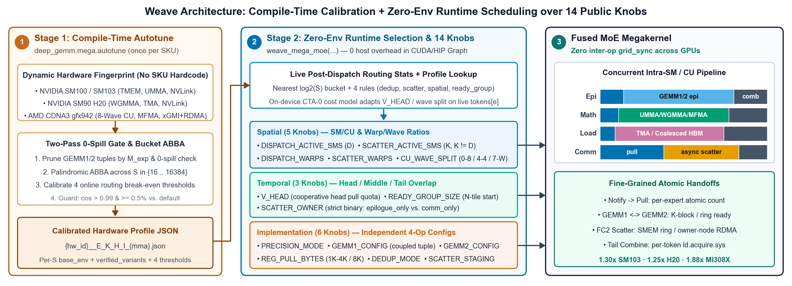
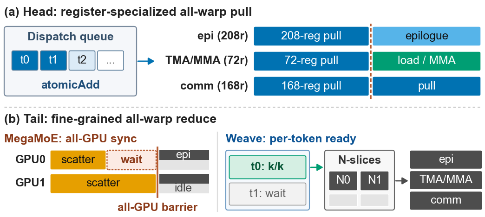

[English](README.md) | [简体中文](README_zh.md)

# Weave：面向 MoE Megakernel 的路由自适应运行时动态调度系统

Weave 是一个**路由自适应、运行时动态的 MoE megakernel**，由统一的
C++/CUDA/HIP 代码库实现。它是论文 **Weave: Fine-Grained Dynamic SM Scheduling
in an MoE Megakernel for Compute-Communication Overlap**
（[arXiv:2609.21483](https://arxiv.org/abs/2609.21483)）的 artifact。同一套调度
契约覆盖 **NVIDIA SM103 (148-SM)**、**NVIDIA H20** 与 **AMD MI308X**：同一个
内核读取 dispatch 完成后的实时路由直方图，并在内核内部运行时改变空间切分、
scatter 归属与开局头部拉取配额，无需主机往返。

## 架构

| 硬件 | 语言 | 支持的精度取值 | 入口 |
|---|---|---|---|
| NVIDIA SM103 (148-SM) | CUDA C++ | `0 = fp8xfp4`（默认）、`1 = fp4xfp4`（NVFP4）、`3 = bf16`；不支持 `2 = fp8` | sm100_fp8_fp4_mega_moe.cuh / sm100_fp4_fp4_mega_moe.cuh，通过 weave_mega_moe(..., mma_type=...) 分派 |
| NVIDIA H20（SM90） | CUDA C++ | 仅 `2 = fp8`（fp8xfp8） | sm90_fp8_mega_moe.cuh |
| AMD MI308X（gfx942） | HIP C++ | 仅 `2 = fp8`（fp8xfp8）；支持 EP8 与 EP16 | gfx942_fp8_mega_moe.cuh 与 amd/megamoe_amd.hip |

内核使用单一设备端发布轨：CTA 0 读取 dispatch 完成后的实时路由直方图，在片上
评估代价模型并通过 release store 发布调度决策，其余 CTA 通过
`load_published_policy` 或 `wait_and_copy_policy` 获取。运行期动态调整三项核心
决策：通信/计算硬件分区比例、Scatter 执行归属（Epilogue 内联或通信队列异步）以
及启动阶段首波预取配额，全程无主机往返、无动态二次启动。

## 分区化硬件执行与全局 ready queue

每个 SM/CU 被划分为 **Communication Partition（`N_c`）** 与
**Compute/GEMM Partition（`N_e`）**。每个分区由自己的**全局 ready queue** 支撑。
队列索引是轻量且隐式的：到达计数器、逐专家分组位图与前缀和替代了昂贵的运行时
排序。

- **GEMM Ready Queue**（由 Compute Partition `N_e` 消费）：随着 token 按
  `LOCAL_READY -> REMOTE_PRIMARY -> LOCAL_COPY` 流程到达，接收就绪的
  `(expert, m_block)` tile。条目按确定性的全局顺序遍历（L2 tile-swizzle /
  冷热窗口顺序在启动时参数化）；当 `WEAVE_READY_QUEUE=1` 时改为从全局 FIFO
  弹出。当 `s = epi`（`WEAVE_SCATTER_MODE=0`）时，Scatter 在 Compute/GEMM
  分区内部（epilogue）就地执行。
- **Communication Ready Queue**（由 Communication Partition `N_c` 消费）：驱动
  远端 Dispatch/Pull。当 `s = comm`（`WEAVE_SCATTER_MODE=1`）或本地去重
  （`WEAVE_SCATTER_MODE=2`）时，它接收 epilogue/local-combine warp 压入的
  就绪 FC2 scatter 描述符，使 `N_c` 能在后续 GEMM tile 继续运行的同时并发地
  执行远端 NVLink/xGMI scatter。

## 快速开始

    git clone https://github.com/ziyuhuang123/weave.git
    cd weave
    python -m pip install -e .
    python -m py_compile baselines/*.py ablation/*.py
    python tests/verify_tunable_params_doc.py

Python 入口示意：

    import torch
    from deep_gemm.mega import SymmBuffer, weave_mega_moe

    # 先为进程组和模型形状构造对称缓冲区，然后调用：
    # weave_mega_moe(y, l1_weights, l2_weights, sym_buffer,
    #                mma_type="fp4xfp4")
    # NVIDIA SM103 (148-SM) 支持 fp8xfp4、fp4xfp4 与 bf16；
    # NVIDIA H20 与 AMD MI308X 使用 fp8。

也可以设置公开精度选择器：

    export WEAVE_PRECISION_MODE=fp4xfp4

## 实测性能

论文 Fig. 7：6 模型 x 5 batch size 的三硬件 MoE 层实测加速比。

绑定硬件资源利用率：每个点是对该 cell 真正形成瓶颈的资源（HBM、NVLink/xGMI
或计算）的实测峰值利用率。对于 `Qwen3.5-35B`（`H=2048, I=512`）与
`Qwen3.5-122B` 等较小模型，在 8 卡 EP8 + 小 batch（`S=16..1024`）下属于典型的
**8 卡固定延迟下限主导**（例如 148-SM SM103 上 `Qwen3.5-35B` 全量理论 HBM/NVLink
耗时仅 `2-10 us`，远低于 8 卡跨卡同步与常驻 kernel 启动的 `~35 us` 物理下限）；
当 batch 增至 `S=16K` 摊薄固定开销后，SM103 利用率回升至 `79.4%`，H20 回升至
`60.8%`。在适配 8 卡的大模型（`Qwen3.8-2.4T`、`MiniMax-M3`）上，Weave 在
148-SM SM103 最高达 `97.6%`、H20 最高达 `85.5%`；其中 H20 在 `Qwen3.8-2.4T`
`S=1024` 处受 HBM3 带宽受限（`T_hbm=755 us` 对比 `T_comp=437 us`），物理上将
FP8 Tensor Core 活跃度封顶在 `58%` 以下。

下表全部为真实硬件实测值。所有 TFLOPS 都是单卡值，绝不是集群聚合值。计时前已在
每个 rank 上检查完整输出。

| 硬件 / 规模 | 精度 | 全输出正确性 | 实测延迟与吞吐 | 结论 |
|---|---|---|---|---|
| 8x NVIDIA SM103 (148-SM) 安装；4 卡可用验证窗口 | fp4xfp4 (NVFP4) | EP4，S=16，H=6144，I=2048，E=128，K=8；4/4 rank 有限，统一路径与直接路径逐位一致，512 条路由；4/4 轮完整 FP32 参考 PASS；CTA-0 现场回读 magic 0x57415645、version 4、published_epoch=2、valid=1 | 跨 rank 中位数之中位数 172.384 us；最慢 rank 172.480 us；54.418 TFLOPS/GPU 标称值（52.088--60.001）。加入发布轨前参考值 143.552 us、65.757 TFLOPS/GPU | PASS |
| 同一 148-SM SM103 安装 | fp8xfp4 | EP1 构建参考并打印预期配置，但首次 kernel launch 未返回；不主张任何输出或延迟。新克隆复现挂起；compute-sanitizer memcheck 在挂起前未发现非法访问 | 未测量 | BLOCKED_RUNTIME_HANG |
| 8x NVIDIA H20 EP8 | fp8 | Qwen3.8-Max，E=512，K=10，H=8192，I=2048；最差 rank calc_diff 5.924e-4--5.948e-4，最差 rel_l2 0.034483，cos_sim 0.999405；全部 rank PASS | S=128 AUTO=1 1452.512 us，对比 AUTO=0 1942.784 us，延迟变化 -25.24%；S=1024 AUTO=1 4977.584 us，对比 AUTO=0 4981.344 us | PASS |
| 8x AMD MI308X EP8 | fp8 | 4/4 全输出 cell 在 8 个 rank 上全部 PASS；最大 rel_l2 0.001545--0.001908，最大行 rel_l2 0.001952--0.005731，device_error=0 | qwen38max S=16 687.422/713.942 us；S=128 1539.625/1554.185 us；DeepSeek-V4-Flash S=16 378.761/395.421 us；S=128 699.642/709.743 us；单卡 TFLOPS 1.595--9.219 | PASS |
| 16x AMD MI308X EP16（2 节点 x 8） | fp8 | 16/16 rank 全元素 FP64 对比 PASS；qwen38max S=128 与 DeepSeek-V4-Flash S=128；最大 rel_l2 0.012535/0.012292，最大行 rel_l2 0.019612/0.015528；96 条 launch-state 记录 device_error=0 | qwen38max metric1 1594.079 -> 1010.679 us（1.5772x），metric2 1591.939 -> 1006.619 us（1.5815x）；DeepSeek-V4-Flash metric1 1387.055 -> 735.300 us（1.8864x），metric2 1367.269 -> 732.679 us（1.8661x） | PASS |

148-SM SM103 fp8xfp4 路径可以编译，两个 148-SM SM103 内核都带有 CTA-0 策略轨，但 FP8xFP4 的
首次启动仍卡在 FP8 GEMM 事务屏障协议。移除策略轨、限制 rank 顺序、删除 pull
等待、改变 block 形状都会复现同一等待。这是尚未解决的运行时调查，不是 PASS。
相同源码线上的 NVFP4 sibling 已完成端到端验证并具备现场策略回读。

## WeaveProfiler 软硬件时间线

三张图在匹配的 `Qwen3.8-Max, EP8, S=1024` 负载上使用统一的 WeaveProfiler
契约：硬件计数器、全部物理 SM/CU 泳道与代表性 CTA 流水线。产出各条 trace 的
完整调优 `WEAVE_*` 参数（按 **空间维度 / 时间维度 / 工程实现** 分类）及一键
复现脚本均位于 [examples/](examples/README_zh.md)：

- NVIDIA SM103 (148-SM)：[examples/sm103_qwen38max_ep8_s1024.sh](examples/sm103_qwen38max_ep8_s1024.sh)
- NVIDIA H20：[examples/h20_qwen38max_ep8_s1024.sh](examples/h20_qwen38max_ep8_s1024.sh)
- AMD MI308X：[examples/mi308x_qwen38max_ep8_s1024.sh](examples/mi308x_qwen38max_ep8_s1024.sh)（EP8）与 [examples/mi308x_qwen38max_ep16_s128.sh](examples/mi308x_qwen38max_ep16_s128.sh)（2 节点 EP16）
- 一键运行与重绘时间线：`python examples/profile_and_render_timeline.py --preset sm103`（支持 `sm103`、`h20`、`mi308x_ep8`、`mi308x_ep16`，并支持 `--run` / `--render`）

数值来自已测配对 trace；不可用的计数器保持 unavailable，不填零。MI308X 的硬件
计数器是每次 dispatch 的聚合值；trace 自身声明窗口长度不一致，不主张绝对时钟对齐。

## 参数分类：空间维度、时间维度与工程实现

Weave 的调度与内核参数按职责分为三类：

- **空间维度（Spatial）**：控制计算、通信与 tile 资源在 SM/CU、
  warp、cluster 及数值精度上的空间切分，包括通信/计算 warp 比例、异构 SM 角色
  掩码、双 CTA 多播、精度模式（`fp8xfp4` / `fp4xfp4` / `fp8` / `bf16`），以及
  依据实时逐专家 token 数的**运行时逐专家 tile 自适应**（MI308X 五档动态规划
  `BM_e in {16, 32, 64, 128, 256}`，EP16 下限 32；H20 八档 swapAB `{8..64}`
  由 padding 比例门控；148-SM SM103 动态 TMA-A `m8/m16/BM`、动态 epilogue
  `store_m8/m16` 及逐专家 tile 阶梯）。
- **时间维度（Temporal）**：控制执行顺序、通算重叠与阶段衔接，
  包括 Scatter 执行归属（Epilogue 内联 / 通信队列异步 / 本地预归约去重后异步）、
  启动首波预取配额、就绪队列与冷热/L2-swizzle 顺序、L1/L2 交错、全 warp 协作
  尾部 Combine，以及**运行时自适应流水深度**（GEMM 流水级数 `num_stages` 按当前
  tile 形状与剩余 SMEM 预算在启动时动态推导，而非编译期写死）。
- **工程实现与已有工作（Implementation / Prior Art）**：来自已有 GPU/MoE 系统
  工作的通用实现技术与实验开关，包括寄存器直拉/直归约、选择性去重、RDMA 描述符
  分片、SMEM 复用、Profiler 插桩级别与消融预设。

运行时 CTA 0 用轻量片上代价模型对候选调度排序：共享固定开销在候选比较中相互
抵消，在 48 个实测 148-SM SM103 测试点上与穷举 Oracle 匹配 38/48，取得
1.301x 几何平均加速（Oracle 为 1.332x，选择损失仅 2.4%；单点绝对延迟平均误差
34.0%）。

下表每个 `file:line` 引用均由 `tests/verify_tunable_params_doc.py` 自动校验。
完整参数文档见 [docs/TUNABLE_PARAMETERS.md](docs/TUNABLE_PARAMETERS.md)。

## 统一核心 WEAVE_* 参数

| 参数 | 层级 | 取值（每个可接受取值均有明确含义） | 默认 | 机制 | 主机解析 | 内核消费 |
|---|---|---|---|---|---|---|
| `WEAVE_PRECISION_MODE` | 1 | `0 = fp8xfp4`（MXFP8 激活 x MXFP4 权重）；`1 = fp4xfp4`（NVFP4 激活与权重）；`2 = fp8`（fp8xfp8）；`3 = bf16` | 0（fp8xfp4） | 数值精度选择器，也是代价模型中所有字节宽度与张量核速率的来源。各硬件支持集并不相同：NVIDIA SM103 (148-SM) 接受 `0`（默认）、`1` 与 `3`，且是唯一支持 FP4 的平台；NVIDIA H20 (SM90) 只接受 `2`；AMD MI308X (gfx942) 只接受 `2`。 | `deep_gemm/include/deep_gemm/scheduler/weave_knobs.cuh:269` | `deep_gemm/include/deep_gemm/scheduler/weave_cost_model.cuh:25` |
| `WEAVE_ABLATION_PRESET` | 1 | `0 = Weave`（完整：CTA-0 空间搜索 + 时间重叠 + 选择性去重 + 细粒度尾部）；`1 = -S`（固定按架构选择的空间切分；重叠与去重保留）；`2 = -S-T`（固定切分；关闭时间重叠；保留去重）；`3 = -S-T-C`（固定切分；关闭重叠；关闭选择性去重与协作式尾部合并） | 0 | 编译期渐进消融。preset 同时改变若干默认值：ENABLE_COST_MODEL 仅在 0 时为 1；preset >= 2 时 OVERLAP_PIPELINE 变为 0；preset 3 时 SELECTIVE_DEDUP 变为 0；preset >= 2 时 ALL_WAVE_COMBINE 与 TAIL_FINE_GRAINED 变为 0。MI308X EP16 上 preset 3 还会把 SCATTER_MODE 强制为 0。 | `deep_gemm/include/deep_gemm/scheduler/weave_knobs.cuh:40` | `deep_gemm/include/deep_gemm/scheduler/weave_cost_model.cuh:26` |
| `WEAVE_ENABLE_COST_MODEL` | 3 | `0 = 关闭`：所有 CTA 使用固定的 Level-1 候选或显式覆盖值；`1 = 开启`：CTA 0 在 dispatch 完成后的实时直方图上计算 Eq. (1)-(3) 并发布 (r, s, V_head) | preset 0 时为 1；preset 1-3 时为 0 | CTA-0 运行时选择器的总开关。关闭时不扫描直方图，空间切分、scatter 归属与头部配额均来自编译期默认值或覆盖值。 | `deep_gemm/include/deep_gemm/scheduler/weave_knobs.cuh:49` | `deep_gemm/include/deep_gemm/scheduler/weave_cost_model.cuh:27` |
| `WEAVE_COMM_UNITS` | 1 | `N = 运行时搜索关闭时使用的编译期默认 N_c 通信比例（每 SM/CU）`；`0 = 纯计算切分，不设专用通信单元` | 4 | 代价模型关闭时写入 r_mask 的默认 N_c。代价模型把候选 comm/comp 单元视为每 SM/CU 的比例，在施加链路带宽上限时再乘以 SM/CU 数量。 | `deep_gemm/include/deep_gemm/scheduler/weave_knobs.cuh:59` | `deep_gemm/include/deep_gemm/scheduler/weave_cost_model.cuh:28` |
| `WEAVE_COMP_UNITS` | 1 | `N = 编译期默认 N_e 计算单元数`；`0 = 无计算单元（退化配置，不是可独立运行的调度）` | 4 | 代价模型关闭时写入 r_mask 的默认 N_e。 | `deep_gemm/include/deep_gemm/scheduler/weave_knobs.cuh:69` | `deep_gemm/include/deep_gemm/scheduler/weave_cost_model.cuh:29` |
| `WEAVE_V_HEAD` | 3 | `0xffffffff = auto`：由 Eq. (3) 计算开局头部拉取配额；`0 = 关闭`：不做开局头部拉取；`V = 显式覆盖`：按峰值链路带宽只拉取前 V 个不同远端 token | auto（0xffffffff） | 开局头部拉取配额（论文中的 V_head）。层开始时 GEMM 尚无就绪 tile，所有可用通信 warp/wave 以峰值链路带宽拉取前 V_head 个 token，以消除启动气泡；随后切换到稳态 N_c 个通信 warp 与计算重叠。auto 值 = align_up(min(num_SM x N_c x head_tasks_per_comm_unit, D_in), 32)，其中 D_in 是实测去重后的远端拉取数。设置为整数即覆盖该值。 | `deep_gemm/include/deep_gemm/scheduler/weave_knobs.cuh:259` | `deep_gemm/include/deep_gemm/scheduler/weave_cost_model.cuh:30` |
| `WEAVE_SCATTER_MODE` | 3 | `0 = epilogue 内联（s = epi）`：GEMM epilogue warp 直接在 Compute/GEMM 分区内发起 NVLink/xGMI scatter（零交接开销；小 batch 最优）；`1 = 通信卸载（s = comm）`：epilogue warp 通过 SMEM/异步交接把 FC2 tile 输出写入 Communication 分区 Ready Queue，通信 warp 在后续 GEMM tile 运行期间异步排空 NVLink/xGMI scatter；`2 = 本地去重 / 节点内部分归约`：当一个 token 路由到同一 GPU（EP16 中为同一 8 卡节点）的多个专家时，epilogue/local-combine warp 先把这些部分贡献归约去重到一份合并 HBM 缓冲，再向 Communication 分区 Ready Queue 入队一次去重传输，使通信 warp 对每个目的 token 只发送一次 | 1（148-SM SM103 数据流为 0；MI308X EP16 为 2） | 选择 scatter 步骤的归属者以及由哪个 ready queue 承载。它也是 CTA 0 依据路由选择的三个动态决策之一（s）。 | `deep_gemm/include/deep_gemm/scheduler/weave_knobs.cuh:159` | `deep_gemm/include/deep_gemm/scheduler/weave_cost_model.cuh:31` |
| `WEAVE_OVERLAP_PIPELINE` | 2 | `0 = 关闭`：消融开关，强制批量同步的逐阶段串行化（-S-T / -S-T-C 使用）；`1 = 开启`（默认）：计算-通信重叠打开 | 1 | dispatch、GEMM、scatter 与 combine 之间的时间重叠。默认 = 1：计算-通信重叠默认开启。设为 0 是消融开关，强制逐阶段批量同步执行。 | `deep_gemm/include/deep_gemm/scheduler/weave_knobs.cuh:149` | `deep_gemm/include/deep_gemm/scheduler/weave_cost_model.cuh:32` |
| `WEAVE_SELECTIVE_DEDUP` | 2 | `0 = 关闭`：每条 (token, expert) 路由一个通信桶；`1 = 开启`：按唯一 (token, destination) 建桶，同一 token 路由到同一目的 rank 的多个专家时只传输一次 | 1（preset 3 时为 0） | 通信阶段的选择性输入去重。 | `deep_gemm/include/deep_gemm/scheduler/weave_knobs.cuh:199` | `deep_gemm/include/deep_gemm/scheduler/weave_cost_model.cuh:33` |
| `WEAVE_ALL_WAVE_COMBINE` | 2 | `0 = 仅计算组 epilogue warp 执行尾部合并`；`1 = 所有空闲 wave（dispatch 与 epilogue）都加入协作式尾部合并` | 1（preset >= 2 时为 0） | 协作式尾部合并的参与宽度。 | `deep_gemm/include/deep_gemm/scheduler/weave_knobs.cuh:179` | `deep_gemm/include/deep_gemm/scheduler/weave_cost_model.cuh:34` |
| `WEAVE_TAIL_FINE_GRAINED` | 2 | `0 = 单一尾部`：使用一个粗粒度尾部归约项；`1 = 细粒度尾部`：带宽受限的归约并与 ready queue 重叠 | 1（preset >= 2 时为 0） | 用细粒度尾部归约替代单一尾部。 | `deep_gemm/include/deep_gemm/scheduler/weave_knobs.cuh:249` | `deep_gemm/include/deep_gemm/scheduler/weave_cost_model.cuh:373` |

## NVIDIA SM103 (148-SM) WEAVE_* 参数

| 参数 | 层级 | 取值（每个可接受取值均有明确含义） | 默认 | 机制 | 主机解析 | 内核消费 |
|---|---|---|---|---|---|---|
| `WEAVE_READY_GROUP_SIZE` | 1 | `0 = 专家级就绪`：整个专家到齐后才发布 pool tile；`1, 2, 4, 8, 16 = 分组粒度`：按顺序每 N x BLOCK_M 个 token 发布一次 | 0 | 细粒度到达发布。组越大，元数据更新越少，但 tile 可用时间越晚。 | `csrc/jit_kernels/impls/sm100_fp8_fp4_mega_moe.hpp:129` | `deep_gemm/include/deep_gemm/impls/sm100_fp8_fp4_mega_moe.cuh:7` |
| `WEAVE_WARP_SPLIT_MODE` | 1 | `0 = 基线`：不做 warp 切分，4 个 dispatch warp，默认 epilogue 数；`1 = 开启切分`：D2 pull 循环开启，4 个 dispatch warp，8 个 epilogue warp；`2 = 每个 SM 都用 8 个 dispatch warp`；`3 = 偶数物理 SMID 用 8 个，其余用 4 个`；`4 = SMID 前半用 8 个，其余用 4 个`；`5 = 8 warp + 混合 pull（0-3 走 TMA，4-7 走寄存器直拉），全 SM`；`6 = 模式 5 + 偶数 SMID 掩码`；`7 = 模式 5 + 前半掩码`；`8 = 模式 5 + ((smid >> 1) & 1) == 0 掩码`；`9, 10 = 保留，行为等同 1`；`11 = 8 个 dispatch warp，默认 epilogue 数`；`12 = 偶数 SMID 8 warp，默认 epilogue 数`；`13 = 前半 8 warp，默认 epilogue 数`；`14 = 8 warp + 混合 pull，默认 epilogue 数`；`15 = 模式 14 + ((smid >> 1) & 1) == 0 掩码` | 0 | dispatch warp 重配置与寄存器切分。模式 2-4 强制 8 个 dispatch warp 与 2048 字节 pull 块；模式 5-8 与 14 使用混合 pull；模式 3、4、6、7、8、12、13、15 使用物理 SMID 掩码，仅子组运行 8-warp 前端。 | `csrc/jit_kernels/impls/sm100_fp8_fp4_mega_moe.hpp:131` | `deep_gemm/include/deep_gemm/impls/sm100_fp8_fp4_mega_moe.cuh:23` |
| `WEAVE_REG_PULL_BYTES` | 1 | `0 = SMEM 暂存 TMA pull`；`1024, 2048, 4096 = 零 SMEM 寄存器直拉，每次 warp 迭代 N 字节` | 0 | 寄存器直拉宽度。非零值启用零 SMEM pull 路径并关闭 TMA dispatch 暂存。 | `csrc/jit_kernels/impls/sm100_fp8_fp4_mega_moe.hpp:132` | `deep_gemm/include/deep_gemm/impls/sm100_fp8_fp4_mega_moe.cuh:39` |
| `WEAVE_HETERO_SM_LIMIT` | 1 | `N 在 0..148 = 物理 SMID 阈值`：小于 N 的 SMID 进入 8-warp 子组；`0 = 没有 SM 合格，8-warp 子组关闭` | 74 | 异构角色切分的 SM-id 上限。仅在使用阈值形式的 SMID 掩码 warp 切分模式下生效。 | `csrc/jit_kernels/impls/sm100_fp8_fp4_mega_moe.hpp:133` | `deep_gemm/include/deep_gemm/impls/sm100_fp8_fp4_mega_moe.cuh:55` |
| `WEAVE_DISP_REGS` | 1 | `0 = 自动寄存器预算`；`N = 每个 dispatch warp 的显式最大寄存器数` | 0 | 通过 setmaxnreg 施加的 dispatch warp 显式寄存器预算。 | `csrc/jit_kernels/impls/sm100_fp8_fp4_mega_moe.hpp:134` | `deep_gemm/include/deep_gemm/impls/sm100_fp8_fp4_mega_moe.cuh:66` |
| `WEAVE_EPI_REGS` | 1 | `0 = 自动寄存器预算`；`N = 每个 epilogue warp 的显式最大寄存器数` | 0 | 通过 setmaxnreg 施加的 epilogue warp 显式寄存器预算。 | `csrc/jit_kernels/impls/sm100_fp8_fp4_mega_moe.hpp:135` | `deep_gemm/include/deep_gemm/impls/sm100_fp8_fp4_mega_moe.cuh:77` |
| `WEAVE_BLOCK_M` | 2 | `0 = 形状启发式`；`32, 64, 96, 128, 192 = 显式 GEMM tile M` | 形状启发式 | GEMM tile M 覆盖值。必须是合法候选 tile 高度之一。 | `csrc/jit_kernels/impls/sm100_fp8_fp4_mega_moe.hpp:137` | `deep_gemm/include/deep_gemm/impls/sm100_fp8_fp4_mega_moe.cuh:88` |
| `WEAVE_BLOCK_N` | 2 | `0 = 自动（128）`；`64, 128, 256 = 显式 GEMM tile N` | 形状启发式 | GEMM tile N 覆盖值。 | `csrc/jit_kernels/impls/sm100_fp8_fp4_mega_moe.hpp:138` | `deep_gemm/include/deep_gemm/impls/sm100_fp8_fp4_mega_moe.cuh:104` |
| `WEAVE_BLOCK_K` | 2 | `0 = 自动`；`64, 128, 256 = 显式 GEMM tile K` | 形状启发式 | GEMM tile K 覆盖值。必须整除该层归约维度。 | `csrc/jit_kernels/impls/sm100_fp8_fp4_mega_moe.hpp:139` | `deep_gemm/include/deep_gemm/impls/sm100_fp8_fp4_mega_moe.cuh:120` |
| `WEAVE_STORE_BLOCK_M` | 2 | `0 = 自动`；`4, 8, 16, 32 = 显式 TMA-store M 粒度` | 形状启发式 | TMA-store M 粒度。DYN_EPILOGUE = 2 时强制为 16，并每次 store 使用两个 8 行 atom。 | `csrc/jit_kernels/impls/sm100_fp8_fp4_mega_moe.hpp:140` | `deep_gemm/include/deep_gemm/impls/sm100_fp8_fp4_mega_moe.cuh:136` |
| `WEAVE_DYN_EPILOGUE` | 1 | `0 = 静态 epilogue`：每个 warpgroup 固定一次全 tile pass；`1 = 运行时 pass 数`：按实时 valid_m 把 ceil(valid_m / STORE_BLOCK_M) 个块分配给各 epilogue warpgroup；`2 = atom 粒度 store`：每次 16 行 store 两个 8 行 atom，并带 m8 尾部描述符 | 0 | 动态 epilogue pass 数与 store 粒度。模式 2 即 store_m8 / store_m16 动态 epilogue，并要求 STORE_BLOCK_M = 16。 | `csrc/jit_kernels/impls/sm100_fp8_fp4_mega_moe.hpp:141` | `deep_gemm/include/deep_gemm/impls/sm100_fp8_fp4_mega_moe.cuh:152` |
| `WEAVE_DYN_TMA_A` | 1 | `0 = 始终加载 LOAD_BLOCK_M 行`；`1 = aligned_valid_m <= 32 时改用 16 行 TMA-A 描述符`；`2 = aligned_valid_m <= 16 时用 8 行描述符，<= 32 时用 16 行` | 0 | 小 M 的动态 TMA-A 描述符。模式 1 与 2 消除最后一个部分 tile 的 A 侧无效流量。 | `csrc/jit_kernels/impls/sm100_fp8_fp4_mega_moe.hpp:142` | `deep_gemm/include/deep_gemm/impls/sm100_fp8_fp4_mega_moe.cuh:168` |
| `WEAVE_OVERLAP_EXPERT_SMEM` | 1 | `0 = 专家元数据使用独立 SMEM 阶段`；`1 = 专家元数据 SMEM 与下一 tile 加载重叠` | 0 | 专家元数据 SMEM 与下一 tile 重叠。 | `csrc/jit_kernels/impls/sm100_fp8_fp4_mega_moe.hpp:143` | `deep_gemm/include/deep_gemm/impls/sm100_fp8_fp4_mega_moe.cuh:184` |
| `WEAVE_EXPERT_STEP_MODE` | 1 | `0 = 专家的每个 m-block 使用固定 BLOCK_M`；`1 = 运行时逐专家 BM 阶梯`：在 32, 64, 128, 256 中选最小的、其 padding 后 token 数不超过 32 行 padding 值的档位（可加 pad slack）；`2 = 1 的等价别名` | 0 | 专家步进调度模式。任何 > 0 的值都会按实时逐专家 token 数启用 select_expert_bm；同时会为调度器预留更多寄存器。 | `csrc/jit_kernels/impls/sm100_fp8_fp4_mega_moe.hpp:144` | `deep_gemm/include/deep_gemm/impls/sm100_fp8_fp4_mega_moe.cuh:200` |
| `WEAVE_ACCUM_STAGES` | 1 | `2 = 两个 TMEM 累加器环槽`；`3 = 三个槽`；`4 = 四个槽` | 2 | TMEM 累加器环深度。更深的环允许更多 epilogue 重叠，但占用更多 TMEM 列。 | `csrc/jit_kernels/impls/sm100_fp8_fp4_mega_moe.hpp:145` | `deep_gemm/include/deep_gemm/impls/sm100_fp8_fp4_mega_moe.cuh:216` |
| `WEAVE_TMA_STORE_STAGES` | 1 | `2, 3, 4, 5, 6 = TMA-store 环深度（stage 数）` | 2 | TMA-store 环深度。必须落在 epilogue 输出 SMEM 预算内。 | `csrc/jit_kernels/impls/sm100_fp8_fp4_mega_moe.hpp:146` | `deep_gemm/include/deep_gemm/impls/sm100_fp8_fp4_mega_moe.cuh:227` |
| `WEAVE_SCHED_STAGES` | 1 | `2 = 两槽调度前瞻`；`3 = 三槽调度前瞻` | 2 | 调度器前瞻深度。 | `csrc/jit_kernels/impls/sm100_fp8_fp4_mega_moe.hpp:147` | `deep_gemm/include/deep_gemm/scheduler/mega_moe.cuh:238` |
| `WEAVE_EXPERTS_PER_WAVE` | 2 | `0 = 自然专家顺序，不使用窗口`；`1, 2, 4, 8, 16, 32, 64 = N 个专家一个调度窗口`：窗口内按 m-block 数降序排序（LPT） | 0（自然顺序） | 每个调度 wave 分配的专家数。窗口化 LPT 排序让最大的专家先启动，同时保持顺序局部性。 | `csrc/jit_kernels/impls/sm100_fp8_fp4_mega_moe.hpp:149` | `deep_gemm/include/deep_gemm/scheduler/mega_moe.cuh:254` |
| `WEAVE_STATIC_EXPERT_ORDER` | 2 | `0 = 在线推导专家顺序`；`1 = 从 WEAVE_STATIC_EXPERT_ORDER_FILE 读取逐 rank 专家顺序表（文件缺失时忽略）` | 0 | 使用静态专家顺序表。 | `csrc/jit_kernels/impls/sm100_fp8_fp4_mega_moe.hpp:150` | `deep_gemm/include/deep_gemm/scheduler/mega_moe.cuh:270` |
| `WEAVE_READY_QUEUE` | 2 | `0 = 静态前缀和块顺序`：每个 CTA 由前缀和推导自己的 (expert, m_block)；`1 = 全局 FIFO ready queue`：pool tile 完全到达时由 dispatch 压入描述符，调度 CTA 按到达顺序弹出 | 0 | 启用动态 ready queue。该队列让 GEMM 分区无需运行时排序即可获得实时 (expert, m_block) 就绪信息。 | `csrc/jit_kernels/impls/sm100_fp8_fp4_mega_moe.hpp:151` | `deep_gemm/include/deep_gemm/scheduler/mega_moe.cuh:286` |
| `WEAVE_SCHED_MODE` | 2 | `0 = 按 m-block 数降序，token 数次序，专家索引逆序最终次序`；`1 = 仅按 m-block 数降序，专家索引逆序（更便宜的 key）`；`2 = 模式 0，但最后一个（可能不完整的）专家窗口保持排序顺序，不做冷热配对`；`3 = 保留，当前与 0 相同` | 0 | 调度器排序模式选择器。 | `csrc/jit_kernels/impls/sm100_fp8_fp4_mega_moe.hpp:152` | `deep_gemm/include/deep_gemm/scheduler/mega_moe.cuh:302` |
| `WEAVE_DEDUP_MODE` | 2 | `0 = 关闭`；`1 = 去重`：按唯一 (token, destination) 建通信桶；`2 = 本地预归约`：去重并在通信前做同 rank 部分归约（仅 4 或 8 rank；要求 E/rank >= 18、topk <= 10、H % 512 == 0、pull 字节 % 1024 == 0） | 0 | 去重模式：关闭、去重或本地预归约。 | `csrc/jit_kernels/impls/sm100_fp8_fp4_mega_moe.hpp:155` | `deep_gemm/include/deep_gemm/impls/sm100_fp8_fp4_mega_moe.cuh:318` |
| `WEAVE_DEDUP_SCHED` | 2 | `0 = 去重调度器关闭`；`1 = 去重调度器开启`（DEDUP_MODE = 2 时的默认值） | dedup=2 时为 1，否则为 0 | 去重调度器开关。 | `csrc/jit_kernels/impls/sm100_fp8_fp4_mega_moe.hpp:156` | `deep_gemm/include/deep_gemm/scheduler/mega_moe.cuh:334` |
| `WEAVE_COMBINE_GROUP_TILES` | 2 | `0 = 关闭`；`1, 2, 4, 8, 16 = 将 N 个连续 L2 输出 tile 合并为一次协作式 combine`（必须是整除 L2_SHAPE_N / BLOCK_N 的 2 的幂） | 0 | Combine 分组 tile 数。 | `csrc/jit_kernels/impls/sm100_fp8_fp4_mega_moe.hpp:158` | `deep_gemm/include/deep_gemm/impls/sm100_fp8_fp4_mega_moe.cuh:350` |
| `WEAVE_COMBINE_REDUCE_WARPS` | 2 | `0 = 全部 epilogue warp`；`1, 2, 4, 8, 16 = 将 combine 限制为 N 个 warp` | 0（全部 epilogue warp） | 静态 combine warp 上限。 | `csrc/jit_kernels/impls/sm100_fp8_fp4_mega_moe.hpp:159` | `deep_gemm/include/deep_gemm/impls/sm100_fp8_fp4_mega_moe.cuh:366` |
| `WEAVE_SCATTER_SMEM_ALIAS` | 1 | `0 = 独立 scatter 暂存 SMEM`；`1 = scatter 暂存与 epilogue store 缓冲复用同一块 SMEM` | 1 | scatter 暂存 SMEM 与 epilogue 存储复用。 | `csrc/jit_kernels/impls/sm100_fp8_fp4_mega_moe.hpp:163` | `deep_gemm/include/deep_gemm/impls/sm100_fp8_fp4_mega_moe.cuh:393` |
| `WEAVE_SCATTER_WARPS` | 2 | `0 = 自动`：使用已配置的 dispatch warp；`2, 4, 8 = N 个专用 scatter 执行 warp`（同时把 dispatch 线程数设为 32N） | 0（自动） | scatter 执行 warp 数。 | `csrc/jit_kernels/impls/sm100_fp8_fp4_mega_moe.hpp:164` | `deep_gemm/include/deep_gemm/impls/sm100_fp8_fp4_mega_moe.cuh:404` |
| `WEAVE_SCATTER_HANDOFF_WAIT` | 2 | `0 = epilogue 写完后立即交接`；`1 = 等到 combine-ready epoch / pull-done 标志后再交接` | 1 | 交接前等待 combine-ready epoch。 | `csrc/jit_kernels/impls/sm100_fp8_fp4_mega_moe.hpp:165` | `deep_gemm/include/deep_gemm/impls/sm100_fp8_fp4_mega_moe.cuh:420` |
| `WEAVE_SHARED_L2_EARLY_BLOCKS` | 1 | `0 = 不做提前播种`；`N 在 1..148 = 前 N 个 CTA 负责 shared-L2 复用播种` | 10 | 用于播种 shared-L2 复用的早期块数。 | `csrc/jit_kernels/impls/sm100_fp8_fp4_mega_moe.hpp:203` | `deep_gemm/include/deep_gemm/impls/sm100_fp8_fp4_mega_moe.cuh:431` |
| `WEAVE_ENABLE_MULTICAST` | 1 | `1 = 启用双 CTA TMA 多播`（148-SM SM103 FP8xFP4 内核必需）；`0 = 编译掉多播路径`（未验证的调度） | 1 | 148-SM SM103 FP8xFP4 内核所需的双 CTA TMA 多播。 | `csrc/jit_kernels/impls/sm100_fp8_fp4_mega_moe.hpp:166` | `deep_gemm/include/deep_gemm/impls/sm100_fp8_fp4_mega_moe.cuh:442` |
| `WEAVE_SCATTER_MODE` | 3 | `0 = epilogue 内联（s = epi）`：在 Compute/GEMM 分区内 scatter；`1 = 通信卸载（s = comm）`：FC2 输出交接到 Communication 分区 Ready Queue；`2 = 本地去重`：先把同 rank 部分贡献归约到一份合并缓冲，再做一次去重传输 | 148-SM SM103 数据流为 0 | 148-SM SM103 数据流的 scatter 路径覆盖。三个取值的归属语义与统一表一致。 | `csrc/jit_kernels/impls/sm100_fp8_fp4_mega_moe.hpp:161` | `deep_gemm/include/deep_gemm/impls/sm100_fp8_fp4_mega_moe.cuh:382` |

## NVIDIA H20 WEAVE_* 参数

下表中 Level 2 的主机侧行，其"内核消费"列引用固定编译期内核模板的主机决策点。
内核头文件消费的是被选中的配置，而不是运行时环境变量本身。

| 参数 | 层级 | 取值（每个可接受取值均有明确含义） | 默认 | 机制 | 主机解析 | 内核消费 |
|---|---|---|---|---|---|---|
| `WEAVE_SWAPAB_AUTO` | 2 | `0 = 关闭`：官方固定 tokens-per-expert 上限，与官方 DeepGEMM 逐位一致；`1 = 开启`：padding 感知门控，保留官方决策并额外接纳 pad_frac >= WEAVE_SWAPAB_PAD_PCT 的形状 | 0 | 启用 padding 感知的自动 swap-AB 选择。 | `csrc/jit_kernels/heuristics/sm90_mega_moe.hpp:654` | `csrc/jit_kernels/heuristics/sm90_mega_moe.hpp:654` |
| `WEAVE_SWAPAB_EPI_WG` | 2 | `2 = 官方 BN=128 tile，两个 epilogue warpgroup`；`4 = 宽 BN=256 tile，四个 epilogue warpgroup` | 2 | swap-AB 下的 epilogue warpgroup 数。请求 4 时，若 SWAPAB_AUTO = 1 且 padding 门控拒绝宽 tile，仍回退到 2。 | `csrc/jit_kernels/heuristics/sm90_mega_moe.hpp:650` | `csrc/jit_kernels/heuristics/sm90_mega_moe.hpp:650` |
| `WEAVE_SWAPAB_MAX_LOAD` | 2 | `N = SWAPAB_AUTO = 0 时的 tokens-per-expert 上限`（compact 形状默认 24，其余 16）；`0 = 关闭 swap-AB` | 形状启发式（compact 24 / 其余 16） | 官方固定规则下 swap-AB 的负载上界。 | `csrc/jit_kernels/heuristics/sm90_mega_moe.hpp:669` | `csrc/jit_kernels/heuristics/sm90_mega_moe.hpp:669` |
| `WEAVE_SWAPAB_PAD_PCT` | 2 | `0..100 = 接纳宽 tile 所需的最小 padding 浪费百分比`；`0 = 总是接纳`；`100 = 从不接纳` | 25 | SWAPAB_AUTO = 1 时 swap-AB 的 padding 比例门控。 | `csrc/jit_kernels/heuristics/sm90_mega_moe.hpp:639` | `csrc/jit_kernels/heuristics/sm90_mega_moe.hpp:639` |
| `WEAVE_SWAPAB_MIN_LOAD` | 2 | swap-AB 接纳所需的`每专家最小非零 token 数 N`；`0 = 不设下限` | 8 | swap-AB 的负载下界。 | `csrc/jit_kernels/heuristics/sm90_mega_moe.hpp:640` | `csrc/jit_kernels/heuristics/sm90_mega_moe.hpp:640` |
| `WEAVE_MCAST` | 1 | `0 = 关闭，编译结果与 1 相同的单 CTA 加载路径`；`1 = 显式单 CTA 权重加载，无跨 CTA 多播`；`2 = 双 CTA cluster TMA 多播`（SM 数或 N tile 数为奇数时自动降级为 1） | 0 | SM90 多播模式。 | `csrc/jit_kernels/heuristics/sm90_mega_moe.hpp:229` | `deep_gemm/include/deep_gemm/impls/sm90_fp8_mega_moe.cuh:7` |
| `WEAVE_SWIZZLE_TILES` | 2 | `0 = 线性 tile 顺序`；`1 = L1 与 L2 上启用 GroupM tile swizzle` | 0 | 跨专家 tile 的 swizzle。 | `csrc/jit_kernels/heuristics/sm90_mega_moe.hpp:230` | `deep_gemm/include/deep_gemm/impls/sm90_fp8_mega_moe.cuh:18` |
| `WEAVE_HOT_COLD_MODE` | 2 | `0 = 自然专家顺序`；`1 = LPT：按 m-block 数降序，热专家优先`；`2 = LPT + 冷热配对`：把剩余最热与最冷专家配对，平衡每个 wave 与 L2 权重驻留 | 0 | 冷热专家权重驻留策略。 | `csrc/jit_kernels/heuristics/sm90_mega_moe.hpp:231` | `deep_gemm/include/deep_gemm/impls/sm90_fp8_mega_moe.cuh:29` |
| `WEAVE_DEDUP_DISPATCH` | 2 | `0 = 每条路由行都 dispatch`；`1 = 去重 dispatch 行`（仅当 3 x pool/8 >= ranks x max_tokens 时生效） | 0 | 去重 dispatch 行并启用 fast pull 路径。 | `csrc/jit_kernels/heuristics/sm90_mega_moe.hpp:232` | `deep_gemm/include/deep_gemm/impls/sm90_fp8_mega_moe.cuh:40` |
| `WEAVE_DEDUP_SCATTER` | 2 | `0 = 每个部分行都 scatter`；`1 = 去重相同 scatter 目的地`（需通过 pool 与 N tile 容量检查） | 0 | 去重 scatter 目的地。 | `csrc/jit_kernels/heuristics/sm90_mega_moe.hpp:233` | `deep_gemm/include/deep_gemm/impls/sm90_fp8_mega_moe.cuh:51` |
| `WEAVE_REG_COMBINE` | 1 | `0 = SMEM 暂存 combine`；`1 = 寄存器直连 combine`；`2 = 寄存器直连，且即使 token 数很大也强制 dual-vector chunk 候选` | 0 | 寄存器直连 combine 路径。 | `csrc/jit_kernels/heuristics/sm90_mega_moe.hpp:234` | `deep_gemm/include/deep_gemm/impls/sm90_fp8_mega_moe.cuh:62` |
| `WEAVE_ALL_IDLE_COMBINE` | 2 | `0 = 仅 epilogue warp`；`1 = 所有空闲 dispatch 与 epilogue warp 加入 combine`（要求寄存器 combine 且 H % 512 == 0） | 0 | 使用空闲 warp 执行 combine 阶段。 | `csrc/jit_kernels/heuristics/sm90_mega_moe.hpp:235` | `deep_gemm/include/deep_gemm/impls/sm90_fp8_mega_moe.cuh:73` |
| `WEAVE_DYN_SCHED` | 2 | `0 = 静态专家 wave`；`1 = 动态专家游标与专家缓存`（INTERLEAVE_L1_L2 > 0 或 HOT_COLD_MODE > 0 时自动启用） | 0 | 动态专家调度。 | `csrc/jit_kernels/heuristics/sm90_mega_moe.hpp:236` | `deep_gemm/include/deep_gemm/impls/sm90_fp8_mega_moe.cuh:84` |
| `WEAVE_INTERLEAVE_L1_L2` | 2 | `0 = 先全部 L1 再全部 L2`；`1 = 专家完成度交织，L2 优先`；`2 = 均衡切分：偶数 CTA 优先 L2，奇数 CTA 优先 L1`；`3 = m-block 粒度交织`；`4 = 每 wave 一专家交织：L1(w) 后 L2(w)`；`5 = EPW 交替 + L2 K-block 依赖`；`6 = wave 滞后 EPW：L1(w+1) 先于 L2(w) 发出` | 0 | 交织第一层与第二层专家工作。模式 4-6 使用每 wave 专家数。 | `csrc/jit_kernels/heuristics/sm90_mega_moe.hpp:237` | `deep_gemm/include/deep_gemm/impls/sm90_fp8_mega_moe.cuh:95` |
| `WEAVE_SCATTER_ROLE_DISP` | 2 | `0 = scatter 由 epilogue warp 执行`；`1 = scatter 分配给 dispatch warp` | 0 | 把 scatter 分配给 dispatch warp。 | `csrc/jit_kernels/heuristics/sm90_mega_moe.hpp:238` | `deep_gemm/include/deep_gemm/impls/sm90_fp8_mega_moe.cuh:106` |
| `WEAVE_HETERO_MASK_MODE` | 1 | `0 = 均匀 dispatch warp`；`1 = 偶数物理 SMID 得 6（或 2）个 warp，奇数得 2（或 0）个`；`2 = SMID 前半 6 个，后半 2 个`；`3 = 前半 6 个，后半 0 个`；`4 = 偶数 SMID 6 个，奇数 0 个`；`5 = 每四个 SMID 中三个得 6 个，第四个得 2 个` | 0 | 异构 SM 角色掩码模式。要求 2、6 或 8 个 dispatch warp，且在 Linear1 阶段生效。表中列出的是 6-warp 映射；2-warp 前端按 2/0 缩放，8-warp 前端下模式 2-5 退化为前半掩码。 | `csrc/jit_kernels/heuristics/sm90_mega_moe.hpp:239` | `deep_gemm/include/deep_gemm/impls/sm90_fp8_mega_moe.cuh:117` |
| `WEAVE_PIPE_WGMMA` | 1 | `0 = 操作数等待后再发 WGMMA`；`1 = 下一次 WGMMA 发射与当前等待流水化` | 0 | 流水化 WGMMA 发射。 | `csrc/jit_kernels/heuristics/sm90_mega_moe.hpp:240` | `deep_gemm/include/deep_gemm/impls/sm90_fp8_mega_moe.cuh:128` |
| `WEAVE_SWAP_PIPE` | 1 | `0 = producer/consumer 角色不变`；`1 = 交换 producer 与 consumer 流水角色` | 0 | 交换 producer/consumer 流水角色。 | `csrc/jit_kernels/heuristics/sm90_mega_moe.hpp:241` | `deep_gemm/include/deep_gemm/impls/sm90_fp8_mega_moe.cuh:139` |
| `WEAVE_FAST_PULL` | 1 | `0 = 常规 pull`；`1 = 快速寄存器 pull`（DEDUP_DISPATCH 也会自动启用） | 0 | 快速寄存器 pull 路径。 | `csrc/jit_kernels/heuristics/sm90_mega_moe.hpp:242` | `deep_gemm/include/deep_gemm/impls/sm90_fp8_mega_moe.cuh:150` |
| `WEAVE_ADAPT_BM` | 2 | `0 = 固定 BLOCK_M = 64`；`1 = 逐专家自适应 BM 档位`（要求 swap-AB、BM 64、split-N 与专家缓存） | 0 | 逐专家自适应 block-M 档位。 | `csrc/jit_kernels/heuristics/sm90_mega_moe.hpp:243` | `deep_gemm/include/deep_gemm/impls/sm90_fp8_mega_moe.cuh:161` |

## AMD MI308X WEAVE_* 参数

| 参数 | 层级 | 取值（每个可接受取值均有明确含义） | 默认 | 机制 | 主机解析 | 内核消费 |
|---|---|---|---|---|---|---|
| `WEAVE_BM_TIER_MODE` | 2 | `0 = 传统固定 BM 64，按 64 行 padding`；`1 = 紧凑 16/32/64 阶梯`（仅 EP8 overlay）；`2 = 五档动态规划器，按实时 m_e 选 BM_e in {16, 32, 64, 128, 256}`（EP16 要求 2，且阶梯下限为 32） | 2 | 五档 block-M 规划器。选择随实时逐专家 token 数变化，因此 tile 形状在内核内部运行时自适应。 | `deep_gemm/include/deep_gemm/impls/amd/ep16/build_port.py:105` | `deep_gemm/include/deep_gemm/impls/amd/include/direct_gather_and_greedy_tiles.hpp:71` |
| `WEAVE_DUALGROUP_MIN_TOKENS` | 2 | `N = 把通信 wave 4-7 重绑为第二计算组的本地 token 阈值`；`0 = 只要 EP16 路径允许就启用双组`（preset 0 下 t_local >= 4 且 est_s1_tiles >= 192 也会启用双组） | 64 | 把通信 wave 重绑为第二计算组的阈值。 | `deep_gemm/include/deep_gemm/impls/amd/ep16/build_port.py:107` | `deep_gemm/include/deep_gemm/impls/amd/megamoe_amd.hip:1159` |
| `WEAVE_BN2_MODE` | 2 | `0 = 自动`：仅当没有大 tile、init_m_tiles >= 16 且 init_m_tiles x n2_blocks <= 320 时用 BN64；`64 = 强制第二阶段 BN 64`；`128 = 强制第二阶段 BN 128` | 0 | 第二阶段 BN 模式。 | `deep_gemm/include/deep_gemm/impls/amd/ep16/build_port.py:110` | `deep_gemm/include/deep_gemm/impls/amd/megamoe_amd.hip:900` |
| `WEAVE_S2_NGROUP_MODE` | 2 | `0 = 自动`：按工作量估计选 4、2 或 1；`1 = 每次申请一个 N block`；`2 = 每次申请两个 N block`；`4 = 每次申请四个 N block`（固定值仅在整除 n2_blocks 时使用，否则为 1） | 0 | 第二阶段 N 组宽度。 | `deep_gemm/include/deep_gemm/impls/amd/ep16/build_port.py:111` | `deep_gemm/include/deep_gemm/impls/amd/megamoe_amd.hip:908` |
| `WEAVE_TH_BM64` | 2 | `N = BM64 档位的声明式小 M 阈值`（默认 16）；当前 EP16 贪心规划器从 q32 推导档位，因此该值为 ABI 保留 | 16 | BM64 的小 M 阈值。 | `deep_gemm/include/deep_gemm/impls/amd/ep16/build_port.py:113` | `deep_gemm/include/deep_gemm/impls/amd/megamoe_amd.hip:544` |
| `WEAVE_TH_BM128` | 2 | `N = BM128 档位的声明式小 M 阈值`（默认 96）；当前 EP16 贪心规划器从 q32 推导档位，因此该值为 ABI 保留 | 96 | BM128 的小 M 阈值。 | `deep_gemm/include/deep_gemm/impls/amd/ep16/build_port.py:114` | `deep_gemm/include/deep_gemm/impls/amd/megamoe_amd.hip:547` |
| `WEAVE_PARALLEL_ROUTE_PLAN` | 2 | `0 = 单 CTA 路由直方图与前缀`；`1 = 全 CTA 并行的 80-CTA 路由直方图与前缀` | 1 | 全 CTA 并行路由直方图与前缀。 | `deep_gemm/include/deep_gemm/impls/amd/ep16/build_port.py:112` | `deep_gemm/include/deep_gemm/impls/amd/megamoe_amd.hip:26` |
| `WEAVE_WAVE_ROLES` | 1 | `struct {compute_ctas, comm_base, comm_ctas}`；默认 `{80, 0, 80}` = 80 个计算 CTA 与 80 个通信 CTA；CTA 0 依据选中的 r_mask 按 64/16、72/8 或 76/4 角色切分重映射 | roles={80,0,80} | 由 CTA 0 依据 selected_r_mask 重映射的 wave 角色描述符。 | `deep_gemm/include/deep_gemm/impls/amd/megamoe_amd.hip:397` | `deep_gemm/include/deep_gemm/impls/amd/megamoe_amd.hip:397` |
| `WEAVE_SLOT_CHUNK` | 2 | `0 = 自适应`：从 4 开始，当 N x 8 < t_local 时倍增，上限 64；`1, 2, 4, 8, 16, 32, 64 = 每个 RDMA 描述符覆盖的连续 bucket slot 数` | 自适应 | dispatch 描述符 slot 粒度。 | `deep_gemm/include/deep_gemm/impls/amd/ep16/host/run_turbo512_vs_rccl.py:170` | `deep_gemm/include/deep_gemm/impls/amd/ep16/host/ep16_turbo_layout.hpp:54` |
| `WEAVE_RET_CHUNK` | 2 | `0 = 由 SLOT_CHUNK 推导`（上限 16）；`1, 2, 4, 8, 16 = 固定节点返回描述符粒度`（上限 16） | 推导值 | 节点内部分路径的返回描述符 slot 粒度。 | `deep_gemm/include/deep_gemm/impls/amd/ep16/host/run_turbo512_vs_rccl.py:235` | `deep_gemm/include/deep_gemm/impls/amd/ep16/host/ep16_turbo_layout.hpp:303` |
| `WEAVE_META_CHUNK_SLOTS` | 2 | `N >= 1 = 每个 RDMA 写描述符的元数据槽数`；有效值为 max(N, t_local) | max(256, t_local) | 每个 RDMA 写描述符的元数据槽数。 | `deep_gemm/include/deep_gemm/impls/amd/ep16/host/run_turbo512_vs_rccl.py:234` | `deep_gemm/include/deep_gemm/impls/amd/ep16/host/ep16_turbo_layout.hpp:55` |
| `WEAVE_PROFILER_LEVEL` | 1 | `0 = 生产模式，无插桩`；`1 = 仅阶段 open/close 事件`；`2 = 完整逐阶段事件` | 0 | 插桩级别，桥接为 HIP profiler 的 FI_LEVEL。build_port.py 仅在 level 2 生成 FI2 变体；level 1 是 FI_LEVEL 消费的 open/close 插桩级别。 | `deep_gemm/include/deep_gemm/impls/amd/ep16/build_port.py:97` | `deep_gemm/include/deep_gemm/impls/amd/third_party_overlay/fi_lite_hip.h:31` |
| `WEAVE_ABLATION_PRESET` | 1 | `0 = Weave`；`1 = -S`；`2 = -S-T`；`3 = -S-T-C`（EP16 构建期选择器；preset 3 还强制 scatter mode 为 0） | 0 | EP16 构建期消融选择器。 | `deep_gemm/include/deep_gemm/impls/amd/ep16/build_port.py:93` | `deep_gemm/include/deep_gemm/impls/amd/megamoe_amd.hip:1154` |
| `WEAVE_SCATTER_MODE` | 3 | `0 = epilogue 内联（s = epi）`：GEMM epilogue warp 直接发起 xGMI scatter；`1 = 通信卸载（s = comm）`：epilogue 输出交接到 Communication 分区 Ready Queue 并异步排空；`2 = 本地去重 / 节点内部分归约`：先把同节点部分贡献归约到一份合并缓冲，再入队一次去重传输 | 2（preset 3 时为 0） | EP16 scatter 与返回模式；模式 2 启用节点内部分路径。 | `deep_gemm/include/deep_gemm/impls/amd/ep16/build_port.py:103` | `deep_gemm/include/deep_gemm/impls/amd/ep16/ep16_combine.hpp:50` |
| `WEAVE_SELECTIVE_DEDUP` | 2 | `1 = EP16 路径所需的选择性输入去重`（默认）；`0 = 编译掉去重`（仅用于传统对比，不是已验证的 EP16 调度） | 1 | EP16 路径所需的选择性输入去重。 | `deep_gemm/include/deep_gemm/impls/amd/ep16/build_port.py:106` | `deep_gemm/include/deep_gemm/impls/amd/include/weave_comm_4wave_turbo.hpp:511` |
| `WEAVE_OVERLAP_PIPELINE` | 2 | `0 = 关闭`：批量同步逐阶段串行化（-S-T / -S-T-C 使用）；`1 = 开启`（默认）：计算-通信重叠打开 | 1 | 启用 EP16 重叠流水。 | `deep_gemm/include/deep_gemm/impls/amd/ep16/build_port.py:108` | `deep_gemm/include/deep_gemm/impls/amd/megamoe_amd.hip:709` |
| `WEAVE_ALL_WAVE_COMBINE` | 2 | `0 = 仅计算组 wave`；`1 = 所有 wave 加入协作式尾部合并` | 1 | 使用所有 wave 参与协作式尾部合并。 | `deep_gemm/include/deep_gemm/impls/amd/ep16/build_port.py:109` | `deep_gemm/include/deep_gemm/impls/amd/ep16/ep16_combine.hpp:194` |

## 基线

官方 DeepGEMM、DeepEP + DeepGEMM、FlashInfer、SGLang、vLLM、RCCL + AITER
（一阶段与两阶段 CK）以及 ROCm 推理引擎的完整安装与启动矩阵见
[baselines/README.md](baselines/README.md) 与
[baselines/README_zh.md](baselines/README_zh.md)。

    python baselines/run_b300_baselines.py --baseline all --dry-run
    python baselines/run_h20_baselines.py --baseline all --dry-run
    python baselines/run_mi308x_baselines.py --baseline all --ep 16 --dry-run

启动器文件名 `run_b300_baselines.py` 是为命令兼容保留的代码/路径字面量；其公开
文档与输出标签使用 NVIDIA SM103 (148-SM)。

## 消融与复现

[ablation/README.md](ablation/README.md) 与
[ablation/README_zh.md](ablation/README_zh.md) 记录四臂渐进消融、代价模型与
Oracle 对比、EPLB 兼容性以及 WeaveProfiler 捕获。

    python ablation/run_progressive_ablation.py --backend b300 --presets 0,1,2,3 --dry-run
    python ablation/eval_cost_model_vs_oracle.py
    python ablation/capture_weaveprofiler_timeline.py         --trace result.sw_hw.perfetto.json.gz         --out-png result.png

已验证的 48 格相对各官方基线的几何平均加速（论文 Table IV）：

| 平台 | Weave | -S | -S-T | -S-T-C |
|---|---:|---:|---:|---:|
| NVIDIA SM103 (148-SM) | 1.301 | 1.192 | 1.010 | 0.996 |
| NVIDIA H20 | 1.162 | 1.137 | 1.053 | 0.947 |
| AMD MI308X EP16 | 2.147 | 1.808 | 1.537 | 1.362 |

EPLB 使 Weave 与放置正交（论文 Table V）：原始路由下相对基线 1.274x，启用
EPLB 时 1.128x，而 EPLB 下相对基线 1.144x。

## 构建

依赖：CUDA 13.x 或 ROCm 7.x 栈、CMake、C++20 编译器、PyTorch 以及 vendored
CUTLASS 树。AMD 构建还需要由 WEAVE_AITER_SITE 指定的外部 AITER site 树。

    python -m pip install -e .

在 Windows 上，请在 WSL 中运行 g++ host gate。运行 nvcc 的 shell 需已加载
`vcvars64.bat` 并加入 `-Xcompiler /Zc:preprocessor`，否则 CCCL 头文件无法
预处理。

NVIDIA 设备前端检查：

    nvcc -std=c++20 -ptx -arch=sm_90a -I deep_gemm/include         -I third-party/cutlass/include -I third-party/deep_jit/include         -x cu deep_gemm/include/deep_gemm/impls/sm90_fp8_mega_moe.cuh -o h20.ptx

    nvcc -std=c++20 -ptx -arch=sm_100a -I deep_gemm/include         -I third-party/cutlass/include -I third-party/deep_jit/include         -x cu deep_gemm/include/deep_gemm/impls/sm100_fp8_fp4_mega_moe.cuh -o sm103_fp8.ptx

    nvcc -std=c++20 -ptx -arch=sm_100a -I deep_gemm/include         -I third-party/cutlass/include -I third-party/deep_jit/include         -x cu deep_gemm/include/deep_gemm/impls/sm100_fp4_fp4_mega_moe.cuh -o sm103_fp4.ptx

AMD EP16 构建：

    cd deep_gemm/include/deep_gemm/impls/amd/ep16
    WEAVE_PROFILER_LEVEL=0 python build_port.py

## 验证门禁

在仓库根目录运行：

    g++ -std=c++17 -O2 -Wall -Wextra -I deep_gemm/include         tests/test_cost_model_eq123.cpp -o test_cost_model
    ./test_cost_model

    for p in 0 1 2 3; do
      g++ -std=c++17 -O2 -Wall -Wextra -I deep_gemm/include           -DWEAVE_ABLATION_PRESET=$p tests/test_ablation_presets.cpp           -o test_ablation_$p
      ./test_ablation_$p
    done

    python tests/validate_cost_model_3hw.py
    python tests/check_kernel_policy_wiring.py
    python tests/verify_tunable_params_doc.py
    python -m py_compile baselines/*.py ablation/*.py
    python ablation/eval_cost_model_vs_oracle.py

## 引用

如果本项目对您的研究有帮助，请引用我们的论文：

Ziyu Huang, Yangjie Zhou, Chenhao Zhu, Peng Yu, Zihan Liu, Jinyu Liu,
Shulai Zhang, Xingxun Tang, Hongzhe Yan, Xinhao Luo, Minyi Guo, Xiu Lin,
Yinghao Yu, Guodong Yang, Liping Zhang, Shixuan Sun, and Jingwen Leng.
Weave: Fine-Grained Dynamic SM Scheduling in an MoE Megakernel for
Compute-Communication Overlap. arXiv:2609.21483, 2026.
<https://arxiv.org/abs/2609.21483>

    @misc{huang2026weavefinegraineddynamicsm,
          title={Weave: Fine-Grained Dynamic SM Scheduling in an MoE Megakernel for Compute-Communication Overlap},
          author={Ziyu Huang and Yangjie Zhou and Chenhao Zhu and Peng Yu and Zihan Liu and Jinyu Liu and Shulai Zhang and Xingxun Tang and Hongzhe Yan and Xinhao Luo and Minyi Guo and Xiu Lin and Yinghao Yu and Guodong Yang and Liping Zhang and Shixuan Sun and Jingwen Leng},
          year={2026},
          eprint={2609.21483},
          archivePrefix={arXiv},
          primaryClass={cs.DC},
          url={https://arxiv.org/abs/2609.21483},
    }
