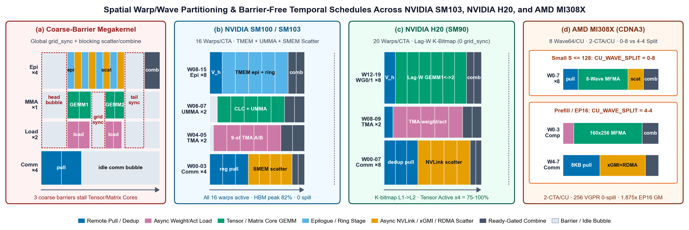

[English](README.md) | [简体中文](README_zh.md)

# Weave：面向 MoE Megakernel 的路由自适应动态调度与自动调参系统

Weave 是一个面向 MoE 推理的**路由自适应、无算子间全局栅栏（Zero Inter-Op `grid_sync`）融合 Megakernel**（C++/CUDA/HIP 统一实现，论文：[Weave: Fine-Grained Dynamic SM Scheduling in an MoE Megakernel for Compute-Communication Overlap](https://arxiv.org/abs/2609.21483)），支持 **NVIDIA SM100 / SM103**、**NVIDIA H20（SM90）** 与 **AMD MI308X（CDNA3 gfx942）**。系统通过**编译期一次性自动定标 + 运行时零环境变量选参**，驱动统一的 **14 个公开参数（空间 5 / 时间 3 / 实现 6）**，将跨卡通信与 Tensor/Matrix Core 计算细粒度重叠。

## 架构概览与跨硬件角色切分

| 硬件平台 | 语言 | 支持精度（`WEAVE_PRECISION_MODE`） | 内核入口 |
|---|---|---|---|
| NVIDIA SM100 / SM103 (148-SM) | CUDA C++ | `0=fp8xfp4`（默认）、`1=fp4xfp4`（NVFP4）、`3=bf16` | `sm100_fp8_fp4_mega_moe.cuh` / `sm100_fp4_fp4_mega_moe.cuh` |
| NVIDIA H20（SM90, 78-SM） | CUDA C++ | `2=fp8`（`fp8xfp8`） | `sm90_fp8_mega_moe.cuh` |
| AMD MI308X（gfx942, 80-CU） | HIP C++ | `2=fp8`（`fp8xfp8`，支持单机 EP8 与双机 EP16） | `gfx942_fp8_mega_moe.cuh` 与 `amd/ep16/v70/` |

Weave 消除算子间粗粒度全局屏障（`Notify->Pull`、`GEMM1->GEMM2`、`Scatter->Combine` 全部采用细粒度原子计数器与 `ld.acquire.sys` 就绪交接），并沿三个正交维度协同调度：

- **空间维度（Spatial，5 个 knob）**：独立控制参与拉取的 SM/CU 数（`D`）与异步 Scatter 的 SM/CU 数（`K`，$D \neq K$），以及单 SM/CU 内的通算比例——NVIDIA SM103 采用 `16 warps/CTA`（`4 Comm + 2 TMA + 2 UMMA/CLC + 8 TMEM Epilogue`），NVIDIA H20 采用 `20 warps/CTA`（`8 Comm + 2 TMA + 8 Math WG0/1`），AMD MI308X 在单 CU 8 个 Wave64（双 CTA/CU）上按负载动态切换 `0-8`（小 `S` 全算力打满 HBM）与 `4-4`（大 `S` 4 计算 wave 与 4 通信 wave 同驻重叠 xGMI + GDA RDMA）。
- **时间维度（Temporal，3 个 knob）**：首部由 `WEAVE_V_HEAD` 控制协助拉取配额、配合 `WEAVE_READY_GROUP_SIZE` 按 `N`-tile 组粒度提前启动 GEMM1；中部通过 `WEAVE_SCATTER_OWNER` 实施严格二分归属（`epilogue_only` 直写 vs `comm_only` 后台异步排空），并在 H20 上通过 `7-W` K-block 位图实现无栅栏 `GEMM1 <-> GEMM2` 交错；尾部由全部完成前序任务的空闲 warp/wave 协同执行就绪门控 Combine 归约。
- **单算子实现维度（Implementation，6 个 knob）**：**GEMM1、GEMM2、Dispatch、Scatter** 独立选参——选定 `WEAVE_GEMM1_CONFIG` / `WEAVE_GEMM2_CONFIG` 的 `blockM` 即同步锁定匹配的 `(blockN, blockK, mainloop_stages, epi_stages)`（默认 `0` 常开 host 形状自适应元组选择并自动执行 0-spill 钳位）；Dispatch 独立配置零 SMEM 寄存器直传宽度（`WEAVE_REG_PULL_BYTES`：NVIDIA `1024..4096 B/warp`，MI308X `8192 B/wave`）与跨卡拉取去重（`WEAVE_DEDUP_MODE`）；Scatter 独立选择 `reg_2stage`、`smem` 环或 `hbm_dedup` 通路（`WEAVE_SCATTER_STAGING`）。

## 快速开始与两阶段自动调参

    git clone https://github.com/ziyuhuang123/weave.git
    cd weave
    python -m pip install -e .
    python tests/verify_tunable_params_doc.py

在新机器上（动态读取架构号、SM/CU 数、SMEM/LDS 与 L2 容量，**无任何卡名硬编码**）只需两步即可自动获得最优参数（完整指南见 [docs/AUTOTUNE_AND_TUNING_GUIDE.md](docs/AUTOTUNE_AND_TUNING_GUIDE.md)）：

    # 第 1 步：编译期一次性定标（0-spill 编译门禁 + 分桶回文 ABBA 优选 + 4 条在线规则阈值标定）
    python -m deep_gemm.mega.autotune --model qwen3.8-2.4t --num-processes 4

    # 第 2 步：线上零环境变量推理（weave_mega_moe 自动加载本机 JSON 按实时路由查桶选参，CUDA/HIP Graph 下零 host 开销）
    python -c "from deep_gemm.mega import SymmBuffer, weave_mega_moe"

端到端自动调参实测台账：[results/autotune_e2e_b300_h20.json](results/autotune_e2e_b300_h20.json)、[results/autotune_e2e_mi308x_v70.json](results/autotune_e2e_mi308x_v70.json) 与跨 SKU 编译证明 [results/blackwell_sm100a_sm103a_compile_proof.json](results/blackwell_sm100a_sm103a_compile_proof.json)（`1440` 个 `sm_100a`/`sm_103a` 编译单元 `0` 失败）：
- **NVIDIA H20（30 格）**：零环境变量 `auto` **30/30** 落在手调 Oracle 的 `2%` 以内，相对官方 DeepGEMM 几何平均快 **`1.13x–1.25x`**（最高 **`1.69x`**）；
- **NVIDIA SM103 (148-SM)（20 格）**：**19/20** 落在手调 Oracle 的 `2%` 以内（`auto/Oracle` 几何平均 `0.973` 与 `0.992`）；
- **AMD MI308X 双节点 16x EP16（30 格）**：**30/30** 超越最快官方基线，几何平均加速 **`1.875x`**。

## 实测端到端性能与瓶颈资源利用率

在全部 **90 个评测格**（3 硬件平台 x 6 模型 x 5 档 `S in {16, 128, 1K, 8K, 16K}`，真实 ShareGPT 路由，台账 [results/bound_utilization_90cells_3hw.json](results/bound_utilization_90cells_3hw.json)，无外部依赖重绘脚本 `scripts/render_fig7_eval_speedup_3hw.py` 与 `scripts/render_fig7_bound_utilization_3hw.py`）中，每个系统的瓶颈资源峰值利用率为 `100 * T_bound / 实测时延`（`T_bound` 取关键 rank 上 HBM / 跨卡互连 / 算力三项硬件物理下界的最大值），Weave 在 **90/90** 格全部排名第一：

| 平台配置 | 对比基线 | 30 格几何平均加速比（区间） | Weave 瓶颈资源峰值利用率（GM / 区间） | 代表性大 `S` 表现 |
|---|---|---|---|---|
| **8x NVIDIA SM103 (148-SM)**, EP8 | DeepGEMM-MegaMoE, FlashInfer, SGLang, mKernel, FlashMoE, NanoFlow | **`1.219x`**（`1.05x–1.97x`） | `42.9%`（`5.8%–97.6%`） | `Qwen3.5-35B S=16K` 达 **`1.97x`**（利用率 `97.6%`） |
| **8x NVIDIA H20 (SM90)**, EP8 | DeepGEMM-MegaMoE, FlashInfer | **`1.212x`**（`1.01x–1.61x`） | `53.6%`（`13.3%–85.5%`） | 中小 `S <= 1K` 达 **`1.18x–1.61x`**；`S=16K` 达 `85.5%` 算力峰值 |
| **16x AMD MI308X (CDNA3)**, 双机 EP16 | AITER-1stage, vLLM (RCCL + 2-stage CK) | **`1.875x`**（`1.06x–2.87x`） | `21.6%`（均值 `34.2%`，`1.4%–92.0%`） | `S=16K` 六模型利用率 **`58.0%–92.0%`**（按双机 `4x400GbE = 25 GB/s/GPU` 线速与 `398.7 TFLOPS` SKU 峰值计） |

### 分平台同精度核心对照摘要

- **NVIDIA H20（4x EP4，零算子间 `grid_sync` 融合内核 vs 上游官方 DeepGEMM）**：72/72 组全张量校验通过（每次运行含 500 次连续发射 + 100 次 uniform/skew 交替压力发射，`max calc_diff = 3.96e-4`，台账 [results/h20_ep4_nogridsync_verified.json](results/h20_ep4_nogridsync_verified.json) 与 [results/h20_ep4_pure21_live_sweep.json](results/h20_ep4_pure21_live_sweep.json)）。在 `Qwen3.8-Max` 上 `S=1024` 达 **`1.49x–1.51x`**（`3246 -> 2174 us`），`S=4096` 达 **`1.16x`**（`6088 -> 5235 us`）；在 `Qwen3.5-35B S=16384` 上根除算子间 `grid_sync` 后相对官方提速 **`1.25x`**。
- **AMD MI308X（双节点 16x EP16，V70 双 CTA/CU Path-B `160x256` 冠军 vs `RCCL + AITER`）**：全部 21 个 `.co` 均为 `256 VGPR / 106 SGPR / 0 spill`，576/576 组 16-rank FP64 全元素校验 0 失败（台账 [results/ep16_mi308x_v70_16gpu_champion.json](results/ep16_mi308x_v70_16gpu_champion.json)）：

| 模型（16x MI308X EP16） | `S` | Weave V70 | 上一代 V62 | RCCL + AITER | V70 相对 RCCL + AITER |
|---|---:|---:|---:|---:|---:|
| `Qwen3.8-Max` 2.4T | `16384` | **`6,981.1 us`** | `8,042.6 us` | `17,156.9 us` | **`2.458x`** |
| `Qwen3.5-397B` | `16384` | **`2,363.4 us`** | `2,805.8 us` | `6,955.1 us` | **`2.943x`** |
| `MiniMax M3` | `16384` | **`3,519.2 us`** | `4,328.6 us` | `7,876.9 us` | **`2.238x`** |
| `DeepSeek-V4-Flash` | `16384` | **`2,573.0 us`** | `3,037.9 us` | `5,969.4 us` | **`2.320x`** |
| `Qwen3.5-122B` | `8192` | **`1,091.1 us`** | `1,362.6 us` | `2,374.1 us` | **`2.176x`** |
| `Qwen3.5-35B` | `8192` | **`850.0 us`** | `1,097.1 us` | `1,562.2 us` | **`1.838x`** |

- **NVIDIA SM103 (148-SM，4x EP4，`FP8 x MXFP4`，`E=256`）**：同进程回文 ABBA 对照官方原始 DeepGEMM（[results/sm103_ep4_vs_official_solo_summary.json](results/sm103_ep4_vs_official_solo_summary.json)），`S=1024`（`WEAVE_DISPATCH_ACTIVE_SMS=40`）为 **`292.86 us` vs `294.91 us`（`1.007x`）**，`S=4096` 持平（`399.44` vs `399.38 us`），10 次发射逐位一致。

## WeaveProfiler 软硬件对齐插桩时间线

三张 4-Panel 图均为同一次运行中同步采集的软硬件时间线（Panel A：硬件计数器利用率曲线；Panel B：全卡物理 SM/CU 瀑布图；Panel C：代表性 CTA 全量 warp/wave 轨道与异步深度条；Panel D：微观时间窗放大）：

- **NVIDIA SM103 (148-SM)，4x EP4，`Qwen3.8-2.4T S=1024`（`FP8 x NVFP4`）**：200 kHz `nsys` 同跑采集，16/16 个 warp 全量记录，0 spill，4/4 rank 逐位一致，热态 ABBA 插桩开销 `+9.28%`。HBM 带宽峰值 **`82.0%`**（均值 `72.8%`），Active SMs 均值 **`98.6%`**（148 SM 偏斜仅 `0.14%`），清晰呈现 `MEM`/`MMA` 异步在途深度与发射针。
- **NVIDIA H20 (78-SM)，4x EP4，`Qwen3.5-35B S=16384`（`FP8`，零 `grid_sync` 融合引擎）**：200 kHz `nsys` 同跑采集，20/20 个 warp 全量记录，热态 ABBA 插桩开销 `+8.84%`。根除算子间 `grid_sync` 后，`Tensor Active x4` 在计算主体全程连续维持 **`75–100%`**（峰值 `96.0%`，无任何中部同步深谷），`W00..W07` 在拉取完成后立即并发执行 `Async Comm Scatter (SMEM->NVLink)`，Panel D（`700–730 us`）直观展示 `WGMMA + TMA + NVLink Scatter` 三引擎并发重叠。
- **AMD MI308X (80-CU)，双机 16x EP16，`Qwen3.8-Max S=16384`（V70 `4-4` 构建）**：同跑采集全部 80 个物理 CU 与 CU 0 全部 8 个 Wave64（`W00..W03` 为 `Compute / Combine`，`W04..W07` 为 `Comm / Dispatch & Async Scatter`），`256 VGPR / 0 spill`。`rocprofiler-sdk` 实测曲线显示双机 RDMA 受限下 FP8 Matrix Core 持续保持 **`50–62%`**（相对 `398.7 TFLOPS` SKU 峰值），xGMI TX/RX 全双工并发，Active CUs 全程 `100.0%`。

## 统一核心 WEAVE_* 参数

公开参数面严格为 **14 个 knob、3 个类别**（空间 5 / 时间 3 / 实现 6）。下表同时给出每个参数的**同批实测单参收益**（台账：`results/ep16_mi308x_v70_16gpu_champion.json`、`results/h20_v12_comm_bound_sweep.json`、`results/sm103_v3_clean_config_sweep.json`、`results/sm103_qwen38max_full_sweep.json`）与 `tests/verify_tunable_params_doc.py` 自动校验的代码行号；完整逐硬件语法见 [docs/TUNABLE_PARAMETERS.md](docs/TUNABLE_PARAMETERS.md)，调参方法见 [docs/AUTOTUNE_AND_TUNING_GUIDE.md](docs/AUTOTUNE_AND_TUNING_GUIDE.md)。

### 空间（Spatial）

| 参数 | 分类 | 核心取值（默认 `0` / `auto`） | 作用机制 | 实测单参收益（同批对比） | 代码定位（`Host` / `Kernel`） |
|---|---|---|---|---|---|
| `WEAVE_DISPATCH_ACTIVE_SMS` | 空间 | `0=auto`，`D=1..N`（与 `K` 独立） | 限制参与跨卡拉取的活跃 SM/CU 数，其余 SM 立即进入预取/计算 | **1.41x** MI308X EP16（`1431->1015 us`）；**1.007x** SM103（`D=40`：`294.9->292.9 us`） | `csrc/jit_kernels/heuristics/weave_knob_config.hpp:173` / `deep_gemm/include/deep_gemm/impls/sm100_fp8_fp4_mega_moe.cuh:4073` |
| `WEAVE_SCATTER_ACTIVE_SMS` | 空间 | `0=auto`，`K=1..N`（与 `D` 独立） | 限制参与异步 Scatter 排空的 SM/CU 数，尾部 Combine 仍用全卡 SM | **1.015x** MI308X EP16（`1030->1015 us`）；**1.013x** H20 `S=4K`（`K=39`：`5299->5233 us`） | `csrc/jit_kernels/impls/sm100_fp8_fp4_mega_moe.hpp:204` / `deep_gemm/include/deep_gemm/impls/sm100_fp8_fp4_mega_moe.cuh:554` |
| `WEAVE_DISPATCH_WARPS` | 空间 | `0=默认`，`4`，`8` | 单 CTA 内专职跨卡拉取 token/scale 的通信 warp 配比 | **1.17x** H20 `S=16K`（`8` vs `4`：`1644->1403 us`，`-14.6%`） | `csrc/jit_kernels/heuristics/weave_knob_config.hpp:146` / `deep_gemm/include/deep_gemm/impls/sm100_fp8_fp4_mega_moe.cuh:1134` |
| `WEAVE_SCATTER_WARPS` | 空间 | `0=默认`，`4`，`8` | 单 CTA/CU 内专职异步 FC2 Scatter 写出的通信 warp/wave 数 | **1.17x** H20 `S=16K`（`1644->1405 us`）；**1.04x** MI308X EP16（`1015->976 us`） | `csrc/jit_kernels/impls/sm100_fp8_fp4_mega_moe.hpp:195` / `deep_gemm/include/deep_gemm/impls/sm100_fp8_fp4_mega_moe.cuh:529` |
| `WEAVE_CU_WAVE_SPLIT` | 空间 | MI308X：`auto, 0-8, 4-4, 8-0`；H20：`auto/7-W, 5-E, 6-E` | MI308X 单 CU 8-wave 通算切分；H20 无全局栅栏 L1/L2 K-block 交错流 | **2.15x** MI308X EP16（`4-4` vs `0-8`：`2185->1015 us`）；**1.053x** H20 `S=8K`（`926->880 us`） | `csrc/jit_kernels/heuristics/weave_knob_config.hpp:167` / `deep_gemm/include/deep_gemm/impls/amd/ep8/megamoe_amd_ep8.hip:80` |

### 时间（Temporal）

| 参数 | 分类 | 核心取值（默认 `0` / `auto`） | 作用机制 | 实测单参收益（同批对比） | 代码定位（`Host` / `Kernel`） |
|---|---|---|---|---|---|
| `WEAVE_V_HEAD` | 时间 | `0=auto`，`N=1..65536` | 层启动阶段协助拉取远端 token 的首部配额，缩短首块 GEMM1 等待 | **1.088x** H20 `S=8K`（`941.5->865.3 us`，`-8.1%`）；**1.043x** MI308X（`1015->973 us`） | `csrc/jit_kernels/heuristics/weave_knob_config.hpp:177` / `deep_gemm/include/deep_gemm/scheduler/weave_cost_model.cuh:30` |
| `WEAVE_READY_GROUP_SIZE` | 时间 | `0=整专家`，`1, 2, 4, 8, 16` | 按 `N` 个 tile 粒度发布到达信号，无需等整专家拉齐即启动 GEMM1 | **1.030x** MI308X EP16（`1` vs `16`：`1015->985 us`）；**1.009x** H20 `S=4K`（`5337->5289 us`） | `csrc/jit_kernels/impls/sm100_fp8_fp4_mega_moe.hpp:131` / `deep_gemm/include/deep_gemm/impls/sm100_fp8_fp4_mega_moe.cuh:111` |
| `WEAVE_SCATTER_OWNER` | 时间 | `0=epilogue_only`，`1=comm_only` | 严格二分的 FC2 跨卡发送归属（尾声直写 vs 通信 warp 全异步排空） | **1.14x** H20 `S=16K`（`comm_only`：`1244->1094 us`，`-12.0%`）；**1.034x** MI308X（`1015->981 us`） | `csrc/jit_kernels/heuristics/weave_knob_config.hpp:260` / `deep_gemm/include/deep_gemm/impls/sm100_fp8_fp4_mega_moe.cuh:1780` |

### 实现（Implementation）

| 参数 | 分类 | 核心取值（默认 `0` / `auto`） | 作用机制 | 实测单参收益（同批对比） | 代码定位（`Host` / `Kernel`） |
|---|---|---|---|---|---|
| `WEAVE_PRECISION_MODE` | 实现 | `0=fp8xfp4`，`1=fp4xfp4`，`2=fp8`，`3=bf16` | 选择 GEMM1/GEMM2 张量核数值精度与对应硬件后端 | **1.59x** SM103 `S=16K`（`fp4xfp4` vs `fp8xfp4`：`1038->654 us`）；**1.010x** H20（`5276->5224 us`） | `csrc/jit_kernels/heuristics/weave_knob_config.hpp:389` / `deep_gemm/include/deep_gemm/scheduler/weave_cost_model.cuh:25` |
| `WEAVE_GEMM1_CONFIG` | 实现 | `0=自适应常开` 或 `BM[:STORE_BM[:BK[:ST[:EPI]]]]`（旧名 `WEAVE_BLOCK_M_L1`） | 独立选择 FC1 配置元组并同步锁定 `BN/BK/stages/epi_stages`（自动防溢出） | **1.51x** H20 `S=16K`（`BM=128`：`1651->1091 us`，`-33.9%`）；**1.047x** SM103（`96,16`：`766->731 us`） | `csrc/jit_kernels/heuristics/weave_knob_config.hpp:113` / `deep_gemm/include/deep_gemm/impls/sm100_fp8_fp4_mega_moe.cuh:1253` |
| `WEAVE_GEMM2_CONFIG` | 实现 | `0=跟随/自适应` 或显式元组（与 FC1 解耦；旧名 `WEAVE_BLOCK_M_L2`） | 与 GEMM1 解耦的 FC2 独立配置元组（如 `32/64` 或非对称 `96,16` + `96,8`） | **1.036x** MI308X EP16（`64` vs `32`：`1051->1015 us`）；**1.025x** H20 `32/64`（`2234->2178 us`） | `csrc/jit_kernels/heuristics/weave_knob_config.hpp:116` / `deep_gemm/include/deep_gemm/impls/sm100_fp8_fp4_mega_moe.cuh:1255` |
| `WEAVE_REG_PULL_BYTES` | 实现 | `0=SMEM`，NVIDIA `1024/2048/4096`，MI308X `8192` | 零 SMEM 寄存器直传单轮拉取字节宽度，腾出片上内存给更深 GEMM 流水 | **1.19x** MI308X EP16（`8192` vs `1024`：`1212->1015 us`）；**1.024x** SM103（`4096`：`618.5->604.1 us`） | `csrc/jit_kernels/impls/sm100_fp8_fp4_mega_moe.hpp:135` / `deep_gemm/include/deep_gemm/impls/sm100_fp8_fp4_mega_moe.cuh:143` |
| `WEAVE_DEDUP_MODE` | 实现 | `0=off`，`1=on`（未设时按架构默认） | 跨卡拉取去重：同源多专家命中只跨卡拉一次并在片内广播扇出 | **1.067x** H20 `S=16K`（`1644->1540 us`）；**1.023x** MI308X EP16（`1` vs `0`：`1038->1015 us`） | `csrc/jit_kernels/impls/sm100_fp8_fp4_mega_moe.hpp:170` / `deep_gemm/include/deep_gemm/impls/sm100_fp8_fp4_mega_moe.cuh:443` |
| `WEAVE_SCATTER_STAGING` | 实现 | `0=reg_2stage`，`1=smem`，`2=hbm_dedup` | Scatter 暂存数据通路（双缓冲寄存器、无冲突 SMEM 环或 L2/HBM 去重缓冲） | **1.14x** H20 `S=16K`（`smem` vs `reg_2stage`：`1244->1094 us`）；**1.010x** MI308X（`1025->1015 us`） | `csrc/jit_kernels/heuristics/weave_knob_config.hpp:265` / `deep_gemm/include/deep_gemm/impls/sm100_fp8_fp4_mega_moe.cuh:1786` |

### 已退出公开参数面的内部开关与旧名别名

公开参数面严格固定为上述 **14 个 knob**（空间 5 / 时间 3 / 实现 6），且**全部 14 个参数均在对应负载形态上取得经同批 ABBA 验证的实测正收益**。原 21-knob 中的 6 个开关（`WEAVE_REDUCE_WARPS`, `WEAVE_COMBINE_SYNC_CHUNK`, `WEAVE_REG_BALANCE`, `WEAVE_LOCAL_SCATTER_DEDUP`, `WEAVE_SM0_STREAM_SCHED`, `WEAVE_READY_QUEUE`）已退为内部编译期宏（默认 `0`）与诊断开关；`WEAVE_ADAPT_GEMM_CONFIG`（旧别名 `WEAVE_ADAPT_BM`）亦不再公开——当 `WEAVE_GEMM1_CONFIG=0` 且 `WEAVE_GEMM2_CONFIG=0` 时 host 形状自适应元组选择默认常开，`=0` 仅作内部固定元组诊断覆盖。透明兼容旧名别名：

- 旧名 `WEAVE_BLOCK_M_L1` -> `WEAVE_GEMM1_CONFIG`
- 旧名 `WEAVE_BLOCK_M_L2` -> `WEAVE_GEMM2_CONFIG`

`num_shared_experts` 为 Python/C++ API 参数（默认 `0`，显式非零时才分配共享专家缓冲区）。

### 已知限制

以下边界均来自实测或代码审计（完整细节见 [docs/TUNABLE_PARAMETERS.md](docs/TUNABLE_PARAMETERS.md)）：

**NVIDIA SM103**

- 内部开关 `WEAVE_LOCAL_SCATTER_DEDUP=1`（已退出公开面）在 `S=1024..8192` 下近似活锁（`81-363 ms`），请勿开启。
- 手动指定 `BM=128` + `EPI=2` 会被 host 自动钳位为 `EPI=1` 以保证 0 spill（`BM80/96 epi2` 与 `BM128 epi1` 均为 128 寄存器 0 spill）；当前默认常开的 host 自适应仅选择 launch 级元组。
- 内部 `WEAVE_REDUCE_WARPS > 0` 实测慢于 `0`（`S=1024` 下 `315-317 us` vs `295 us`）；内部 `WEAVE_REG_BALANCE=1` 仅在 `E/rank > 64` 生效；`WEAVE_CU_WAVE_SPLIT` 在 SM103 上无设备端效果；CTA-0 在线层仅在设置内部开关 `WEAVE_SM0_STREAM_SCHED=1` 或 `WEAVE_READY_QUEUE=sm0_fifo` 时编入。

**NVIDIA H20**

- 4-warpgroup Swap-AB 在相同输入重复 launch 间存在约 `1e-8` 的 BF16 末位差异（相对 FP32 `calc_diff ~ 3.55e-4 < 1e-3`，`cos > 0.9996`）。
- `WEAVE_GEMM1_CONFIG=64`（旧名 `WEAVE_BLOCK_M_L1=64`）与不等 `GEMM2` 的拆分组合因寄存器溢出被 host 拒绝，拆分请用 `16`/`32` 或使用等 `BM` 融合发射；显式固定元组优先于自适应。
- 内部 `WEAVE_REDUCE_WARPS=1/2` 实测慢 `1.0-2.5%`，内部 `WEAVE_COMBINE_SYNC_CHUNK > 0` 不属于任何胜者；H20 融合路径下 `WEAVE_CU_WAVE_SPLIT` 默认采用无算子间栅栏的 `7-W`（旧粗粒度栅栏模式 `0..4` 已拒绝）。

## 基线、消融与验证门禁

- **启动示例与基线评测**：[examples/README_zh.md](examples/README_zh.md)、[baselines/README_zh.md](baselines/README_zh.md)、[ablation/README_zh.md](ablation/README_zh.md)。48 组配置逐步消融（论文 Table IV）在 SM103 / H20 / MI308X EP16 上相对基线几何平均加速分别为 `1.301x / 1.162x / 2.147x`（去掉空间调度 `-S` 降至 `1.192x / 1.137x / 1.808x`，再去掉时间调度 `-S-T` 降至 `1.010x / 1.053x / 1.537x`）。
- **AMD MI308X EP16 V70 构建与自动调优**：`python deep_gemm/include/deep_gemm/impls/amd/ep16/v70/build_v70.py --dry-run`（无 ROCm 主机亦可校验编译闭包）或 `v70_autotune.py`。
- **仓库门禁一键检查**：

    python tools/gen_tunable_params_doc.py --check
    python tests/verify_tunable_params_doc.py
    python tests/check_weave_knob_schema.py
    python tests/test_21_weave_knobs_surface.py
    python tests/test_no_inter_op_grid_sync.py
    python tests/test_autotune_and_runtime_selector.py
    python tests/test_ep16_v70_champion.py

## 引用

Ziyu Huang, Yangjie Zhou, Chenhao Zhu, Peng Yu, Zihan Liu, Jinyu Liu, Shulai Zhang, Xingxun Tang, Hongzhe Yan, Xinhao Luo, Minyi Guo, Xiu Lin, Yinghao Yu, Guodong Yang, Liping Zhang, Shixuan Sun, and Jingwen Leng. Weave: Fine-Grained Dynamic SM Scheduling in an MoE Megakernel for Compute-Communication Overlap. arXiv:2609.21483, 2026. <https://arxiv.org/abs/2609.21483>

    @misc{huang2026weavefinegraineddynamicsm,
          title={Weave: Fine-Grained Dynamic SM Scheduling in an MoE Megakernel for Compute-Communication Overlap},
          author={Ziyu Huang and Yangjie Zhou and Chenhao Zhu and Peng Yu and Zihan Liu and Jinyu Liu and Shulai Zhang and Xingxun Tang and Hongzhe Yan and Xinhao Luo and Minyi Guo and Xiu Lin and Yinghao Yu and Guodong Yang and Liping Zhang and Shixuan Sun and Jingwen Leng},
          year={2026},
          eprint={2609.21483},
          archivePrefix={arXiv},
          primaryClass={cs.DC},
          url={https://arxiv.org/abs/2609.21483},
    }
