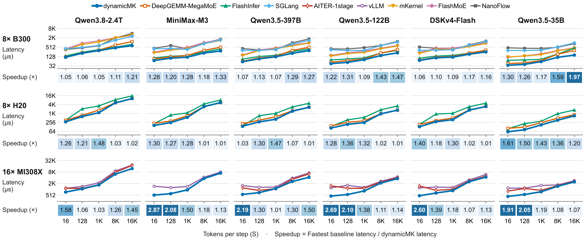
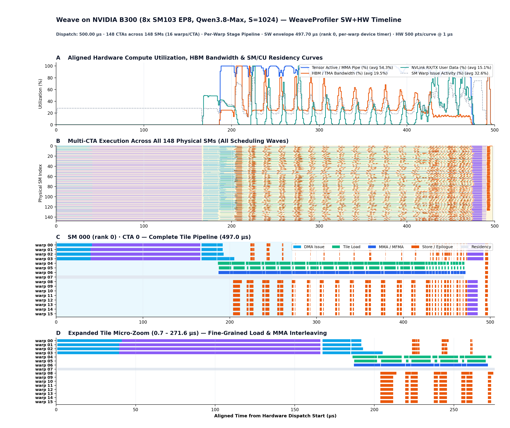
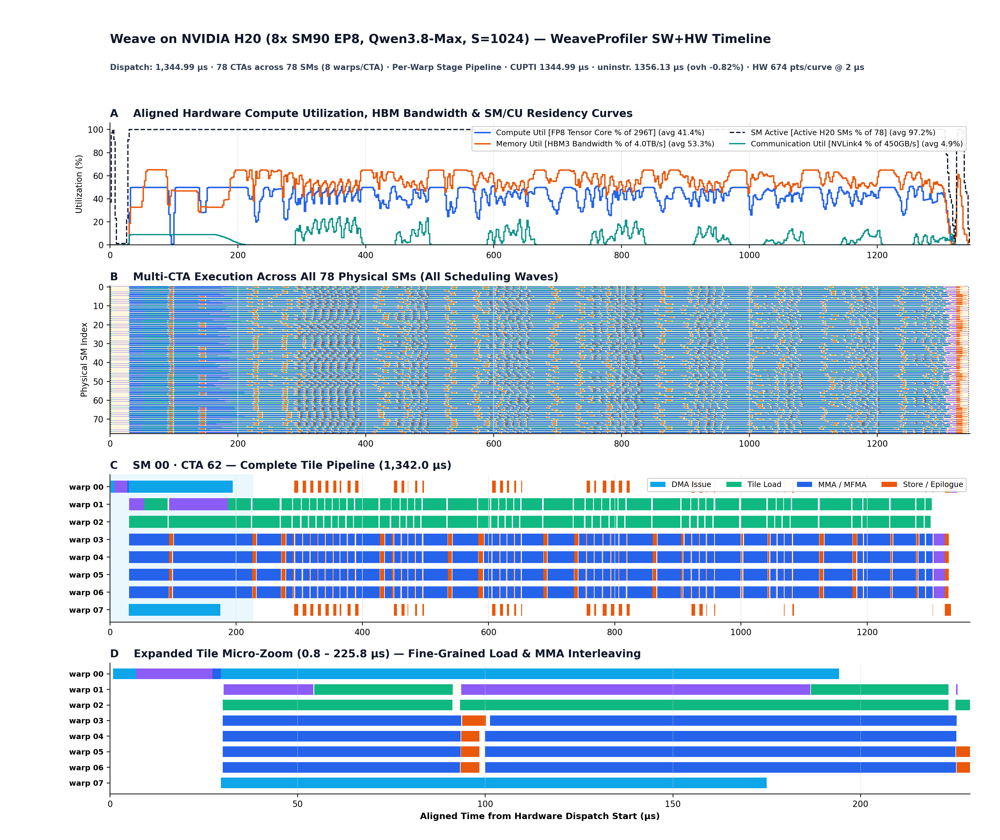
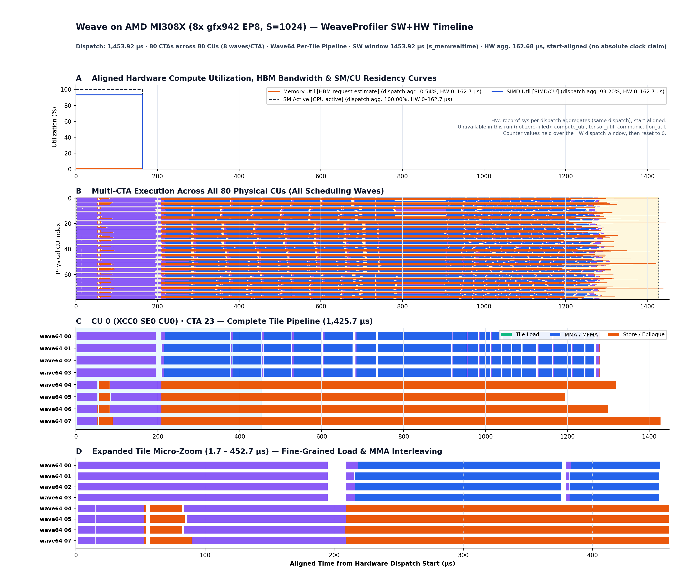

[English](README.md) | [简体中文](README_zh.md)

# Weave：面向 B300、H20 与 MI308X 的统一 C++ MegaMoE

Weave 是论文 **Weave: Fine-Grained Dynamic SM Scheduling in an MoE
Megakernel for Compute-Communication Overlap**
（[arXiv:2609.21483](https://arxiv.org/abs/2609.21483)）中 MoE megakernel 的
统一 C++/CUDA/HIP 实现。同一套调度契约覆盖 NVIDIA B300、NVIDIA H20 与
AMD MI308X。

## 架构

| 硬件 | 语言 | 精度 | 入口 |
|---|---|---|---|
| NVIDIA B300（SM100/SM103） | CUDA C++ | mma_type in {fp8xfp4, fp4xfp4 (NVFP4)} | sm100_fp8_fp4_mega_moe.cuh / sm100_fp4_fp4_mega_moe.cuh，通过 weave_mega_moe(..., mma_type=...) 分派 |
| NVIDIA H20（SM90） | CUDA C++ | fp8 | sm90_fp8_mega_moe.cuh |
| AMD MI308X（gfx942） | HIP C++ | fp8（EP8 与 EP16） | gfx942_fp8_mega_moe.cuh 与 amd/megamoe_amd.hip |

内核使用单一发布轨。CTA 0 读取 dispatch 完成后的实时直方图，计算 Eq.(1)-(3)，
再用 release store 发布 PolicyDecision；所有 CTA 通过 load_published_policy 或
wait_and_copy_policy 获取它。被选择的三项动态决策是 r_mask、scatter mode 与
V_head。该路径没有主机往返，也没有动态并行启动。

## 快速开始

    git clone https://github.com/ziyuhuang123/weave.git
    cd weave
    python -m pip install -e .
    python -m py_compile baselines/*.py ablation/*.py
    python tests/verify_tunable_params_doc.py

Python 入口示意：

    import torch
    from deep_gemm.mega import SymmBuffer, weave_mega_moe

    # 先为进程组和模型形状构造对称缓冲区，然后调用：
    # weave_mega_moe(y, l1_weights, l2_weights, sym_buffer,
    #                mma_type="fp4xfp4")
    # B300 支持 fp8xfp4 与 fp4xfp4；H20 使用 fp8。

也可以设置公开精度选择器：

    export WEAVE_PRECISION_MODE=fp4xfp4

## 实测性能

论文 Fig. 7：三硬件 MoE 层实测加速比。

下表全部为真实硬件实测值。所有 TFLOPS 都是单卡值，绝不是集群聚合值。计时前已在
每个 rank 上检查完整输出。

| 硬件 / 规模 | 精度 | 全输出正确性 | 实测延迟与吞吐 | 结论 |
|---|---|---|---|---|
| 8x NVIDIA B300/SM103-class 安装；4 卡可用验证窗口 | fp4xfp4 (NVFP4) | EP4，S=16，H=6144，I=2048，E=128，K=8；4/4 rank 有限，统一路径与直接路径逐位一致，512 条路由；4/4 轮完整 FP32 参考 PASS；CTA-0 现场回读 magic 0x57415645、version 4、published_epoch=2、valid=1 | 跨 rank 中位数之中位数 172.384 us；最慢 rank 172.480 us；54.418 TFLOPS/GPU 标称值（52.088--60.001）。加入发布轨前参考值 143.552 us、65.757 TFLOPS/GPU | PASS |
| 同一 B300 安装 | fp8xfp4 | EP1 构建参考并打印预期配置，但首次 kernel launch 未返回；不主张任何输出或延迟。新克隆复现挂起；compute-sanitizer memcheck 在挂起前未发现非法访问 | 未测量 | BLOCKED_RUNTIME_HANG |
| 8x NVIDIA H20 EP8 | fp8 | Qwen3.8-Max，E=512，K=10，H=8192，I=2048；最差 rank calc_diff 5.924e-4--5.948e-4，最差 rel_l2 0.034483，cos_sim 0.999405；全部 rank PASS | S=128 AUTO=1 1452.512 us，对比 AUTO=0 1942.784 us，延迟变化 -25.24%；S=1024 AUTO=1 4977.584 us，对比 AUTO=0 4981.344 us | PASS |
| 8x AMD MI308X EP8 | fp8 | 4/4 全输出 cell 在 8 个 rank 上全部 PASS；最大 rel_l2 0.001545--0.001908，最大行 rel_l2 0.001952--0.005731，device_error=0 | qwen38max S=16 687.422/713.942 us；S=128 1539.625/1554.185 us；DeepSeek-V4-Flash S=16 378.761/395.421 us；S=128 699.642/709.743 us；单卡 TFLOPS 1.595--9.219 | PASS |
| 16x AMD MI308X EP16（2 节点 x 8） | fp8 | 16/16 rank 全元素 FP64 对比 PASS；qwen38max S=128 与 DeepSeek-V4-Flash S=128；最大 rel_l2 0.012535/0.012292，最大行 rel_l2 0.019612/0.015528；96 条 launch-state 记录 device_error=0 | qwen38max metric1 1594.079 -> 1010.679 us（1.5772x），metric2 1591.939 -> 1006.619 us（1.5815x）；DeepSeek-V4-Flash metric1 1387.055 -> 735.300 us（1.8864x），metric2 1367.269 -> 732.679 us（1.8661x） | PASS |

B300 fp8xfp4 路径可以编译，两个 B300 内核都带有 CTA-0 策略轨，但 FP8xFP4 的首次
启动仍卡在 FP8 GEMM 事务屏障协议。移除策略轨、限制 rank 顺序、删除 pull 等待、
改变 block 形状都会复现同一等待。这是尚未解决的运行时调查，不是 PASS。相同源码
线上的 NVFP4 sibling 已完成端到端验证并具备现场策略回读。

## WeaveProfiler 软硬件时间线

三张图遵循官方四面板契约：硬件计数器、全部物理 SM/CU 泳道、代表性 CTA 流水线、
tile 级微缩放。数值来自已测配对 trace；不可用的计数器保持 unavailable，不填零。
MI308X 的硬件计数器是每次 dispatch 的聚合值；trace 自身声明窗口长度不一致，不
主张绝对时钟对齐。

## 参数如何选择：三层绑定层级

**第一层：编译期 / 架构固定工程旋钮。** 这些值由 SMEM、TMEM、VGPR 与零 spill
约束按 GPU 架构固定。它们以 WEAVE_* 名称公开，便于消融和未来架构复用，包括累加器
环深度、TMA store 深度、寄存器预算与异构角色编码。

**第二层：主机侧形状与 padding 启发式。** 启动前根据静态 (E, H, I, K, S) 执行
O(1) 确定性规则。B300 使用 tile 尺寸阶梯，H20 使用 pad_frac >= 25% 的 swapAB 门控，
MI308X 使用 block-M 档位与 RDMA chunk 规划。该层不读取实时路由直方图。

**第三层：内核内 CTA-0 运行时代价模型（论文 Eq. 1-3）。** dispatch 完成后，CTA 0
只选择三个依赖路由的动态决策：(r, s, V_head)。代价模型用于排序而不是绝对时延
预言。在 B300 的 48 个实测 cell 上，平均绝对时延预测误差为 34.0%，但共享开销在
argmin 中相互抵消：它达到 38/48 的 Oracle 完全一致，取得 1.301x 几何平均加速，
而穷举 Oracle 为 1.332x，几何平均选择后悔为 2.4%。这一差异是有意披露的设计论点。

下表每一行都标注层级。每个 file:line 引用由
tests/verify_tunable_params_doc.py 机械校验。完整参数文档见
[docs/TUNABLE_PARAMETERS.md](docs/TUNABLE_PARAMETERS.md)。

## 统一核心 WEAVE_* 参数

| 参数 | 层级 | 取值 | 默认值 | 机制 | 主机解析 | 内核消费 |
|---|---|---|---|---|---|---|
| `WEAVE_PRECISION_MODE` | 1 | fp8xfp4  /  fp4xfp4  /  fp8  /  bf16 | fp8xfp4 (0) | 一阶精度开关，决定字节宽度与张量核吞吐率。 | `deep_gemm/include/deep_gemm/scheduler/weave_knobs.cuh:269` | `deep_gemm/include/deep_gemm/scheduler/weave_cost_model.cuh:25` |
| `WEAVE_ABLATION_PRESET` | 1 | 0/1/2/3 | 0 | 四臂渐进消融：Weave、-S、-S-T、-S-T-C。 | `deep_gemm/include/deep_gemm/scheduler/weave_knobs.cuh:40` | `deep_gemm/include/deep_gemm/scheduler/weave_cost_model.cuh:26` |
| `WEAVE_ENABLE_COST_MODEL` | 3 | 0/1 | preset 0 时为 1 | CTA-0 运行时 Eq.(1)-(3) 选择总开关。 | `deep_gemm/include/deep_gemm/scheduler/weave_knobs.cuh:49` | `deep_gemm/include/deep_gemm/scheduler/weave_cost_model.cuh:27` |
| `WEAVE_COMM_UNITS` | 1 | uint32 | 4 | 关闭搜索时使用的编译期默认通信单元数。 | `deep_gemm/include/deep_gemm/scheduler/weave_knobs.cuh:59` | `deep_gemm/include/deep_gemm/scheduler/weave_cost_model.cuh:28` |
| `WEAVE_COMP_UNITS` | 1 | uint32 | 4 | 关闭搜索时使用的编译期默认计算单元数。 | `deep_gemm/include/deep_gemm/scheduler/weave_knobs.cuh:69` | `deep_gemm/include/deep_gemm/scheduler/weave_cost_model.cuh:29` |
| `WEAVE_V_HEAD` | 3 | uint32 | 自动（0xffffffff） | Head-pull 预算覆盖值；自动值由 Eq.(3) 给出。 | `deep_gemm/include/deep_gemm/scheduler/weave_knobs.cuh:259` | `deep_gemm/include/deep_gemm/scheduler/weave_cost_model.cuh:30` |
| `WEAVE_SCATTER_MODE` | 3 | 0/1/2 | 1 | 内联 epilogue、通信队列 scatter 或本地去重 scatter。 | `deep_gemm/include/deep_gemm/scheduler/weave_knobs.cuh:159` | `deep_gemm/include/deep_gemm/scheduler/weave_cost_model.cuh:31` |
| `WEAVE_OVERLAP_PIPELINE` | 2 | 0/1 | 1（preset >=2 时为 0） | dispatch、GEMM、scatter 与 combine 的时间重叠。 | `deep_gemm/include/deep_gemm/scheduler/weave_knobs.cuh:149` | `deep_gemm/include/deep_gemm/scheduler/weave_cost_model.cuh:32` |
| `WEAVE_SELECTIVE_DEDUP` | 2 | 0/1 | 1（preset 3 时为 0） | 按（token，目的 rank）唯一化通信桶。 | `deep_gemm/include/deep_gemm/scheduler/weave_knobs.cuh:199` | `deep_gemm/include/deep_gemm/scheduler/weave_cost_model.cuh:33` |
| `WEAVE_ALL_WAVE_COMBINE` | 2 | 0/1 | 1（preset >=2 时为 0） | 使用全部可用 wave 协作完成尾部 combine。 | `deep_gemm/include/deep_gemm/scheduler/weave_knobs.cuh:179` | `deep_gemm/include/deep_gemm/scheduler/weave_cost_model.cuh:34` |
| `WEAVE_TAIL_FINE_GRAINED` | 2 | 0/1 | 1（preset >=2 时为 0） | 采用细粒度尾部归约，替代单体尾部。 | `deep_gemm/include/deep_gemm/scheduler/weave_knobs.cuh:249` | `deep_gemm/include/deep_gemm/scheduler/weave_cost_model.cuh:373` |

## NVIDIA B300 WEAVE_* 参数

| 参数 | 层级 | 取值 | 默认值 | 机制 | 主机解析 | 内核消费 |
|---|---|---|---|---|---|---|
| `WEAVE_READY_GROUP_SIZE` | 1 | 0/1/2/4/8/16 | 0 | 专家就绪发布的分组粒度。 | `csrc/jit_kernels/impls/sm100_fp8_fp4_mega_moe.hpp:129` | `deep_gemm/include/deep_gemm/impls/sm100_fp8_fp4_mega_moe.cuh:7` |
| `WEAVE_WARP_SPLIT_MODE` | 1 | 0..15 | 0 | Dispatch warp 重配置与寄存器切分模式。 | `csrc/jit_kernels/impls/sm100_fp8_fp4_mega_moe.hpp:131` | `deep_gemm/include/deep_gemm/impls/sm100_fp8_fp4_mega_moe.cuh:23` |
| `WEAVE_REG_PULL_BYTES` | 1 | 0/1024/2048/4096 | 0 | 寄存器直通拉取宽度；0 表示使用 SMEM 暂存。 | `csrc/jit_kernels/impls/sm100_fp8_fp4_mega_moe.hpp:132` | `deep_gemm/include/deep_gemm/impls/sm100_fp8_fp4_mega_moe.cuh:39` |
| `WEAVE_HETERO_SM_LIMIT` | 1 | 0..148 | 74 | 异构角色切分的 SM id 上限。 | `csrc/jit_kernels/impls/sm100_fp8_fp4_mega_moe.hpp:133` | `deep_gemm/include/deep_gemm/impls/sm100_fp8_fp4_mega_moe.cuh:55` |
| `WEAVE_DISP_REGS` | 1 | register count | 0 | 显式 dispatch warp 寄存器预算。 | `csrc/jit_kernels/impls/sm100_fp8_fp4_mega_moe.hpp:134` | `deep_gemm/include/deep_gemm/impls/sm100_fp8_fp4_mega_moe.cuh:66` |
| `WEAVE_EPI_REGS` | 1 | register count | 0 | 显式 epilogue warp 寄存器预算。 | `csrc/jit_kernels/impls/sm100_fp8_fp4_mega_moe.hpp:135` | `deep_gemm/include/deep_gemm/impls/sm100_fp8_fp4_mega_moe.cuh:77` |
| `WEAVE_BLOCK_M` | 2 | 32/64/96/128/192 | 形状启发式 | GEMM tile M 覆盖值。 | `csrc/jit_kernels/impls/sm100_fp8_fp4_mega_moe.hpp:137` | `deep_gemm/include/deep_gemm/impls/sm100_fp8_fp4_mega_moe.cuh:88` |
| `WEAVE_BLOCK_N` | 2 | 64/128/256 | 形状启发式 | GEMM tile N 覆盖值。 | `csrc/jit_kernels/impls/sm100_fp8_fp4_mega_moe.hpp:138` | `deep_gemm/include/deep_gemm/impls/sm100_fp8_fp4_mega_moe.cuh:104` |
| `WEAVE_BLOCK_K` | 2 | 64/128/256 | 形状启发式 | GEMM tile K 覆盖值。 | `csrc/jit_kernels/impls/sm100_fp8_fp4_mega_moe.hpp:139` | `deep_gemm/include/deep_gemm/impls/sm100_fp8_fp4_mega_moe.cuh:120` |
| `WEAVE_STORE_BLOCK_M` | 2 | 4/8/16/32 | 形状启发式 | TMA store 的 M 粒度。 | `csrc/jit_kernels/impls/sm100_fp8_fp4_mega_moe.hpp:140` | `deep_gemm/include/deep_gemm/impls/sm100_fp8_fp4_mega_moe.cuh:136` |
| `WEAVE_DYN_EPILOGUE` | 1 | 0/1/2 | 0 | 动态 epilogue 轮数。 | `csrc/jit_kernels/impls/sm100_fp8_fp4_mega_moe.hpp:141` | `deep_gemm/include/deep_gemm/impls/sm100_fp8_fp4_mega_moe.cuh:152` |
| `WEAVE_DYN_TMA_A` | 1 | 0/1/2 | 0 | 小 M 场景的动态 TMA-A 描述符。 | `csrc/jit_kernels/impls/sm100_fp8_fp4_mega_moe.hpp:142` | `deep_gemm/include/deep_gemm/impls/sm100_fp8_fp4_mega_moe.cuh:168` |
| `WEAVE_OVERLAP_EXPERT_SMEM` | 1 | 0/1 | 0 | 专家元数据 SMEM 与下一 tile 重叠。 | `csrc/jit_kernels/impls/sm100_fp8_fp4_mega_moe.hpp:143` | `deep_gemm/include/deep_gemm/impls/sm100_fp8_fp4_mega_moe.cuh:184` |
| `WEAVE_EXPERT_STEP_MODE` | 1 | 0/1/2 | 0 | 专家步进调度模式。 | `csrc/jit_kernels/impls/sm100_fp8_fp4_mega_moe.hpp:144` | `deep_gemm/include/deep_gemm/impls/sm100_fp8_fp4_mega_moe.cuh:200` |
| `WEAVE_ACCUM_STAGES` | 1 | 2/3/4 | 2 | TMEM 累加器环形深度。 | `csrc/jit_kernels/impls/sm100_fp8_fp4_mega_moe.hpp:145` | `deep_gemm/include/deep_gemm/impls/sm100_fp8_fp4_mega_moe.cuh:216` |
| `WEAVE_TMA_STORE_STAGES` | 1 | 2..6 | 2 | TMA store 环形深度。 | `csrc/jit_kernels/impls/sm100_fp8_fp4_mega_moe.hpp:146` | `deep_gemm/include/deep_gemm/impls/sm100_fp8_fp4_mega_moe.cuh:227` |
| `WEAVE_SCHED_STAGES` | 1 | 2/3 | 2 | 调度器前瞻深度。 | `csrc/jit_kernels/impls/sm100_fp8_fp4_mega_moe.hpp:147` | `deep_gemm/include/deep_gemm/scheduler/mega_moe.cuh:238` |
| `WEAVE_EXPERTS_PER_WAVE` | 2 | 1/2/4/8/16/32/64 | 形状启发式 | 单个调度 wave 分配的专家数。 | `csrc/jit_kernels/impls/sm100_fp8_fp4_mega_moe.hpp:149` | `deep_gemm/include/deep_gemm/scheduler/mega_moe.cuh:254` |
| `WEAVE_STATIC_EXPERT_ORDER` | 2 | 0/1 | 0 | 使用静态专家顺序表。 | `csrc/jit_kernels/impls/sm100_fp8_fp4_mega_moe.hpp:150` | `deep_gemm/include/deep_gemm/scheduler/mega_moe.cuh:270` |
| `WEAVE_READY_QUEUE` | 2 | 0/1 | 0 | 启用动态 ready 队列。 | `csrc/jit_kernels/impls/sm100_fp8_fp4_mega_moe.hpp:151` | `deep_gemm/include/deep_gemm/scheduler/mega_moe.cuh:286` |
| `WEAVE_SCHED_MODE` | 2 | 0..3 | 0 | 调度模式选择器。 | `csrc/jit_kernels/impls/sm100_fp8_fp4_mega_moe.hpp:152` | `deep_gemm/include/deep_gemm/scheduler/mega_moe.cuh:302` |
| `WEAVE_DEDUP_MODE` | 2 | 0/1/2 | 0 | 去重模式：关闭、去重、本地预归约。 | `csrc/jit_kernels/impls/sm100_fp8_fp4_mega_moe.hpp:155` | `deep_gemm/include/deep_gemm/impls/sm100_fp8_fp4_mega_moe.cuh:318` |
| `WEAVE_DEDUP_SCHED` | 2 | 0/1 | dedup=2 时为 1 | 去重调度器开关。 | `csrc/jit_kernels/impls/sm100_fp8_fp4_mega_moe.hpp:156` | `deep_gemm/include/deep_gemm/scheduler/mega_moe.cuh:334` |
| `WEAVE_COMBINE_GROUP_TILES` | 2 | 1/2/4/8/16 | 0 | Combine 分组 tile 数。 | `csrc/jit_kernels/impls/sm100_fp8_fp4_mega_moe.hpp:158` | `deep_gemm/include/deep_gemm/impls/sm100_fp8_fp4_mega_moe.cuh:350` |
| `WEAVE_COMBINE_REDUCE_WARPS` | 2 | 0/1/2/4/8/16 | 0（全部 epilogue warp） | 静态 combine warp 上限。 | `csrc/jit_kernels/impls/sm100_fp8_fp4_mega_moe.hpp:159` | `deep_gemm/include/deep_gemm/impls/sm100_fp8_fp4_mega_moe.cuh:366` |
| `WEAVE_SCATTER_SMEM_ALIAS` | 1 | 0/1 | 1 | Scatter 暂存 SMEM 与 epilogue 存储复用。 | `csrc/jit_kernels/impls/sm100_fp8_fp4_mega_moe.hpp:163` | `deep_gemm/include/deep_gemm/impls/sm100_fp8_fp4_mega_moe.cuh:393` |
| `WEAVE_SCATTER_WARPS` | 2 | 0/2/4/8 | 0 (auto) | Scatter 执行 warp 数。 | `csrc/jit_kernels/impls/sm100_fp8_fp4_mega_moe.hpp:164` | `deep_gemm/include/deep_gemm/impls/sm100_fp8_fp4_mega_moe.cuh:404` |
| `WEAVE_SCATTER_HANDOFF_WAIT` | 2 | 0/1 | 1 | 交接前等待 combine-ready epoch。 | `csrc/jit_kernels/impls/sm100_fp8_fp4_mega_moe.hpp:165` | `deep_gemm/include/deep_gemm/impls/sm100_fp8_fp4_mega_moe.cuh:420` |
| `WEAVE_SHARED_L2_EARLY_BLOCKS` | 1 | 0..148 | 10 | 用于预热共享 L2 复用的早期 block 数。 | `csrc/jit_kernels/impls/sm100_fp8_fp4_mega_moe.hpp:203` | `deep_gemm/include/deep_gemm/impls/sm100_fp8_fp4_mega_moe.cuh:431` |
| `WEAVE_ENABLE_MULTICAST` | 1 | 1 | 1 | B300 FP8xFP4 内核所需的双 CTA TMA 多播。 | `csrc/jit_kernels/impls/sm100_fp8_fp4_mega_moe.hpp:166` | `deep_gemm/include/deep_gemm/impls/sm100_fp8_fp4_mega_moe.cuh:442` |
| `WEAVE_SCATTER_MODE` | 3 | 0/1/2 | 0 | SM100 数据流的 scatter 路径覆盖值。 | `csrc/jit_kernels/impls/sm100_fp8_fp4_mega_moe.hpp:161` | `deep_gemm/include/deep_gemm/impls/sm100_fp8_fp4_mega_moe.cuh:382` |

## NVIDIA H20 WEAVE_* 参数

| 参数 | 层级 | 取值 | 默认值 | 机制 | 主机解析 | 内核消费 |
|---|---|---|---|---|---|---|
| `WEAVE_SWAPAB_AUTO` | 2 | 0/1 | 0 | 启用带 padding 感知的自动 swap-AB 选择。 | `csrc/jit_kernels/heuristics/sm90_mega_moe.hpp:654` | `csrc/jit_kernels/heuristics/sm90_mega_moe.hpp:654` |
| `WEAVE_SWAPAB_EPI_WG` | 2 | 2/4 | 2 | swap-AB 下的 epilogue warpgroup 数。 | `csrc/jit_kernels/heuristics/sm90_mega_moe.hpp:650` | `csrc/jit_kernels/heuristics/sm90_mega_moe.hpp:650` |
| `WEAVE_SWAPAB_MAX_LOAD` | 2 | int | 形状启发式 | swap-AB 的负载上界。 | `csrc/jit_kernels/heuristics/sm90_mega_moe.hpp:669` | `csrc/jit_kernels/heuristics/sm90_mega_moe.hpp:669` |
| `WEAVE_SWAPAB_PAD_PCT` | 2 | 0..100 | 25 | swap-AB 的 padding 比例门限。 | `csrc/jit_kernels/heuristics/sm90_mega_moe.hpp:639` | `csrc/jit_kernels/heuristics/sm90_mega_moe.hpp:639` |
| `WEAVE_SWAPAB_MIN_LOAD` | 2 | int | 8 | swap-AB 的负载下界。 | `csrc/jit_kernels/heuristics/sm90_mega_moe.hpp:640` | `csrc/jit_kernels/heuristics/sm90_mega_moe.hpp:640` |
| `WEAVE_MCAST` | 1 | 0/1/2 | 0 | SM90 多播模式。 | `csrc/jit_kernels/heuristics/sm90_mega_moe.hpp:229` | `deep_gemm/include/deep_gemm/impls/sm90_fp8_mega_moe.cuh:7` |
| `WEAVE_SWIZZLE_TILES` | 2 | 0/1 | 0 | 启用跨专家 tile 的 swizzle。 | `csrc/jit_kernels/heuristics/sm90_mega_moe.hpp:230` | `deep_gemm/include/deep_gemm/impls/sm90_fp8_mega_moe.cuh:18` |
| `WEAVE_HOT_COLD_MODE` | 2 | 0/1/2 | 0 | 热/冷专家权重驻留策略。 | `csrc/jit_kernels/heuristics/sm90_mega_moe.hpp:231` | `deep_gemm/include/deep_gemm/impls/sm90_fp8_mega_moe.cuh:29` |
| `WEAVE_DEDUP_DISPATCH` | 2 | 0/1 | 0 | 去重 dispatch 行。 | `csrc/jit_kernels/heuristics/sm90_mega_moe.hpp:232` | `deep_gemm/include/deep_gemm/impls/sm90_fp8_mega_moe.cuh:40` |
| `WEAVE_DEDUP_SCATTER` | 2 | 0/1 | 0 | 去重 scatter 目的端。 | `csrc/jit_kernels/heuristics/sm90_mega_moe.hpp:233` | `deep_gemm/include/deep_gemm/impls/sm90_fp8_mega_moe.cuh:51` |
| `WEAVE_REG_COMBINE` | 1 | 0/1/2 | 0 | 寄存器直通 combine 路径。 | `csrc/jit_kernels/heuristics/sm90_mega_moe.hpp:234` | `deep_gemm/include/deep_gemm/impls/sm90_fp8_mega_moe.cuh:62` |
| `WEAVE_ALL_IDLE_COMBINE` | 2 | 0/1 | 0 | combine 阶段使用空闲 warp。 | `csrc/jit_kernels/heuristics/sm90_mega_moe.hpp:235` | `deep_gemm/include/deep_gemm/impls/sm90_fp8_mega_moe.cuh:73` |
| `WEAVE_DYN_SCHED` | 2 | 0/1 | 0 | 动态专家调度。 | `csrc/jit_kernels/heuristics/sm90_mega_moe.hpp:236` | `deep_gemm/include/deep_gemm/impls/sm90_fp8_mega_moe.cuh:84` |
| `WEAVE_INTERLEAVE_L1_L2` | 2 | 0..6 | 0 | 交错第一层与第二层专家工作。 | `csrc/jit_kernels/heuristics/sm90_mega_moe.hpp:237` | `deep_gemm/include/deep_gemm/impls/sm90_fp8_mega_moe.cuh:95` |
| `WEAVE_SCATTER_ROLE_DISP` | 2 | 0/1 | 0 | 将 scatter 分配给 dispatch warp。 | `csrc/jit_kernels/heuristics/sm90_mega_moe.hpp:238` | `deep_gemm/include/deep_gemm/impls/sm90_fp8_mega_moe.cuh:106` |
| `WEAVE_HETERO_MASK_MODE` | 1 | 0..5 | 0 | 异构 SM 角色掩码模式。 | `csrc/jit_kernels/heuristics/sm90_mega_moe.hpp:239` | `deep_gemm/include/deep_gemm/impls/sm90_fp8_mega_moe.cuh:117` |
| `WEAVE_PIPE_WGMMA` | 1 | 0/1 | 0 | 流水化 WGMMA 发射。 | `csrc/jit_kernels/heuristics/sm90_mega_moe.hpp:240` | `deep_gemm/include/deep_gemm/impls/sm90_fp8_mega_moe.cuh:128` |
| `WEAVE_SWAP_PIPE` | 1 | 0/1 | 0 | 交换生产者/消费者流水角色。 | `csrc/jit_kernels/heuristics/sm90_mega_moe.hpp:241` | `deep_gemm/include/deep_gemm/impls/sm90_fp8_mega_moe.cuh:139` |
| `WEAVE_FAST_PULL` | 1 | 0/1 | 0 | 快速寄存器拉取路径。 | `csrc/jit_kernels/heuristics/sm90_mega_moe.hpp:242` | `deep_gemm/include/deep_gemm/impls/sm90_fp8_mega_moe.cuh:150` |
| `WEAVE_ADAPT_BM` | 2 | 0/1 | 0 | 逐专家自适应 block-M 档位。 | `csrc/jit_kernels/heuristics/sm90_mega_moe.hpp:243` | `deep_gemm/include/deep_gemm/impls/sm90_fp8_mega_moe.cuh:161` |

## AMD MI308X WEAVE_* 参数

| 参数 | 层级 | 取值 | 默认值 | 机制 | 主机解析 | 内核消费 |
|---|---|---|---|---|---|---|
| `WEAVE_BM_TIER_MODE` | 2 | 0/2 | 2 | 五档 block-M 规划器。 | `deep_gemm/include/deep_gemm/impls/amd/ep16/build_port.py:105` | `deep_gemm/include/deep_gemm/impls/amd/include/direct_gather_and_greedy_tiles.hpp:71` |
| `WEAVE_DUALGROUP_MIN_TOKENS` | 2 | uint32 | 64 | 将通信 wave 重绑为第二计算组的 token 阈值。 | `deep_gemm/include/deep_gemm/impls/amd/ep16/build_port.py:107` | `deep_gemm/include/deep_gemm/impls/amd/megamoe_amd.hip:1159` |
| `WEAVE_BN2_MODE` | 2 | 0/64/128 | 0 | 第二阶段 BN 模式。 | `deep_gemm/include/deep_gemm/impls/amd/ep16/build_port.py:110` | `deep_gemm/include/deep_gemm/impls/amd/megamoe_amd.hip:900` |
| `WEAVE_S2_NGROUP_MODE` | 2 | 0/1/2/4 | 0 | 第二阶段 N 分组宽度。 | `deep_gemm/include/deep_gemm/impls/amd/ep16/build_port.py:111` | `deep_gemm/include/deep_gemm/impls/amd/megamoe_amd.hip:908` |
| `WEAVE_TH_BM64` | 2 | uint32 | 16 | BM64 的小 M 阈值。 | `deep_gemm/include/deep_gemm/impls/amd/ep16/build_port.py:113` | `deep_gemm/include/deep_gemm/impls/amd/megamoe_amd.hip:544` |
| `WEAVE_TH_BM128` | 2 | uint32 | 96 | BM128 的小 M 阈值。 | `deep_gemm/include/deep_gemm/impls/amd/ep16/build_port.py:114` | `deep_gemm/include/deep_gemm/impls/amd/megamoe_amd.hip:547` |
| `WEAVE_PARALLEL_ROUTE_PLAN` | 2 | 0/1 | 1 | 全 CTA 并行路由直方图与前缀和。 | `deep_gemm/include/deep_gemm/impls/amd/ep16/build_port.py:112` | `deep_gemm/include/deep_gemm/impls/amd/megamoe_amd.hip:26` |
| `WEAVE_WAVE_ROLES` | 1 | struct | roles={80,0,80} | Wave 角色描述符，由 CTA-0 根据 selected_r_mask 重映射。 | `deep_gemm/include/deep_gemm/impls/amd/megamoe_amd.hip:397` | `deep_gemm/include/deep_gemm/impls/amd/megamoe_amd.hip:397` |
| `WEAVE_SLOT_CHUNK` | 2 | 1/2/4/8/16/32/64 | 自适应 | Dispatch 描述符 slot 粒度。 | `deep_gemm/include/deep_gemm/impls/amd/ep16/host/run_turbo512_vs_rccl.py:170` | `deep_gemm/include/deep_gemm/impls/amd/ep16/host/ep16_turbo_layout.hpp:54` |
| `WEAVE_RET_CHUNK` | 2 | 1/2/4/8/16 | 派生 | Return 描述符 slot 粒度。 | `deep_gemm/include/deep_gemm/impls/amd/ep16/host/run_turbo512_vs_rccl.py:235` | `deep_gemm/include/deep_gemm/impls/amd/ep16/host/ep16_turbo_layout.hpp:303` |
| `WEAVE_META_CHUNK_SLOTS` | 2 | >=1 | max(256,t_local) | 每个 RDMA 写描述符的元数据 slot 数。 | `deep_gemm/include/deep_gemm/impls/amd/ep16/host/run_turbo512_vs_rccl.py:234` | `deep_gemm/include/deep_gemm/impls/amd/ep16/host/ep16_turbo_layout.hpp:55` |
| `WEAVE_PROFILER_LEVEL` | 1 | 0/1/2 | 0 | 插桩级别；在 HIP profiler 内桥接到 FI_LEVEL。 | `deep_gemm/include/deep_gemm/impls/amd/ep16/build_port.py:97` | `deep_gemm/include/deep_gemm/impls/amd/third_party_overlay/fi_lite_hip.h:8` |
| `WEAVE_ABLATION_PRESET` | 1 | 0/1/2/3 | 0 | EP16 构建期消融选择器；preset 3 同时强制 scatter mode 0。 | `deep_gemm/include/deep_gemm/impls/amd/ep16/build_port.py:93` | `deep_gemm/include/deep_gemm/impls/amd/megamoe_amd.hip:1154` |
| `WEAVE_SCATTER_MODE` | 3 | 0/1/2 | 2（preset 3 时为 0） | EP16 scatter/return 模式；mode 2 启用节点部分和路径。 | `deep_gemm/include/deep_gemm/impls/amd/ep16/build_port.py:103` | `deep_gemm/include/deep_gemm/impls/amd/ep16/ep16_combine.hpp:50` |
| `WEAVE_SELECTIVE_DEDUP` | 2 | 1 | 1 | EP16 路径所需的选择性输入去重。 | `deep_gemm/include/deep_gemm/impls/amd/ep16/build_port.py:106` | `deep_gemm/include/deep_gemm/impls/amd/include/weave_comm_4wave_turbo.hpp:511` |
| `WEAVE_OVERLAP_PIPELINE` | 2 | 0/1 | 1 | 启用 EP16 重叠流水线。 | `deep_gemm/include/deep_gemm/impls/amd/ep16/build_port.py:108` | `deep_gemm/include/deep_gemm/impls/amd/megamoe_amd.hip:709` |
| `WEAVE_ALL_WAVE_COMBINE` | 2 | 0/1 | 1 | 使用全部 wave 完成协作尾部 combine。 | `deep_gemm/include/deep_gemm/impls/amd/ep16/build_port.py:109` | `deep_gemm/include/deep_gemm/impls/amd/ep16/ep16_combine.hpp:194` |

## 基线

官方 DeepGEMM、DeepEP + DeepGEMM、FlashInfer、SGLang、vLLM、RCCL + AITER
（一阶段与两阶段 CK）以及 ROCm 推理引擎的完整安装与运行矩阵见
[baselines/README.md](baselines/README.md) 与
[baselines/README_zh.md](baselines/README_zh.md)。

    python baselines/run_b300_baselines.py --baseline all --dry-run
    python baselines/run_h20_baselines.py --baseline all --dry-run
    python baselines/run_mi308x_baselines.py --baseline all --ep 16 --dry-run

## 消融与复现

[ablation/README.md](ablation/README.md) 与
[ablation/README_zh.md](ablation/README_zh.md) 记录四臂渐进消融、代价模型与
Oracle 对比、EPLB 兼容性以及 WeaveProfiler 捕获流程。

    python ablation/run_progressive_ablation.py --backend b300 --presets 0,1,2,3 --dry-run
    python ablation/eval_cost_model_vs_oracle.py
    python ablation/capture_weaveprofiler_timeline.py         --trace result.sw_hw.perfetto.json.gz --out-png result.png

相对各平台官方基线的已验证 48 格几何平均加速比：

| 平台 | Weave | -S | -S-T | -S-T-C |
|---|---:|---:|---:|---:|
| B300 | 1.301 | 1.192 | 1.010 | 0.996 |
| H20 | 1.162 | 1.137 | 1.053 | 0.947 |
| MI308X EP16 | 2.147 | 1.808 | 1.537 | 1.362 |

EPLB 与 Weave 正交：原始路由下相对基线 1.274x，启用 EPLB 后 1.128x，相对启用
EPLB 的基线为 1.144x。

## 构建

依赖：CUDA 13.x 或 ROCm 7.x 栈、CMake、C++20 编译器、PyTorch，以及仓库内的
CUTLASS。AMD 构建还需要通过 WEAVE_AITER_SITE 指定外部 AITER site tree。

    python -m pip install -e .

NVIDIA 设备前端检查：

    nvcc -std=c++20 -ptx -arch=sm_90a -I deep_gemm/include         -I third-party/cutlass/include -I third-party/deep_jit/include         -x cu deep_gemm/include/deep_gemm/impls/sm90_fp8_mega_moe.cuh -o h20.ptx

    nvcc -std=c++20 -ptx -arch=sm_100a -I deep_gemm/include         -I third-party/cutlass/include -I third-party/deep_jit/include         -x cu deep_gemm/include/deep_gemm/impls/sm100_fp8_fp4_mega_moe.cuh -o b300_fp8.ptx

    nvcc -std=c++20 -ptx -arch=sm_100a -I deep_gemm/include         -I third-party/cutlass/include -I third-party/deep_jit/include         -x cu deep_gemm/include/deep_gemm/impls/sm100_fp4_fp4_mega_moe.cuh -o b300_fp4.ptx

AMD EP16 构建：

    cd deep_gemm/include/deep_gemm/impls/amd/ep16
    WEAVE_PROFILER_LEVEL=0 python build_port.py

## 验证门禁

在仓库根目录运行：

    g++ -std=c++17 -O2 -Wall -Wextra -I deep_gemm/include         tests/test_cost_model_eq123.cpp -o test_cost_model
    ./test_cost_model

    for p in 0 1 2 3; do
      g++ -std=c++17 -O2 -Wall -Wextra -I deep_gemm/include           -DWEAVE_ABLATION_PRESET=$p tests/test_ablation_presets.cpp           -o test_ablation_$p
      ./test_ablation_$p
    done

    python tests/validate_cost_model_3hw.py
    python tests/check_kernel_policy_wiring.py
    python tests/verify_tunable_params_doc.py
    python -m py_compile baselines/*.py ablation/*.py
    python ablation/eval_cost_model_vs_oracle.py

## 引用

若使用本仓库，请引用这篇 17 作者论文：

Ziyu Huang, Yangjie Zhou, Chenhao Zhu, Peng Yu, Zihan Liu, Jinyu Liu,
Shulai Zhang, Xingxun Tang, Hongzhe Yan, Xinhao Luo, Minyi Guo, Xiu Lin,
Yinghao Yu, Guodong Yang, Liping Zhang, Shixuan Sun, and Jingwen Leng.
Weave: Fine-Grained Dynamic SM Scheduling in an MoE Megakernel for
Compute-Communication Overlap. arXiv:2609.21483, 2026.
<https://arxiv.org/abs/2609.21483>

    @misc{huang2026weavefinegraineddynamicsm,
          title={Weave: Fine-Grained Dynamic SM Scheduling in an MoE Megakernel for Compute-Communication Overlap},
          author={Ziyu Huang and Yangjie Zhou and Chenhao Zhu and Peng Yu and Zihan Liu and Jinyu Liu and Shulai Zhang and Xingxun Tang and Hongzhe Yan and Xinhao Luo and Minyi Guo and Xiu Lin and Yinghao Yu and Guodong Yang and Liping Zhang and Shixuan Sun and Jingwen Leng},
          year={2026},
          eprint={2609.21483},
          archivePrefix={arXiv},
          primaryClass={cs.DC},
          url={https://arxiv.org/abs/2609.21483},
    }

DeepGEMM、CUTLASS 与 AMD aiter/CK 组件保留各自原始许可证；见 LICENSE 与
third-party/。
